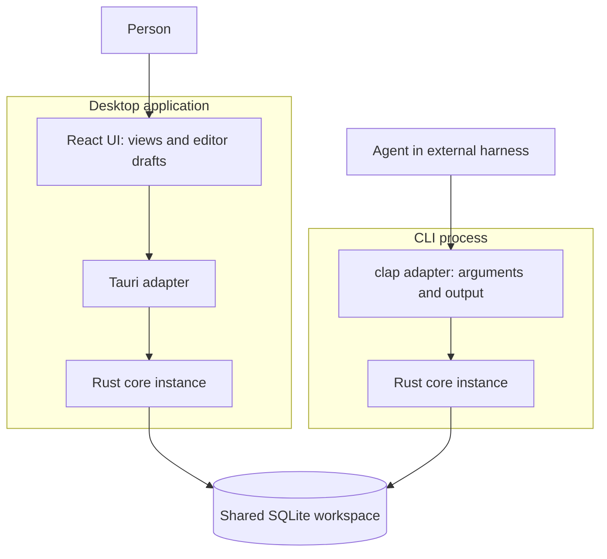
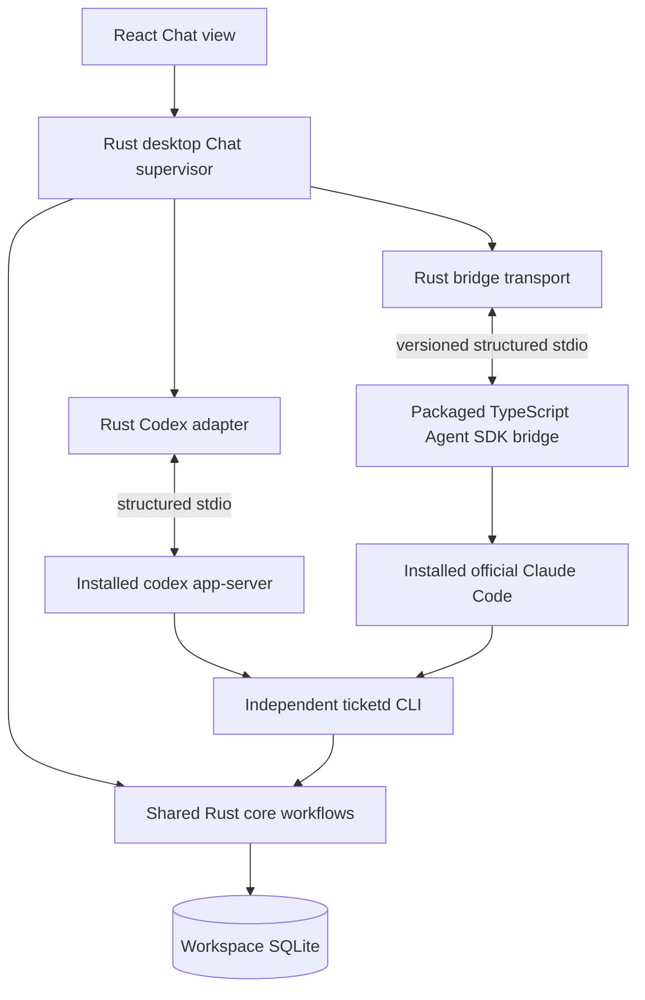

# High-level architecture

ticketd is a local desktop application and an independently usable CLI. Both call the same Rust core library, with a separate instance in each process, and share one local workspace database.

The direct-access process model is the selected direction, conditional on validating concurrency, migrations, and UI refresh in a technical spike. Exact workflow interface signatures remain to be designed.

## Runtime

This diagram describes the existing direct-access runtime. The approved native
Chat extension is shown separately below until its implementation is delivered.

The core is a shared library, not a shared running process. A background daemon, HTTP server, or running desktop is not required for CLI operations.

## Source layout

The Cargo workspace contains `crates/ticketd-core`, `crates/ticketd-cli`, and `apps/desktop/src-tauri`. The React application lives in `apps/desktop/src`; npm manages it as a workspace. Domain rules, operations, queries, and persistence remain internal to the core crate and are introduced as their implementations are needed.

## Module responsibilities

| Module        | Responsibility                                                                                                                           |
| ------------- | ---------------------------------------------------------------------------------------------------------------------------------------- |
| Desktop UI    | Lists, ticket details, Plans, graph presentation, Markdown editing, unsaved drafts, and save feedback                                    |
| Tauri adapter | Translate desktop requests and results across the desktop bridge                                                                         |
| CLI adapter   | Parse arguments and input, resolve invocation context, call the core, format JSON or human-readable output, and map errors to exit codes |
| Rust core     | Workflow operations and queries; domain validation, atomic persistence, history, retry handling, and bounded context assembly            |

The core has one public workflow interface. Its implementation is organized internally into domain rules, write operations, read queries, and SQLite persistence. Callers do not coordinate transactions or access storage directly. Keep domain calculations independent of SQL and Tauri without exposing a general-purpose storage framework.

## Planned native Chat runtime and storage

The approved native Chat design extends the runtime above; it is not yet
implemented. The Rust desktop host supervises a provider process for each active
Chat, using Codex app-server directly or a packaged TypeScript Claude Agent SDK
bridge pointed at the user's installed official Claude Code executable. The
harness owns authentication and native session state. The independently usable
CLI continues to call the shared core without requiring the desktop.

The shared core is a library instantiated by each caller, not a shared process.
Harness-to-CLI calls use the ordinary ticketd interface for context and writes.
The bridge/runtime is packaged by ticketd; harness installation, updates and
credentials remain user-managed. Native Windows, macOS and Ubuntu use the product
specification's existing release matrix.

### Runtime ownership and adapter interface

The Chat supervisor owns dispatch, the visible queue, one active turn per Chat,
and runtime lifetime. Adapters translate protocols and report capabilities and
observations. They coordinate with the supervisor around submission and approval
responses; they do not write workspace storage. The supervisor calls core
workflows, which own validation, transactions and durable Chat records.

Use an internal adapter interface with installation/capability inspection,
new-session or explicit native-resume opening, input submission (new turn or
supported steering), live interaction response, interruption, closure, and an
independent event stream. Capabilities describe effective behavior and its
evidence, including whether steering interrupts tools, rather than only booleans.
Do not expose provider wire formats as the React interface.

Commands carry application submission identity, current runtime generation and
expected native turn/request identity where applicable. Adapters report known
non-delivery, possible delivery, rejection and acknowledgment only as observed;
completion arrives separately. Recheck ownership before dispatch and after awaited
work before answering a live callback. A local request ID supplies correlation,
not a provider-side idempotency guarantee. Claude input-stream completion is not a
per-message acknowledgment. A timed-out command may still receive later evidence.

Continuously drain duplex protocol traffic while outgoing RPCs or human answers
are pending. Route replies, notifications and incoming requests independently;
drain bounded stderr diagnostics separately from stdout protocol frames. The
Claude bridge holds SDK objects and callbacks but has no second durable Chat store.

Navigation and window closure only detach views. Explicit Quit stops new dispatch,
interrupts/closes owned runtimes with bounded cleanup, flushes retained observations
and closes storage last. Verify Windows process-tree ownership separately from
POSIX process groups. A wrapper process exiting does not prove all tools stopped.
Archive does not stop execution; trash does. Process pooling and a standalone
always-running service are not selected for the initial design.

### Persistence and delivery observations

Chat storage uses structured records in the existing SQLite workspace for Chats
and their links, messages, submission attempts, turns, tool activity and retained
interaction state. A small ordered change log supports UI reconnection. These
records are authoritative for ticketd's history; reconstructing a Chat from all
raw provider events is not required. Exact table names and schema are internal
implementation details.

The storage half of this design exists: the core's Chat workflows
(`crates/ticketd-core/src/chats.rs`) own these records and the change log. Chat
tables do not move the workspace change token, so streaming a turn does not make
other views refetch; Chat views follow the Chat change log instead. The supervisor,
adapters and interface are not yet built.

User input and submission attempts are separate. The core saves input before
dispatch and records possible submission before the adapter hands it to the
harness. Provider acknowledgment, correlated processing and terminal outcome
are separate observations, recorded only when supported by actual evidence.
Neither a successful transport write nor a lost response proves task completion
or safe retry. Uncertain attempts are retained without automatic resubmission.
Existing ticketd write-request deduplication does not imply harness idempotency.

The core commits durable record changes and their ordered change entries
atomically; the desktop publishes committed changes. A reconnecting view reads a
snapshot and follows changes after its sequence, refreshing the snapshot when a
cursor cannot be served. Reattaching the UI does not restart the harness. Native
session identity remains distinct from Chat identity and the current runtime
generation.

Stored approval/question state preserves history, not callable authority. Live
responses are checked against the current generation and native request; stale
callbacks and commands cannot target replacement processes. Text updates may be
coalesced and checkpointed with explicit bounds, while critical submission,
interaction and terminal observations are retained. A hard crash can lose an
uncheckpointed streamed suffix. Provider-specific details remain available through
bounded typed extensions rather than unrestricted raw transport storage.

Bound parser frames, pending requests, diagnostics, output previews and subscriber
backlogs separately. Slow views can be directed to a new snapshot instead of
accumulating an unbounded backlog. Flush preceding text before critical control
observations and reconcile authoritative final content without duplicating deltas.
Do not destructively truncate execution input to fit a display budget. On storage
failure, stop admitting/dispatching additional work, report uncertainty about work
already in flight, and perform controlled shutdown/reconciliation. No local
transaction can atomically commit an arbitrary harness side effect.

### Context and recovery boundaries

The host supplies lightweight linked-record references and locates the independent
CLI. Current context is read through core-backed operations. Preserve native
settings and instruction discovery in the selected
working directory. Domain writes retain existing source authority and concurrency
rules. Agent attribution never substitutes for Chat identity or permission.

`ticketd-chat-host` builds that context as text from the Chat's current links
(`context`) and finds the CLI the same way Settings does (`cli`). The text names
each record, the command that returns it, and the bundled `chat` guide; it holds no
record content and the host writes nothing into harness settings, skills or hooks.
Agents change records only by running the CLI. Save as Document is the ordinary
Document-creation workflow applied to a stored response.

Keep view reattachment and replacement-process native resume distinct; a broken
stdio transport means the process is gone, so there is no separate live-process
recovery. Only a live request registry can answer approvals. Native resume failure
keeps the Chat readable and offers an explicit resume in a fresh harness session
started with selected history, recorded under a new native-session identity; it
never triggers automatic replay of uncertain submissions.
Backups retain application records and queued input, not harness credentials or a
promise of native resume state. Restore does not restart work automatically.

The product behavior and release acceptance are in [Native agent Chats](mvp-spec.md#20-native-agent-chats).
Provider support clarification and live compatibility checks remain requirements
before release; this architecture does not claim they have passed. Exact SQL
schema, Rust signatures, bridge framing, buffer limits and version ranges are
implementation details to validate against this contract.

## Local attachment storage

The public `Workspace` interface owns snapshot upload, metadata inspection,
direct ticket associations, native-open resolution, and byte export. The CLI and
Tauri adapters share those workflows. Attachments have their own typed records
and association table, separate from Documents, source connectors, and
Implementation evidence. Storage kinds are `local_snapshot` and `external_reference`;
there is no remote deletion operation.

`Workspace::search_attachments` returns bounded results and their direct,
embedded, Document, draft, Undo and Trash usage from one read snapshot. Literal
filename/metadata search and in-use/unused filtering run in core before paging;
current-ticket context ranks related files ahead of recent workspace uploads.
Ranking never turns linked Document files into direct ticket associations.
Desktop library and insertion search use this same query as the independent CLI.
Display-name changes use `rename_attachment` and the retryable write interface;
they never rewrite Markdown labels, original filenames, upload outcomes or bytes.

Snapshots live in `<database-path>.attachments/<attachment-id>/bytes/` beside
the workspace database. Core upload validates a regular file and the workspace upload
bound, writes into a temporary directory, syncs bytes and a recovery manifest,
then publishes the directory before committing metadata and a replayable result
in SQLite. A file lock serializes uploads and recovery across processes. A
completed manifest survives database failure; listing, inspection, or retry
reconciles it without copying source bytes again. Incomplete staging directories
are never exposed as valid attachments. Ticket association is a separate
retryable transaction, so failed or abandoned insertion retains the upload.

Schema 49 stores the per-file upload limit in `attachment_upload_settings`, with
a 100 MiB default. Core progress callbacks report actual copied bytes in bounded
64 KiB chunks and can cancel before directory publication. Screenshot byte
capture shares the same staging, byte bounds and recovery/commit path; its
request equality includes the filename and SHA-256 digest. Completed operations
replay before checking the current limit or reopening a deleted source.
Tauri translates a binary screenshot IPC payload and progress channel; it owns
only cancellation signals, not storage policy. Native drops are scoped to the
active editor/picker bounds using physical-to-logical coordinates.

The desktop upload queue records source paths or clipboard File blobs and original
operation IDs in IndexedDB, scoped by the core workspace identity, before copying.
Completed uploads and canonical references remain core-owned. Recovering a queue
does not insert into another editor automatically: Retry is explicit at the new
caret. Successful insertion dismisses its capture record; Dismiss discards only
capture recovery and never deletes stored bytes. This local capture journal is
outside workspace backups and is separate from content-draft retention. A broken
or unavailable journal blocks new capture rather than silently losing retry IDs.

Upload and ordinary write request IDs share the existing workspace-wide replay
namespace. Exact source path and supplied display name define upload request
equality; retries return original metadata without requiring the source file.
Native open resolves only a stored, complete snapshot and permits passive file
formats; arbitrary types can be exported explicitly without executing them.
Exports publish synced temporary output without replacing an existing file.

`Workspace::export_markdown_with_files` owns portable content export for saved
Documents, tickets (including direct attachments), and selected/current Markdown.
Selections can supply source context; core carries only used reference definitions
into the output, without copying unrelated prose or files.
It acquires the attachment file lock before a SQLite read snapshot, uses local
metadata/byte validation and external provider viewer links, and rewrites only
exported destinations. A fresh temporary bundle is retained only after its
Markdown, copied bytes and complete/partial manifest are synced successfully.
Identity-prefixed filenames prevent collisions across filesystem case rules.
Canonical source and independently linked Documents remain unchanged. The CLI
and desktop translate sources, folder selection and results; they do not resolve
private storage paths or duplicate export policy. Provider references export
links without invoking a download or credential capability.

Backup, restore safety copies, and migration safety copies include every
retained local file. Attachment-bearing backups use a versioned single SQLite
container with streamed file blobs, per-file SHA-256 and a checked inventory;
its version is independent of the workspace schema. The upload lock covers
database snapshotting and file packaging. Files with no reference, files in
Trash, recovery manifests, and retained quarantine are included; incomplete
upload staging and coordination locks are excluded. Remote records remain
references and metadata; credentials and implicit remote downloads are excluded.

Restore validates the database and all retained bytes before changing the
workspace. It stages a live database without archive-only tables and a separate
attachment root, saves a complete safety copy, then replaces the files and
atomically replaces the database. A synced journal resolves interrupted file
swaps before another workspace connection opens. Supported attachment-free and
older database-only backups remain readable. See
[ADR 0008](adr/0008-attachment-backup-container.md) for the format and recovery
trade-off. Desktop review and `ticketd inspect-backup <path>` expose completeness,
local file totals, and the limits of remote references through the same core.

## Local media previews

`Workspace::attachment_preview` retains attachment metadata when bytes are missing,
incomplete, unreadable, or unsuitable for preview. `Workspace::attachment_media`
authorizes a workspace UUID and attachment ID, opens only a complete managed local
snapshot, and classifies bounded header evidence against a passive-media allowlist.
It returns a read handle, never a filesystem path to React. PNG, JPEG, GIF, WebP,
BMP, WAV, MP3, recognized Ogg, MP4 and WebM containers can be attempted; container
recognition is not a codec guarantee. HTML, SVG, PDF, office files, playlists and
unrecognized content retain metadata and explicit export/open fallback actions.
External references use the same preview entry point with cached provider details,
current-source wording and explicit Open in Drive. They never enter the local media
route or offer an original-byte export; unknown provider size remains unknown.
Images require checked dimensions of at most 16,384 per axis and 40 million pixels;
files above 100 MiB remain usable through explicit export/open rather than preview,
even if the configurable upload limit is higher.

The main Tauri WebView serves `attachment-media` requests by identity. GET and HEAD
support single byte ranges, capped at 1 MiB per range response; a full GET remains
a complete representation. Tauri/Wry buffer these responses rather than stream
them; at most two Rust responses are prepared concurrently. Responses use explicit
allowlisted MIME types, no-store, nosniff and a restrictive response CSP. The app
CSP permits this origin only for images/media, with frames and objects disabled.
Navigation to the media origin is refused: Tauri otherwise treats registered
custom schemes as local IPC origins. Media responses also reject document,
frame, object and script fetch destinations when that request evidence is present.
The dialog loads one selected file, never autoplays, and releases media sources on
close. A rendering error triggers fresh inspection without asserting a codec or
storage failure that inspection cannot establish.

Managed-byte resolution rejects links and Windows reparse points at the attachment
root and every managed path component, verifies canonical containment and the
opened regular file's recorded length, and uses the same handle for media reads
and byte exports. Native open retains its explicit extension allowlist. This
protects against stored path traversal and existing filesystem redirections; it
does not sandbox a hostile same-user process racing filesystem replacement between
checks and open, nor isolate hard-linked files. Workspace storage must remain
under the local user's control.

Previewing never rewrites authored Markdown. Replacement selects/uploads a new
identity and changes only the selected Markdown occurrence or direct association.
Reader replacement preserves surrounding source, labels and image syntax; a changed
draft requires reselection. Direct replacement is one replayable core transaction,
so failure leaves the old association intact and other uses retain their snapshots.
Before draft mutation, replacement awaits the shared durable Undo protection for
the chosen identity. Reader replacements retain their own conservative history
claim until that reader unmounts; ordinary reading creates no claim. Cancellation
and failed protection leave the selected reference unchanged. Preview usage is a
display projection of `attachment_usage`, with the full count and at most 20 labeled
entries, including drafts, Undo and Trash; the display subset never decides cleanup.

## Document editing

Draft recovery payloads and derived attachment claims commit together through
`Workspace::retain_draft`. The core parses canonical Markdown using the saved
reference parser. Drafts are private workspace recovery data, not published
Documents or Activities. Desktop startup loads recovery before mounting editors;
each host retains its existing autosave or explicit-submit behavior. Capture
requests keep their original retry identity across restart. Backups include
recovery prose and protections; ordinary domain JSON export excludes this private
authoring state.

Owners use compare-and-swap revisions, including release tombstones; exact
retries of the last update are idempotent. Desktop writes serialize and failures
remain visible and block subsequent submission until protection is durable.
Current draft replacement and independent editor Undo use separate claims; Undo
accumulates references until history is reset/unmounted. Normal unmount releases
only transient history, never a recoverable draft. An interrupted history release
leaves conservative protection for explicit review, without a time expiry.

`Workspace::attachment_usage` returns a consistent snapshot of direct, embedded,
draft and Undo protections, including recoverable Trash and unpromoted Activity
details. Its eligibility is advisory until explicit cleanup rechecks under its
writer/file coordination. Quarantine moves only unused local snapshots into a
fixed retained location. Canonical reference writes and available draft/Undo
references restore those bytes under their existing writer boundary, never taking
the upload lock inside a transaction. Cleanup and explicit restore take that lock
before the writer lock. Both locations remain resolvable after failed commits.
Backup briefly freezes writers for its database/path inventory and streams files
with one open input at a time after releasing the writer barrier. See
[ADR 0010](adr/0010-local-attachment-quarantine.md) for move, retry and backup races.

Explicit permanent purge uses `Workspace::purge_attachment`, outside the generic
write-outcome transaction. Schema 54 records retained/pending/purged status.
Under file-lock-before-writer ordering it commits eligible quarantine's purge
intent, deletes only its checked file with no writer transaction open, then records
completion. Pending intent blocks restoration and byte reads until explicit retry;
recovery prose and identity remain. Complete backup refuses pending purges and
preserves completed purges as unavailable identities. Replayed attachment outcomes
keep original metadata with current purge status. No provider deletion exists.

Remote record removal uses `Workspace::remove_remote_attachment` and the shared
retryable write interface. It checks the same retention claims under a SQLite
writer lock, then removes only the unused attachment and Drive reference rows.
It takes no provider capability and changes no local bytes, credentials or sharing.
Removal outcomes retain the safe provider link for retry/recovery, while uploaded
copy operations and immutable provenance remain discoverable. Old attachment
outcomes resolve current registration before returning success, preserving the
local purge overlay and refusing removed remote identities. Metadata refresh
updates only an existing record after its network read, so a concurrent removal
cannot be silently undone. Upload journals record `record_removed` atomically
with removal, including selected files whose upload registration is still
uncertain. Stale cancellation writes and late completion preserve the marker;
reconciliation can retain verified provenance without recreating the record.
Only explicit Picker selection clears it. Older journal JSON defaults to a
registered record. No workspace schema change is required.

Only upgrades with existing attachment records require review of legacy browser
drafts. Startup imports every recoverable slot in the current profile, including
unopened tickets and legacy Activity details/request keys. Other profiles remain
unknowable to the core: cleanup stays blocked until the user confirms those
profiles were reviewed. Fresh and attachment-free upgraded workspaces have no
such guard. See [durable draft retention](adr/0009-draft-retention.md).

Rich document editing uses Plate, with Markdown remaining canonical across storage and CLI operations. Editor document trees remain transient UI state; CodeMirror provides source editing, and Mermaid renders diagrams locally. See [Plate editing with canonical Markdown](adr/0005-plate-editor-with-canonical-markdown.md) for fidelity and integration boundaries.

## Interface direction

| Caller intent           | Core behavior                                                                                               |
| ----------------------- | ----------------------------------------------------------------------------------------------------------- |
| Create a ticket         | Validate initial content and links, assign identity/reference, persist, and return the ticket               |
| Change a ticket         | Apply supplied fields, explicit relationship changes, and optional authored Activities as one atomic change |
| Apply a batch           | Compose the same operations atomically, with local names for new tickets                                    |
| Find tickets            | Apply search, filters, ordering, and output limits                                                          |
| Open ticket context     | Assemble the ticket and requested related context from one consistent snapshot                              |
| View a dependency graph | Return bounded graph data for presentation                                                                  |

Projects, Plans, Activities, tags, and trash/restore also need focused operations; their exact signatures remain to be designed. The table describes the main ticket workflows, not a complete method inventory. Few methods alone do not make an interface simple: each operation must hide the coordination its callers would otherwise repeat.

## Writes and concurrent editing

For each write, the core coordinates request-ID replay checks, validation against current data, persistence, history, and the saved request outcome. Changes and their successful request outcome commit together. Batches either commit completely or persist nothing.

Record versions and stale-edit rejection are outside the MVP. Updates affect only supplied fields, with last-successful-write wins on the same field. Dependencies and tags use explicit additions/removals rather than replacing whole lists. The desktop retains unsaved drafts when saved content changes, indicates that change, and lets the person reload or save over it.

Request IDs prevent repeated execution after a lost response; they do not prevent overwrites by different requests. Successful request outcomes are retained indefinitely in the MVP and included in backups. Replays return original results, not current ticket state.

## Workspace and persistence

One default workspace lives in the operating system's application-data directory, outside project checkouts. The database holds tickets, project registrations, Plans, Activities, tags, relationships, ticket history, and successful request outcomes. Project checkout paths locate repositories; they do not select a different database. Multiple selectable workspaces are outside the MVP.

The core owns migrations, export, backup/restore, and data access. Domain validation and persistence must remain atomic across processes, including cycle checks and hierarchy rules. Validate lock handling, concurrent writes, migration coordination, and active-database backup behavior before finalizing the process model.

## External changes

The desktop must detect writes committed by CLI processes and refresh affected views through the core's read interface. It must also refresh dependent information, such as readiness and Plan counts. The notification or polling mechanism remains to be chosen; unsaved editor drafts remain owned by the UI.

## Verification and future evolution

Future ticket source integrations use a ticketd-owned extension engine and a
shared, versioned connector interface, beginning with a built-in GitHub Issues
connector. Connectors handle provider-specific connection configuration,
discovery, ticket/comment retrieval, external identity, status interpretation,
and optional publication. ticketd owns scheduling, identity preservation, local
data, and persistence; connectors do not modify the database directly.

Provider-specific configuration and filter forms are described by schemas for
fields, selectors, dynamic options, and validation, rendered by ticketd and
usable through the CLI. Custom extension development, installation/distribution,
and arbitrary extension-rendered UI are deferred. Keep the interface suitable for
future providers without building a general plugin system. Exact interface
signatures and execution mechanics are described next.

### Source connector layers

The code lives in `ticketd_core::source`, from the inside out:

- **Contract** (`contract.rs`): the `Connector` trait and its provider-neutral
  types (`ExternalIssue`, `ExternalIdentity`, `ExternalState`, `ClosureReason`,
  `SourceError`). `CONTRACT_VERSION` identifies the contract; the engine refuses
  a connector that declares another version. Changing a signature or the meaning
  of a type bumps the version. Adding an optional capability does not. Publication
  is an optional capability with a default "unsupported" implementation.
- **Schema** (`schema.rs`): fields, selectors, dynamic options, and validation,
  shared by every client. Desktop forms and CLI `--set key=value` flags both build
  raw values that `ConfigSchema::validate` checks and normalizes.
- **Engine** (`engine.rs`): the only caller of connectors. It validates
  configuration, walks pages with a progress guard, de-duplicates by external
  identity, bounds previews, and holds no database handle.
- **Connectors** (`github/`): provider translation over an `HttpTransport` seam
  with deterministic fixtures in tests. GitHub uses the person's own credential
  (environment token or `gh auth token`), which is never stored, exported,
  backed up, logged, or sent to any host other than the API.
- **Workflows** (`source/mod.rs`): methods on `Workspace` that call the engine
  first and then write in one short transaction, so no network I/O happens while
  the database is locked. `save_source` validates and previews before it saves.

Saved source configuration is workspace data (`source_configurations`), is
included in export and backups, and is separate from any imported ticket.

An imported ticket stores three things apart, each keyed by the ticket:
`external_identities` (provenance: which external issue it is or was, never
deleted), `external_ownership` (authority: `external` means synchronized and
read-only, `local` means ticketd owns it), and `source_sync` (the last observed
external state and freshness). Imported title and description live in the
ordinary ticket columns. `Workspace::refresh_sources` gathers through the engine
with no transaction open and then applies the result in one short write that
re-reads each ticket's ownership; the core rejects title, description and
closure-owned status edits to externally owned tickets. The same write re-reads
the saved configuration. If it changed during the network work, successful reads
of existing tickets can still apply, while discovery imports, membership, failures
and source-run health from the replaced rules are discarded. Saving changed rules
invalidates match membership until the next complete discovery walk.

The source conversation (an external ticket's comments and timeline events) is
a read-only mirror in `source_conversation`, keyed by ticket and the source's
own entry id. It has no write workflow: refresh replaces it in the same short
write as the ticket, only when the issue changed since it was last read, and a
failed read keeps what was retrieved. Authors are the source's identities, never
an editing agent, and the rows survive takeover as provenance. Agents read it
with `ticketd context T-n --conversation`.

Freshness and availability are persisted, not inferred: `source_sync` records the
start of each ticket's failure streak and `source_status` records each source's
last run, current error and any rate-limit hold. A ticket reads _Source
unavailable_ exactly when its latest recorded attempt failed with an unreachable,
unauthenticated, forbidden, missing, unusable or unconfigured answer; a rate
limit is delayed, not unavailable. Neither changes content, status or ownership.
A successful or partial whole-source run persists its distinct checked-issue
count with its refresh time; a failed or single-ticket run does not replace it.
The current tracked-ticket count is read separately. A source closure time comes
only from the latest close event in a conversation retrieved for the currently
observed source update; missing or stale evidence remains unknown.
A refresh ignores an observation older than the one it holds, so a slower
overlapping run cannot move confirmed state backwards. The desktop starts
refreshing on launch and periodically through one in-process
`RefreshCoordinator` (one run at a time, exponential backoff on failure, rate
limits honored across restarts); there is no daemon, and `ticketd source refresh`
and `ticketd source status` work without the desktop.

Publication cannot be atomic across GitHub and SQLite, so `Workspace::publish_ticket`
is built on a durable attempt (`publication_attempts`). One short write checks
eligibility and saves the attempt as `in_flight` with the exact title,
description and destination; a unique partial index allows one open attempt per
ticket. The connector's create call then runs with no transaction open. A second
short write links the confirmed issue (`external_identities` with origin
`published`, ownership `external`) and marks the attempt `succeeded`. A refusal
the provider proves (`SourceError::ruled_out_creation`) marks it `failed` and
leaves the ticket local. Anything else (timeout, server error, unreadable
answer, an issue that could not be recorded, a crash) leaves it `in_flight` past
its lease or `unresolved`: the ticket stays local and a second create is
refused until the attempt is resolved. Replaying a request for an already
published ticket returns it without calling the connector.

Taking ownership (`Workspace::take_ownership`, `ticketd source take-ownership`,
replayable as `WriteRequest::TakeOwnership`) is one atomic write allowed only
while a ticket reads _Source unavailable_. It flips `external_ownership` to
`local`, clears the failure columns of `source_sync` and records an `ownership`
history entry; the identity, content, status, relationships and authored Activities are
untouched. Because every refresh path re-reads authority inside its own write,
rediscovery, restored access and a refresh already in flight neither resume
synchronization nor import a second ticket, and nothing turns a local row back
into `external` for an existing identity: reconnecting needs a future explicit
action. A taken-over Duplicate keeps its status and the source's last canonical
as provenance until it leaves Duplicate.

Test core behavior through its public interface using temporary SQLite databases, including multiple-process concurrency tests. UI and CLI tests focus on their respective interactions and translation of requests/results.

A future server may call the same core workflow interface. Cloud synchronization, accounts, and authorization require additional design; preserving this interface does not make synchronization automatic. GitHub Issues tracks development of ticketd and is separate from the application's local ticket storage.

## Related documents

- [Product specification](mvp-spec.md)
- [Domain glossary](../GLOSSARY.md)
- [Atomic writes and retries](adr/0002-atomic-writes-and-retries.md)
- [Deferred record versioning](adr/0003-defer-record-versioning.md)
- [Shared core and local workspace](adr/0004-shared-core-local-workspace.md)

A caller that needs retries uses the core `write` workflow with a typed write request and optional request ID. The CLI exposes the same workflow as `ticketd write --request-id ID FILE` (use `-` for standard input). For example, `{"operation":"create_ticket","title":"Investigate","project_id":null}` creates a ticket, and `{"operation":"batch","operations":[...]}` applies a batch. Results contain a `kind` and `value` (the delete result has no value). Existing individual commands remain available without retry IDs.

Desktop ticket creation retains its submission ID in the recoverable draft before
sending the write. `create_ticket_with_content` atomically commits the ticket's
content, organization and following choice with its replay receipt. A lost response
or failed draft release reuses that ID after restart rather than creating another
ticket. Retrying locks the submitted fields; editing them as a new ticket requires
an explicit decision and durable draft save before a fresh ID can be used. The
captured following and Create more choices survive restart. After workspace restoration,
recovery reloads the restored revisions and cutover state, and retained editor
subtrees remount against that recovery generation.

Request IDs share one workspace-wide namespace. Equality compares the serialized typed request, including its operation, exact strings, attribution, supplied patch fields, and ordered arrays. JSON object key order and whitespace do not matter; omitted optional fields and their default values compare equally, except that omitted patch fields and explicitly cleared fields remain distinct. A different request with the same ID fails even if its effect would happen to be equivalent. Failed requests are not retained and may be retried. Successful outcomes are retained indefinitely and replayed as originally returned.

The JSON export includes `ticket_follows` and `inbox_entries`. Their `person`
field is the stable `local-person` scope for the initial local person; it is a
personal preference scope, not an account or editing-agent identity. Backups
include these records and retained write outcomes.

The CLI reads the newest personal entries with `ticketd inbox` (use `--limit`
and `--offset` for bounded pages). Personal writes use the retryable `write`
workflow: `set_following` takes a ticket `reference` and `following` boolean;
`set_inbox_read` takes explicit entry `ids` and a `read` boolean. Supplying the
IDs actually displayed avoids marking later arrivals read.

To review duplicate dependencies through the CLI, run `ticketd preview-duplicate
T-1 T-2`. Submit the returned `canonical` as `expected_canonical` and each edge
with an explicit `replace`, `remove`, or `retain` choice using `ticketd write`
with operation `mark_duplicate_reviewed`, source, canonical, decisions, and an
optional agent. The preview records its `mode` (`duplicate`, or `separate` with
`--separate`) and the normalized `source`. The preview
also lists each dependent (`waiting`) with its current status, trash state,
readiness and unresolved blockers, and, per edge, the reason Replace is invalid
(`already_exists`, `self_block`, `cycle`, or `trashed`). A ticket reviewed against
itself, or a trashed source or canonical in a duplicate review, is rejected up
front. Each edge carries that `mode` and two opaque fingerprints. `basis` covers
what Remove and Keep depend on (the edges, and each dependent's and its blockers'
status and trash state); `replacement_basis` covers what only Replace depends on
(the replacement endpoints and the replacement dependent's blockers) and is
compared only for Replace decisions. Submit edges unchanged. An edge missing
`mode`, `basis` or `replacement_basis` is rejected, so requests built from an
older preview must be previewed again. If the affected edges, any of that state,
or the resolved canonical change, the review is stale and must be previewed
again; edits to unrelated tickets do not make it stale. Feasibility of a Replace
(a new cycle, a trashed endpoint) is not in the fingerprints; it is re-checked on
evaluate and apply, and a Replace that is no longer possible is also reported as a
changed review. A preview
submitted to the other kind of review fails with a distinct "different kind of
review" error instead.

The core also judges all of a review's choices together. The desktop calls
`evaluate_dependency_review` (core `evaluate_dependency_review`) with the preview's
source and canonical, the mode, and the decisions, and receives one outcome per
waiting ticket (each dependent and, for Replace, the replacement dependent, so the
canonical appears when the duplicate is a dependent): its status, `before` and
`after` readiness (`ready`, `blocked`, or `no_ready_state`), and the blockers
still unresolved afterwards. Readiness uses `Status::satisfies_dependency`; a
started, finished, or trashed ticket has no Ready state, matching the Ready list.
The duplicate has the Duplicate status afterwards in a duplicate review.
For a separate graph edit after undo, preview the current endpoint against the
replacement endpoint with `--separate` and submit the same fields with operation
`edit_dependencies_reviewed`. Neither operation silently moves newly arrived
edges; a retained duplicate prerequisite remains unresolved.
Personal reminders are exported in `ticket_reminders`, scoped to `local-person`.
`ticketd reminder show|set|snooze|dismiss` manages one reminder per ticket.
Set and snooze take an RFC 3339 instant with an explicit offset; show displays
local time and UTC. The retryable `set_reminder` write takes `reference` and
`due_at` (or null to dismiss). Reading the inbox atomically delivers due
occurrences; reopening the inbox catches up after downtime without a daemon.

Inbox entries for new Activities retain the Activity ID and its original brief in
`from_value` and `to_value`; this snapshot remains meaningful after the Activity is
edited or deleted. `editing_agent` is descriptive attribution. Relationship
history kinds `parent`, `dependency`, and those prefixed `relationship:` also
produce inbox entries for followed tickets, in the same transaction as the
change. New relationship types use that prefix to participate.

## Context-management extension

The confirmed target model adds Documents, Activities, and Plans; see [product behavior](mvp-spec.md#16-context-management) and
[ADR 0007](adr/0007-context-storage-and-graph-queries.md). Earlier implementation
names and command examples in this architecture describe the current runtime,
not compatibility requirements for the extension. No migration of development
data or legacy command aliases is required.

The core owns atomic Activity/supporting-Document creation, origin cleanup,
Document search and mention indexing, Plan associations, and bounded context and
graph queries. The desktop owns capture/editing state and graph presentation;
the CLI exposes the same operations without coordinating their transactions.
Explicit relationship tables remain authoritative. Shared entity identities
support cross-type references while concrete records retain domain invariants.

## Inline attachment references

Schema 48 assigns a persistent workspace identity and derives
`embedded_attachments` from canonical Markdown link/image destinations, including
GFM tables and reference-style links. Ticket and Document body indexing and
Activity brief indexing update these references within the content transaction;
Activity details use their supporting Document identity. Activity deletion removes
its brief references while leaving the supporting Document and its files intact.
Trash keeps references. Direct `ticket_attachments` remain independent, and files
in linked Documents are not flattened into ticket attachments.

`Workspace::attachment_uri` checks a completed local snapshot or stored external reference before producing
`ticketd://attachment/<workspace-id>/<attachment-id>`.
`resolve_attachment_uri` rejects foreign workspace identities and retains metadata
for missing local bytes. Newly introduced local links require stored bytes;
existing broken references remain editable and removable. Foreign links remain
canonical content with unresolved reference records. `embedded_attachments` and
`embedded_attachment_uris` expose derived uses without depending on editor trees.

Publication eligibility inspects the exact outgoing Markdown inside the write
transaction before saving an attempt or calling the connector. Its
`internal_attachments` reason and preview list expose workspace-only URIs and known
display names to desktop and CLI. Retries use the same guard; resolving an
uncertain attempt only reads the provider and never resends its saved body.
Direct attachments are counted as local context, never uploaded implicitly.

Source import, refresh and publication resolution index authoritative incoming
text without requiring its attachment links to resolve. Known identities retain
their file association; unknown or foreign links retain the URI with no local
identity. Local authoring continues to validate newly introduced local file links.
Both paths update derived references in the content transaction and leave direct
ticket attachment associations and explicit local Document references untouched.

The desktop shares one AttachmentPicker between the direct-ticket adapter and
MarkdownEditor. Its `onPick(file, requestId)` callback receives only a successfully
stored or inspected identity. MarkdownEditor resolves the URI through the core
and inserts at its saved rich/source selection; the host owns persistence. Closing
or unmounting abandons insertion without deleting uploaded bytes. The CLI's
`attachment uri` exposes the same identity contract without the desktop.

## Existing Google Drive references

The core's narrow `drive::AttachmentProvider` capability resolves file metadata.
It is separate from ticket-source connectors. Uploads use the separate
`drive::DriveUploadProvider` capability; neither interface exposes deletion,
overwrites, conversion or sharing changes.
The Google implementation can exchange/refresh authorization, read account
identity and read explicitly authorized file metadata. A separate read-only
`DriveCopyProvider` inspects and downloads uploaded blob copies for explicit
export. It never downloads or converts Google-native content and cannot change
sharing or delete a remote file.

`Workspace::reference_drive_file` resolves outside a SQLite transaction, validates
metadata and viewer URLs, then atomically stores/reuses a workspace attachment
identity keyed by connection and Drive file ID. A `drive_references` row holds the
opaque connection handle and last-known MIME, size when supplied, resource key,
name and viewer URL. External references can be reused and inserted offline;
resolution errors retain identity and last-known metadata. Local snapshot-byte
validation remains mandatory. Schema 51 rebuilds the attachment kind constraint
under the existing exclusive migration lock, checks foreign keys before commit,
and retains pre-migration safety backup behavior and reference rows.

OAuth uses the system browser, native OAuth-integrated Picker, PKCE S256 and a
bounded one-shot IPv4 loopback callback with host/path/state validation. Only
`drive.file` is requested; broader grants are refused. Account identity is read
with the same scope, so reconnecting the same client/account reuses its handle,
and another account cannot replace credentials behind existing references.
Selection order is retained. Tauri owns browser opening and cancellation, returns
only attachment metadata/errors to React, and never loads Google scripts in the
WebView. The shared picker handles both direct associations and inline insertion.

The shared core embeds the publisher's installed-app registration from build-time
`TICKETD_GOOGLE_OAUTH_CLIENT_JSON`, so desktop and CLI need no user configuration
to begin sign-in. The optional runtime `TICKETD_GOOGLE_OAUTH_CLIENT_FILE` remains
an explicit developer override; an invalid override never falls back silently.
Distribution validates each platform's registration before building its artifacts.

Refresh credentials and installed-client material live in the OS user's secure
store, under `ticketd.google-drive.v1`, keyed by the opaque connection handle.
Windows uses Credential Manager, macOS Keychain, and Linux encrypted Secret
Service. There is no plaintext fallback. Cross-process file locks outside the
workspace serialize refresh-token rotation; access tokens stay in memory.
Transport diagnostics omit URLs, headers and bodies, and Google redirects are
not followed. Workspace backups/JSON export contain reference metadata, never
credentials or remote bytes. The standalone CLI uses the same core/vault namespace;
no desktop process is needed. Portable Drive-link export and remote record cleanup
are separate workflows.

`check_drive_reference` returns an explicit access observation with typed provider
failure and last-known metadata; access is not persisted as a workspace-wide fact
because credentials belong to each OS user. Failed reads never erase metadata.
Successful refresh changes current provider metadata and known size, preserving
local display names, original filenames, authored Markdown and immutable uploaded-copy
provenance. Network calls precede short database transactions.

`begin_drive_reference_recovery` constrains native Picker recovery to one original
file and account/client handle. Callback processing verifies both before loading
or saving credentials; `recover_drive_reference` rechecks the selection at the
Workspace boundary before metadata refresh. Wrong selection is not replacement.
React displays recovery state and Tauri translates browser/cancellation requests;
the standalone CLI prints the same bounded session URL for explicit browser opening.
Neither adapter decides authorization policy or changes sharing. Error classification
uses provider evidence: app-not-authorized, reconnect, explicit file-permission
denial and positively observed trash are distinct; unknown 403/404 stays ambiguous.

## Google Drive uploaded copies

Schema 55 stores the workspace upload preference and per-request destination
bindings. `attachment_upload_destination` reads last validated metadata offline;
`set_drive_upload_destination` checks the existing provider's writable-folder
capability before one atomic preference update. Validation and network failures
preserve the prior value. Local selection requires no provider configuration.

`begin_attachment_upload` freezes either the current preference or an explicit
override in a short writer transaction before an upload effect. Both storage paths
enforce the binding. Retries return the original destination, even after another
process changes the default. Pre-55 local receipts/recovery manifests and Drive
operation journals supply their historical destination instead of today's preference.
The desktop's older capture records continue to pass their explicit original
local/Drive choice. Preferences and bindings survive backup/restore and contain
opaque account/folder metadata only, with no credentials or remote bytes.

Schema 52 adds `drive_upload_operations`. Workspace workflows own per-file input
bounds, a frozen temporary input and its SHA-256, destination validation, durable
operation identity, remote ID reservation, reconciliation and attachment registration.
An operation binds the original connection, folder and filename. Both adapters
use `DriveUploadDestination`; future default-destination changes cannot redirect
an existing retry. The shared picker persists that destination with its existing
capture recovery record. Explicit local fallback creates a separate local operation
and retains the Drive operation for reconciliation.

Each operation holds a cross-process file lock before short database writes;
process exit releases ownership without a time-based lease. No network call holds
a SQLite transaction. The operation is persisted before ID allocation, the
pre-generated blob ID is persisted before create, and uncertainty is persisted
before sending bytes. Retry/restart resolves that same ID first. A missing or
inaccessible read does not prove non-creation: subsequent creates still use the
same ID, allowing Drive's duplicate-ID rejection to prevent a second object.
`check_drive_upload` only reconciles; it never starts an upload. Ordinary writes
and Drive uploads share a request-ID namespace enforced by database triggers.

The provider creates a blob with that ID and provenance in `appProperties`, then
sends bounded 256 KiB resumable chunks. Session URLs stay in memory and are never
logged, backed up or exported. After interruption or session expiry, a new session
may target only the original ID after reconciliation. Completion requires matching
ID, operation provenance, folder, size and SHA-256; unsupported/missing verification
leaves an uncertain operation with an Open in Drive route. A same-ID conflict is
not itself success. Failure to register metadata remains recoverable without a
second create or requiring the source when remote completion can be verified.

Completed copies use the remote `external_reference` storage locator with separate
immutable upload provenance, exposed by `drive_uploaded_copy`. They remain reusable
if insertion or reference saving fails. They are uploaded copies, not local
snapshots. Explicit byte export verifies current content against provenance.
Backup/restore and JSON export retain
operation metadata and remote references only, with no tokens, session URLs,
source paths or cached remote bytes. Remote content is retained after cancellation,
local fallback and record cleanup.

`inspect_drive_uploaded_copy` compares immutable upload SHA-256 and size with
current metadata without downloading or updating provenance. Its `unchanged`
status describes a matching checksum/size observation, not verified downloaded
bytes. Missing checksum/version/size or capability evidence is `unknown`;
unsupported downloads, changed content and typed access failures remain distinct.
Drive's [file version](https://developers.google.com/workspace/drive/api/reference/rest/v3/files)
includes server-side metadata changes, so a later version with matching content
does not prevent export. The recorded upload version remains immutable.

Both `export_attachment` and the existing portable Markdown exporter use the
same verified-download workflow. The Google adapter reads authenticated blob
ranges of at most 256 KiB, checks range/length responses and preserves resource
keys. Core stages output, bounds and hashes actual bytes, and requires matching
before/after metadata observations, including version, before publishing a file.
Version changes during download return `unknown`; failed or unstable
downloads remove staged bytes and return explicit status; there is no revision
pinning or automatic cache. Portable format 1 adds nullable `copy_status` to
uploaded-copy entries, retaining old manifest compatibility. Omissions make the
result partial without changing canonical Markdown or current-source links.
Local inputs are copied from the existing protected snapshot before network
reads; no provider call holds a SQLite transaction or attachment file barrier.
