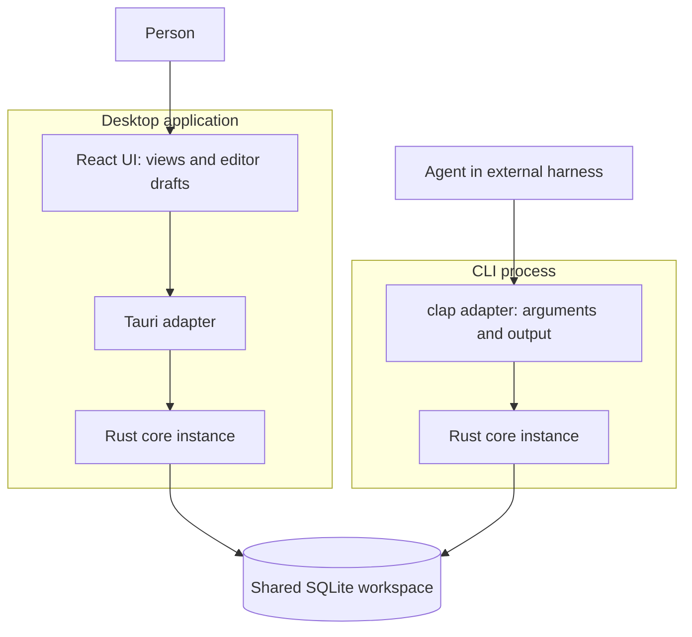

# High-level architecture

ticketd is a local desktop application and an independently usable CLI. Both call the same Rust core library, with a separate instance in each process, and share one local workspace database.

The direct-access process model is the selected direction, conditional on validating concurrency, migrations, and UI refresh in a technical spike. Exact workflow interface signatures remain to be designed.

## Runtime

The core is a shared library, not a shared running process. A background daemon, HTTP server, or running desktop is not required for CLI operations.

## Source layout

The Cargo workspace contains `crates/ticketd-core`, `crates/ticketd-cli`, and `apps/desktop/src-tauri`. The React application lives in `apps/desktop/src`; npm manages it as a workspace. Domain rules, operations, queries, and persistence remain internal to the core crate and are introduced as their implementations are needed.

## Module responsibilities

| Module        | Responsibility                                                                                                                           |
| ------------- | ---------------------------------------------------------------------------------------------------------------------------------------- |
| Desktop UI    | Lists, ticket details, Plans, graph presentation, Markdown editing, unsaved drafts, and save feedback                                    |
| Tauri adapter | Translate desktop requests and results across the desktop bridge                                                                         |
| CLI adapter   | Parse arguments and input, resolve invocation context, call the core, format JSON or human-readable output, and map errors to exit codes |
| Rust core     | Workflow operations and queries; domain validation, atomic persistence, history, retry handling, and bounded context assembly            |

The core has one public workflow interface. Its implementation is organized internally into domain rules, write operations, read queries, and SQLite persistence. Callers do not coordinate transactions or access storage directly. Keep domain calculations independent of SQL and Tauri without exposing a general-purpose storage framework.

## Local attachment storage

The public `Workspace` interface owns snapshot upload, metadata inspection,
direct ticket associations, native-open resolution, and byte export. The CLI and
Tauri adapters share those workflows. Attachments have their own typed records
and association table, separate from Documents, source connectors, and
Implementation evidence. Storage kinds are `local_snapshot` and `external_reference`;
there is no remote deletion operation.

Snapshots live in `<database-path>.attachments/<attachment-id>/bytes/` beside
the workspace database. Core upload validates a regular file and the workspace upload
bound, writes into a temporary directory, syncs bytes and a recovery manifest,
then publishes the directory before committing metadata and a replayable result
in SQLite. A file lock serializes uploads and recovery across processes. A
completed manifest survives database failure; listing, inspection, or retry
reconciles it without copying source bytes again. Incomplete staging directories
are never exposed as valid attachments. Ticket association is a separate
retryable transaction, so failed or abandoned insertion retains the upload.

Schema 49 stores the per-file upload limit in `attachment_upload_settings`, with
a 100 MiB default. Core progress callbacks report actual copied bytes in bounded
64 KiB chunks and can cancel before directory publication. Screenshot byte
capture shares the same staging, byte bounds and recovery/commit path; its
request equality includes the filename and SHA-256 digest. Completed operations
replay before checking the current limit or reopening a deleted source.
Tauri translates a binary screenshot IPC payload and progress channel; it owns
only cancellation signals, not storage policy. Native drops are scoped to the
active editor/picker bounds using physical-to-logical coordinates.

The desktop upload queue records source paths or clipboard File blobs and original
operation IDs in IndexedDB, scoped by the core workspace identity, before copying.
Completed uploads and canonical references remain core-owned. Recovering a queue
does not insert into another editor automatically: Retry is explicit at the new
caret. Successful insertion dismisses its capture record; Dismiss discards only
capture recovery and never deletes stored bytes. This local capture journal is
outside workspace backups and is separate from content-draft retention. A broken
or unavailable journal blocks new capture rather than silently losing retry IDs.

Upload and ordinary write request IDs share the existing workspace-wide replay
namespace. Exact source path and supplied display name define upload request
equality; retries return original metadata without requiring the source file.
Native open resolves only a stored, complete snapshot and permits passive file
formats; arbitrary types can be exported explicitly without executing them.
Exports publish synced temporary output without replacing an existing file.

`Workspace::export_markdown_with_files` owns portable content export for saved
Documents, tickets (including direct attachments), and selected/current Markdown.
It acquires the attachment file lock before a SQLite read snapshot, uses local
metadata/byte validation and external provider viewer links, and rewrites only
exported destinations. A fresh temporary bundle is retained only after its
Markdown, copied bytes and complete/partial manifest are synced successfully.
Identity-prefixed filenames prevent collisions across filesystem case rules.
Canonical source and independently linked Documents remain unchanged. The CLI
and desktop translate sources, folder selection and results; they do not resolve
private storage paths or duplicate export policy. Provider references export
links without invoking a download or credential capability.

Backup, restore safety copies, and migration safety copies include every
retained local file. Attachment-bearing backups use a versioned single SQLite
container with streamed file blobs, per-file SHA-256 and a checked inventory;
its version is independent of the workspace schema. The upload lock covers
database snapshotting and file packaging. Files with no reference, files in
Trash, recovery manifests, and retained quarantine are included; incomplete
upload staging and coordination locks are excluded. Remote records remain
references and metadata; credentials and implicit remote downloads are excluded.

Restore validates the database and all retained bytes before changing the
workspace. It stages a live database without archive-only tables and a separate
attachment root, saves a complete safety copy, then replaces the files and
atomically replaces the database. A synced journal resolves interrupted file
swaps before another workspace connection opens. Supported attachment-free and
older database-only backups remain readable. See
[ADR 0008](adr/0008-attachment-backup-container.md) for the format and recovery
trade-off. Desktop review and `ticketd inspect-backup <path>` expose completeness,
local file totals, and the limits of remote references through the same core.

## Document editing

Draft recovery payloads and derived attachment claims commit together through
`Workspace::retain_draft`. The core parses canonical Markdown using the saved
reference parser. Drafts are private workspace recovery data, not published
Documents or Activities. Desktop startup loads recovery before mounting editors;
each host retains its existing autosave or explicit-submit behavior. Capture
requests keep their original retry identity across restart. Backups include
recovery prose and protections; ordinary domain JSON export excludes this private
authoring state.

Owners use compare-and-swap revisions, including release tombstones; exact
retries of the last update are idempotent. Desktop writes serialize and failures
remain visible and block subsequent submission until protection is durable.
Current draft replacement and independent editor Undo use separate claims; Undo
accumulates references until history is reset/unmounted. Normal unmount releases
only transient history, never a recoverable draft. An interrupted history release
leaves conservative protection for explicit review, without a time expiry.

`Workspace::attachment_usage` returns a consistent snapshot of direct, embedded,
draft and Undo protections, including recoverable Trash and unpromoted Activity
details. Its eligibility is advisory: later cleanup must recheck it under its
writer/file coordination. Retention never moves or deletes bytes and never takes
the upload lock inside a database transaction. Later byte-moving operations must
coordinate canonical writes, registration and Undo without reversing the existing
file-lock-before-database-lock order.

Only upgrades with existing attachment records require review of legacy browser
drafts. Startup imports every recoverable slot in the current profile, including
unopened tickets and legacy Activity details/request keys. Other profiles remain
unknowable to the core: cleanup stays blocked until the user confirms those
profiles were reviewed. Fresh and attachment-free upgraded workspaces have no
such guard. See [durable draft retention](adr/0009-draft-retention.md).

Rich document editing uses Plate, with Markdown remaining canonical across storage and CLI operations. Editor document trees remain transient UI state; CodeMirror provides source editing, and Mermaid renders diagrams locally. See [Plate editing with canonical Markdown](adr/0005-plate-editor-with-canonical-markdown.md) for fidelity and integration boundaries.

## Interface direction

| Caller intent           | Core behavior                                                                                               |
| ----------------------- | ----------------------------------------------------------------------------------------------------------- |
| Create a ticket         | Validate initial content and links, assign identity/reference, persist, and return the ticket               |
| Change a ticket         | Apply supplied fields, explicit relationship changes, and optional authored Activities as one atomic change |
| Apply a batch           | Compose the same operations atomically, with local names for new tickets                                    |
| Find tickets            | Apply search, filters, ordering, and output limits                                                          |
| Open ticket context     | Assemble the ticket and requested related context from one consistent snapshot                              |
| View a dependency graph | Return bounded graph data for presentation                                                                  |

Projects, Plans, Activities, tags, and trash/restore also need focused operations; their exact signatures remain to be designed. The table describes the main ticket workflows, not a complete method inventory. Few methods alone do not make an interface simple: each operation must hide the coordination its callers would otherwise repeat.

## Writes and concurrent editing

For each write, the core coordinates request-ID replay checks, validation against current data, persistence, history, and the saved request outcome. Changes and their successful request outcome commit together. Batches either commit completely or persist nothing.

Record versions and stale-edit rejection are outside the MVP. Updates affect only supplied fields, with last-successful-write wins on the same field. Dependencies and tags use explicit additions/removals rather than replacing whole lists. The desktop retains unsaved drafts when saved content changes, indicates that change, and lets the person reload or save over it.

Request IDs prevent repeated execution after a lost response; they do not prevent overwrites by different requests. Successful request outcomes are retained indefinitely in the MVP and included in backups. Replays return original results, not current ticket state.

## Workspace and persistence

One default workspace lives in the operating system's application-data directory, outside project checkouts. The database holds tickets, project registrations, Plans, Activities, tags, relationships, ticket history, and successful request outcomes. Project checkout paths locate repositories; they do not select a different database. Multiple selectable workspaces are outside the MVP.

The core owns migrations, export, backup/restore, and data access. Domain validation and persistence must remain atomic across processes, including cycle checks and hierarchy rules. Validate lock handling, concurrent writes, migration coordination, and active-database backup behavior before finalizing the process model.

## External changes

The desktop must detect writes committed by CLI processes and refresh affected views through the core's read interface. It must also refresh dependent information, such as readiness and Plan counts. The notification or polling mechanism remains to be chosen; unsaved editor drafts remain owned by the UI.

## Verification and future evolution

Future ticket source integrations use a ticketd-owned extension engine and a
shared, versioned connector interface, beginning with a built-in GitHub Issues
connector. Connectors handle provider-specific connection configuration,
discovery, ticket/comment retrieval, external identity, status interpretation,
and optional publication. ticketd owns scheduling, identity preservation, local
data, and persistence; connectors do not modify the database directly.

Provider-specific configuration and filter forms are described by schemas for
fields, selectors, dynamic options, and validation, rendered by ticketd and
usable through the CLI. Custom extension development, installation/distribution,
and arbitrary extension-rendered UI are deferred. Keep the interface suitable for
future providers without building a general plugin system. Exact interface
signatures and execution mechanics are described next.

### Source connector layers

The code lives in `ticketd_core::source`, from the inside out:

- **Contract** (`contract.rs`): the `Connector` trait and its provider-neutral
  types (`ExternalIssue`, `ExternalIdentity`, `ExternalState`, `ClosureReason`,
  `SourceError`). `CONTRACT_VERSION` identifies the contract; the engine refuses
  a connector that declares another version. Changing a signature or the meaning
  of a type bumps the version. Adding an optional capability does not. Publication
  is an optional capability with a default "unsupported" implementation.
- **Schema** (`schema.rs`): fields, selectors, dynamic options, and validation,
  shared by every client. Desktop forms and CLI `--set key=value` flags both build
  raw values that `ConfigSchema::validate` checks and normalizes.
- **Engine** (`engine.rs`): the only caller of connectors. It validates
  configuration, walks pages with a progress guard, de-duplicates by external
  identity, bounds previews, and holds no database handle.
- **Connectors** (`github/`): provider translation over an `HttpTransport` seam
  with deterministic fixtures in tests. GitHub uses the person's own credential
  (environment token or `gh auth token`), which is never stored, exported,
  backed up, logged, or sent to any host other than the API.
- **Workflows** (`source/mod.rs`): methods on `Workspace` that call the engine
  first and then write in one short transaction, so no network I/O happens while
  the database is locked. `save_source` validates and previews before it saves.

Saved source configuration is workspace data (`source_configurations`), is
included in export and backups, and is separate from any imported ticket.

An imported ticket stores three things apart, each keyed by the ticket:
`external_identities` (provenance: which external issue it is or was, never
deleted), `external_ownership` (authority: `external` means synchronized and
read-only, `local` means ticketd owns it), and `source_sync` (the last observed
external state and freshness). Imported title and description live in the
ordinary ticket columns. `Workspace::refresh_sources` gathers through the engine
with no transaction open and then applies the result in one short write that
re-reads each ticket's ownership; the core rejects title, description and
closure-owned status edits to externally owned tickets. The same write re-reads
the saved configuration. If it changed during the network work, successful reads
of existing tickets can still apply, while discovery imports, membership, failures
and source-run health from the replaced rules are discarded. Saving changed rules
invalidates match membership until the next complete discovery walk.

The source conversation (an external ticket's comments and timeline events) is
a read-only mirror in `source_conversation`, keyed by ticket and the source's
own entry id. It has no write workflow: refresh replaces it in the same short
write as the ticket, only when the issue changed since it was last read, and a
failed read keeps what was retrieved. Authors are the source's identities, never
an editing agent, and the rows survive takeover as provenance. Agents read it
with `ticketd context T-n --conversation`.

Freshness and availability are persisted, not inferred: `source_sync` records the
start of each ticket's failure streak and `source_status` records each source's
last run, current error and any rate-limit hold. A ticket reads _Source
unavailable_ exactly when its latest recorded attempt failed with an unreachable,
unauthenticated, forbidden, missing, unusable or unconfigured answer; a rate
limit is delayed, not unavailable. Neither changes content, status or ownership.
A successful or partial whole-source run persists its distinct checked-issue
count with its refresh time; a failed or single-ticket run does not replace it.
The current tracked-ticket count is read separately. A source closure time comes
only from the latest close event in a conversation retrieved for the currently
observed source update; missing or stale evidence remains unknown.
A refresh ignores an observation older than the one it holds, so a slower
overlapping run cannot move confirmed state backwards. The desktop starts
refreshing on launch and periodically through one in-process
`RefreshCoordinator` (one run at a time, exponential backoff on failure, rate
limits honored across restarts); there is no daemon, and `ticketd source refresh`
and `ticketd source status` work without the desktop.

Publication cannot be atomic across GitHub and SQLite, so `Workspace::publish_ticket`
is built on a durable attempt (`publication_attempts`). One short write checks
eligibility and saves the attempt as `in_flight` with the exact title,
description and destination; a unique partial index allows one open attempt per
ticket. The connector's create call then runs with no transaction open. A second
short write links the confirmed issue (`external_identities` with origin
`published`, ownership `external`) and marks the attempt `succeeded`. A refusal
the provider proves (`SourceError::ruled_out_creation`) marks it `failed` and
leaves the ticket local. Anything else (timeout, server error, unreadable
answer, an issue that could not be recorded, a crash) leaves it `in_flight` past
its lease or `unresolved`: the ticket stays local and a second create is
refused until the attempt is resolved. Replaying a request for an already
published ticket returns it without calling the connector.

Taking ownership (`Workspace::take_ownership`, `ticketd source take-ownership`,
replayable as `WriteRequest::TakeOwnership`) is one atomic write allowed only
while a ticket reads _Source unavailable_. It flips `external_ownership` to
`local`, clears the failure columns of `source_sync` and records an `ownership`
history entry; the identity, content, status, relationships and authored Activities are
untouched. Because every refresh path re-reads authority inside its own write,
rediscovery, restored access and a refresh already in flight neither resume
synchronization nor import a second ticket, and nothing turns a local row back
into `external` for an existing identity: reconnecting needs a future explicit
action. A taken-over Duplicate keeps its status and the source's last canonical
as provenance until it leaves Duplicate.

Test core behavior through its public interface using temporary SQLite databases, including multiple-process concurrency tests. UI and CLI tests focus on their respective interactions and translation of requests/results.

A future server may call the same core workflow interface. Cloud synchronization, accounts, and authorization require additional design; preserving this interface does not make synchronization automatic. GitHub Issues tracks development of ticketd and is separate from the application's local ticket storage.

## Related documents

- [Product specification](mvp-spec.md)
- [Domain glossary](../GLOSSARY.md)
- [Atomic writes and retries](adr/0002-atomic-writes-and-retries.md)
- [Deferred record versioning](adr/0003-defer-record-versioning.md)
- [Shared core and local workspace](adr/0004-shared-core-local-workspace.md)

A caller that needs retries uses the core `write` workflow with a typed write request and optional request ID. The CLI exposes the same workflow as `ticketd write --request-id ID FILE` (use `-` for standard input). For example, `{"operation":"create_ticket","title":"Investigate","project_id":null}` creates a ticket, and `{"operation":"batch","operations":[...]}` applies a batch. Results contain a `kind` and `value` (the delete result has no value). Existing individual commands remain available without retry IDs.

Request IDs share one workspace-wide namespace. Equality compares the serialized typed request, including its operation, exact strings, attribution, supplied patch fields, and ordered arrays. JSON object key order and whitespace do not matter; omitted optional fields and their default values compare equally, except that omitted patch fields and explicitly cleared fields remain distinct. A different request with the same ID fails even if its effect would happen to be equivalent. Failed requests are not retained and may be retried. Successful outcomes are retained indefinitely and replayed as originally returned.

The JSON export includes `ticket_follows` and `inbox_entries`. Their `person`
field is the stable `local-person` scope for the initial local person; it is a
personal preference scope, not an account or editing-agent identity. Backups
include these records and retained write outcomes.

The CLI reads the newest personal entries with `ticketd inbox` (use `--limit`
and `--offset` for bounded pages). Personal writes use the retryable `write`
workflow: `set_following` takes a ticket `reference` and `following` boolean;
`set_inbox_read` takes explicit entry `ids` and a `read` boolean. Supplying the
IDs actually displayed avoids marking later arrivals read.

To review duplicate dependencies through the CLI, run `ticketd preview-duplicate
T-1 T-2`. Submit the returned `canonical` as `expected_canonical` and each edge
with an explicit `replace`, `remove`, or `retain` choice using `ticketd write`
with operation `mark_duplicate_reviewed`, source, canonical, decisions, and an
optional agent. The preview records its `mode` (`duplicate`, or `separate` with
`--separate`) and the normalized `source`. The preview
also lists each dependent (`waiting`) with its current status, trash state,
readiness and unresolved blockers, and, per edge, the reason Replace is invalid
(`already_exists`, `self_block`, `cycle`, or `trashed`). A ticket reviewed against
itself, or a trashed source or canonical in a duplicate review, is rejected up
front. Each edge carries that `mode` and two opaque fingerprints. `basis` covers
what Remove and Keep depend on (the edges, and each dependent's and its blockers'
status and trash state); `replacement_basis` covers what only Replace depends on
(the replacement endpoints and the replacement dependent's blockers) and is
compared only for Replace decisions. Submit edges unchanged. An edge missing
`mode`, `basis` or `replacement_basis` is rejected, so requests built from an
older preview must be previewed again. If the affected edges, any of that state,
or the resolved canonical change, the review is stale and must be previewed
again; edits to unrelated tickets do not make it stale. Feasibility of a Replace
(a new cycle, a trashed endpoint) is not in the fingerprints; it is re-checked on
evaluate and apply, and a Replace that is no longer possible is also reported as a
changed review. A preview
submitted to the other kind of review fails with a distinct "different kind of
review" error instead.

The core also judges all of a review's choices together. The desktop calls
`evaluate_dependency_review` (core `evaluate_dependency_review`) with the preview's
source and canonical, the mode, and the decisions, and receives one outcome per
waiting ticket (each dependent and, for Replace, the replacement dependent, so the
canonical appears when the duplicate is a dependent): its status, `before` and
`after` readiness (`ready`, `blocked`, or `no_ready_state`), and the blockers
still unresolved afterwards. Readiness uses `Status::satisfies_dependency`; a
started, finished, or trashed ticket has no Ready state, matching the Ready list.
The duplicate has the Duplicate status afterwards in a duplicate review.
For a separate graph edit after undo, preview the current endpoint against the
replacement endpoint with `--separate` and submit the same fields with operation
`edit_dependencies_reviewed`. Neither operation silently moves newly arrived
edges; a retained duplicate prerequisite remains unresolved.
Personal reminders are exported in `ticket_reminders`, scoped to `local-person`.
`ticketd reminder show|set|snooze|dismiss` manages one reminder per ticket.
Set and snooze take an RFC 3339 instant with an explicit offset; show displays
local time and UTC. The retryable `set_reminder` write takes `reference` and
`due_at` (or null to dismiss). Reading the inbox atomically delivers due
occurrences; reopening the inbox catches up after downtime without a daemon.

Inbox entries for new Activities retain the Activity ID and its original brief in
`from_value` and `to_value`; this snapshot remains meaningful after the Activity is
edited or deleted. `editing_agent` is descriptive attribution. Relationship
history kinds `parent`, `dependency`, and those prefixed `relationship:` also
produce inbox entries for followed tickets, in the same transaction as the
change. New relationship types use that prefix to participate.

## Context-management extension

The confirmed target model adds Documents, Activities, and Plans; see [product behavior](mvp-spec.md#16-context-management) and
[ADR 0007](adr/0007-context-storage-and-graph-queries.md). Earlier implementation
names and command examples in this architecture describe the current runtime,
not compatibility requirements for the extension. No migration of development
data or legacy command aliases is required.

The core owns atomic Activity/supporting-Document creation, origin cleanup,
Document search and mention indexing, Plan associations, and bounded context and
graph queries. The desktop owns capture/editing state and graph presentation;
the CLI exposes the same operations without coordinating their transactions.
Explicit relationship tables remain authoritative. Shared entity identities
support cross-type references while concrete records retain domain invariants.

## Inline attachment references

Schema 48 assigns a persistent workspace identity and derives
`embedded_attachments` from canonical Markdown link/image destinations, including
GFM tables and reference-style links. Ticket and Document body indexing and
Activity brief indexing update these references within the content transaction;
Activity details use their supporting Document identity. Activity deletion removes
its brief references while leaving the supporting Document and its files intact.
Trash keeps references. Direct `ticket_attachments` remain independent, and files
in linked Documents are not flattened into ticket attachments.

`Workspace::attachment_uri` checks a completed local snapshot or stored external reference before producing
`ticketd://attachment/<workspace-id>/<attachment-id>`.
`resolve_attachment_uri` rejects foreign workspace identities and retains metadata
for missing local bytes. Newly introduced local links require stored bytes;
existing broken references remain editable and removable. Foreign links remain
canonical content with unresolved reference records. `embedded_attachments` and
`embedded_attachment_uris` expose derived uses without depending on editor trees.

Publication eligibility inspects the exact outgoing Markdown inside the write
transaction before saving an attempt or calling the connector. Its
`internal_attachments` reason and preview list expose workspace-only URIs and known
display names to desktop and CLI. Retries use the same guard; resolving an
uncertain attempt only reads the provider and never resends its saved body.
Direct attachments are counted as local context, never uploaded implicitly.

Source import, refresh and publication resolution index authoritative incoming
text without requiring its attachment links to resolve. Known identities retain
their file association; unknown or foreign links retain the URI with no local
identity. Local authoring continues to validate newly introduced local file links.
Both paths update derived references in the content transaction and leave direct
ticket attachment associations and explicit local Document references untouched.

The desktop shares one AttachmentPicker between the direct-ticket adapter and
MarkdownEditor. Its `onPick(file, requestId)` callback receives only a successfully
stored or inspected identity. MarkdownEditor resolves the URI through the core
and inserts at its saved rich/source selection; the host owns persistence. Closing
or unmounting abandons insertion without deleting uploaded bytes. The CLI's
`attachment uri` exposes the same identity contract without the desktop.

## Existing Google Drive references

The core's narrow `drive::AttachmentProvider` capability resolves file metadata.
It is separate from ticket-source connectors and has no remote mutation methods.
The Google implementation can exchange/refresh authorization, read account
identity and read explicitly authorized file metadata. It neither downloads nor
converts Google-native content and cannot change sharing or delete a remote file.

`Workspace::reference_drive_file` resolves outside a SQLite transaction, validates
metadata and viewer URLs, then atomically stores/reuses a workspace attachment
identity keyed by connection and Drive file ID. A `drive_references` row holds the
opaque connection handle and last-known MIME, size when supplied, resource key,
name and viewer URL. External references can be reused and inserted offline;
resolution errors retain identity and last-known metadata. Local snapshot-byte
validation remains mandatory. Schema 51 rebuilds the attachment kind constraint
under the existing exclusive migration lock, checks foreign keys before commit,
and retains pre-migration safety backup behavior and reference rows.

OAuth uses the system browser, native OAuth-integrated Picker, PKCE S256 and a
bounded one-shot IPv4 loopback callback with host/path/state validation. Only
`drive.file` is requested; broader grants are refused. Account identity is read
with the same scope, so reconnecting the same client/account reuses its handle,
and another account cannot replace credentials behind existing references.
Selection order is retained. Tauri owns browser opening and cancellation, returns
only attachment metadata/errors to React, and never loads Google scripts in the
WebView. The shared picker handles both direct associations and inline insertion.

Refresh credentials and installed-client material live in the OS user's secure
store, under `ticketd.google-drive.v1`, keyed by the opaque connection handle.
Windows uses Credential Manager, macOS Keychain, and Linux encrypted Secret
Service. There is no plaintext fallback. Cross-process file locks outside the
workspace serialize refresh-token rotation; access tokens stay in memory.
Transport diagnostics omit URLs, headers and bodies, and Google redirects are
not followed. Workspace backups/JSON export contain reference metadata, never
credentials or remote bytes. The standalone CLI uses the same core/vault namespace;
no desktop process is needed. Portable Drive-link export and richer recovery/remote
record cleanup are separate workflows.
