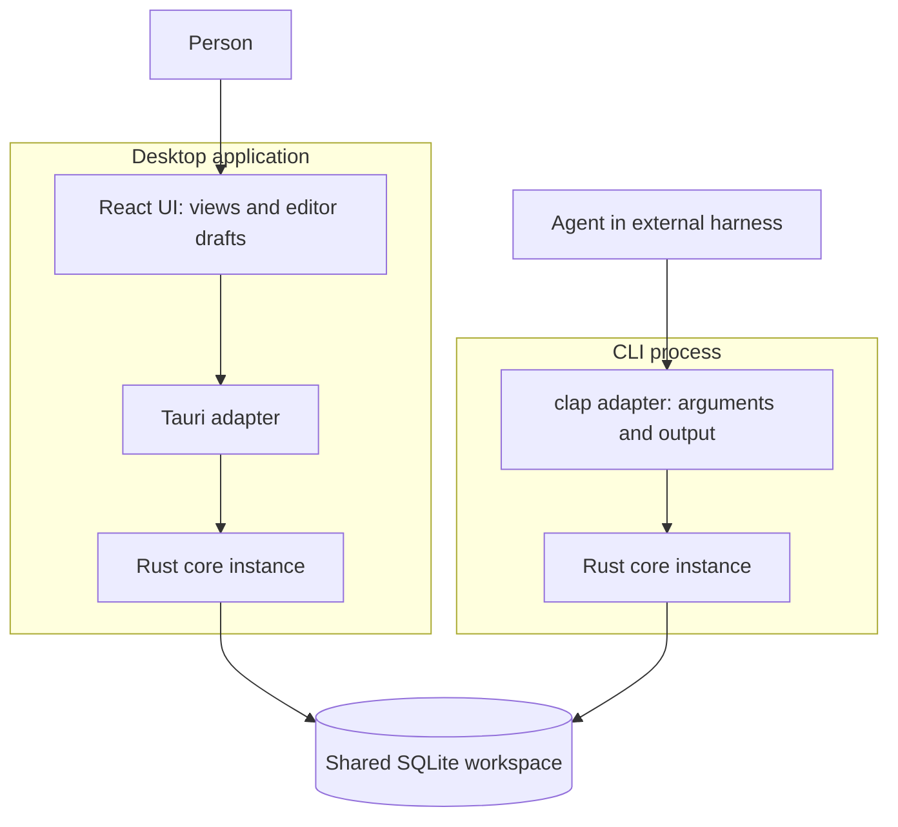

# High-level architecture

ticketd is a local desktop application and an independently usable CLI. Both call the same Rust core library, with a separate instance in each process, and share one local workspace database.

The direct-access process model is the selected direction, conditional on validating concurrency, migrations, and UI refresh in a technical spike. Exact workflow interface signatures remain to be designed.

## Runtime

The core is a shared library, not a shared running process. A background daemon, HTTP server, or running desktop is not required for CLI operations.

## Source layout

The Cargo workspace contains `crates/ticketd-core`, `crates/ticketd-cli`, and `apps/desktop/src-tauri`. The React application lives in `apps/desktop/src`; npm manages it as a workspace. Domain rules, operations, queries, and persistence remain internal to the core crate and are introduced as their implementations are needed.

## Module responsibilities

| Module        | Responsibility                                                                                                                           |
| ------------- | ---------------------------------------------------------------------------------------------------------------------------------------- |
| Desktop UI    | Lists, ticket details, Efforts, graph presentation, Markdown editing, unsaved drafts, and save feedback                                  |
| Tauri adapter | Translate desktop requests and results across the desktop bridge                                                                         |
| CLI adapter   | Parse arguments and input, resolve invocation context, call the core, format JSON or human-readable output, and map errors to exit codes |
| Rust core     | Workflow operations and queries; domain validation, atomic persistence, history, retry handling, and bounded context assembly            |

The core has one public workflow interface. Its implementation is organized internally into domain rules, write operations, read queries, and SQLite persistence. Callers do not coordinate transactions or access storage directly. Keep domain calculations independent of SQL and Tauri without exposing a general-purpose storage framework.

## Interface direction

| Caller intent           | Core behavior                                                                                 |
| ----------------------- | --------------------------------------------------------------------------------------------- |
| Create a ticket         | Validate initial content and links, assign identity/reference, persist, and return the ticket |
| Change a ticket         | Apply supplied fields, explicit relationship changes, and optional notes as one atomic change |
| Apply a batch           | Compose the same operations atomically, with local names for new tickets                      |
| Find tickets            | Apply search, filters, ordering, and output limits                                            |
| Open ticket context     | Assemble the ticket and requested related context from one consistent snapshot                |
| View a dependency graph | Return bounded graph data for presentation                                                    |

Projects, Efforts, notes, tags, and trash/restore also need focused operations; their exact signatures remain to be designed. The table describes the main ticket workflows, not a complete method inventory. Few methods alone do not make an interface simple: each operation must hide the coordination its callers would otherwise repeat.

## Writes and concurrent editing

For each write, the core coordinates request-ID replay checks, validation against current data, persistence, history, and the saved request outcome. Changes and their successful request outcome commit together. Batches either commit completely or persist nothing.

Record versions and stale-edit rejection are outside the MVP. Updates affect only supplied fields, with last-successful-write wins on the same field. Dependencies and tags use explicit additions/removals rather than replacing whole lists. The desktop retains unsaved drafts when saved content changes, indicates that change, and lets the person reload or save over it.

Request IDs prevent repeated execution after a lost response; they do not prevent overwrites by different requests. Successful request outcomes are retained indefinitely in the MVP and included in backups. Replays return original results, not current ticket state.

## Workspace and persistence

One default workspace lives in the operating system's application-data directory, outside project checkouts. The database holds tickets, project registrations, Efforts, notes, tags, relationships, ticket history, and successful request outcomes. Project checkout paths locate repositories; they do not select a different database. Multiple selectable workspaces are outside the MVP.

The core owns migrations, export, backup/restore, and data access. Domain validation and persistence must remain atomic across processes, including cycle checks and hierarchy rules. Validate lock handling, concurrent writes, migration coordination, and active-database backup behavior before finalizing the process model.

## External changes

The desktop must detect writes committed by CLI processes and refresh affected views through the core's read interface. It must also refresh dependent information, such as readiness and Effort counts. The notification or polling mechanism remains to be chosen; unsaved editor drafts remain owned by the UI.

## Verification and future evolution

Test core behavior through its public interface using temporary SQLite databases, including multiple-process concurrency tests. UI and CLI tests focus on their respective interactions and translation of requests/results.

A future server may call the same core workflow interface. Cloud synchronization, accounts, and authorization require additional design; preserving this interface does not make synchronization automatic. GitHub Issues tracks development of ticketd and is separate from the application's local ticket storage.

## Related documents

- [Product specification](mvp-spec.md)
- [Domain glossary](../GLOSSARY.md)
- [Atomic writes and retries](adr/0002-atomic-writes-and-retries.md)
- [Deferred record versioning](adr/0003-defer-record-versioning.md)
- [Shared core and local workspace](adr/0004-shared-core-local-workspace.md)
