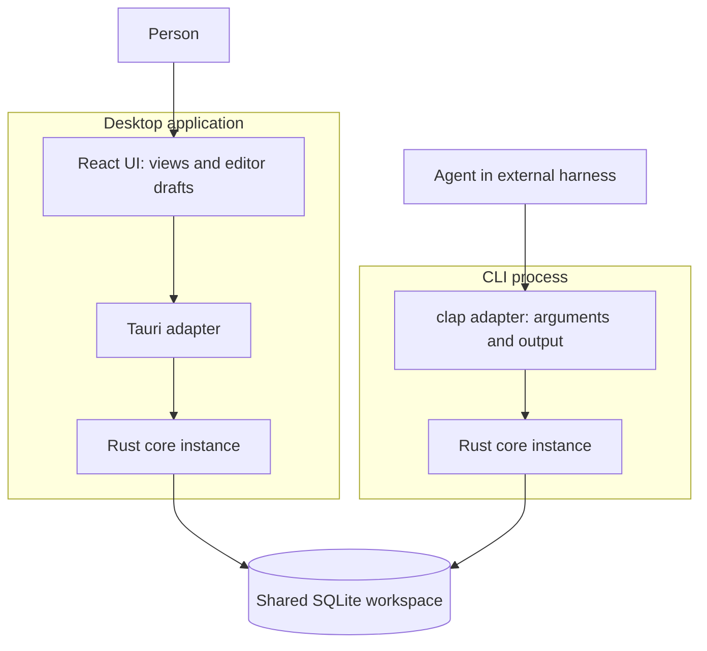

# High-level architecture

ticketd is a local desktop application and an independently usable CLI. Both call the same Rust core library, with a separate instance in each process, and share one local workspace database.

The direct-access process model is the selected direction, conditional on validating concurrency, migrations, and UI refresh in a technical spike. Exact workflow interface signatures remain to be designed.

## Runtime

The core is a shared library, not a shared running process. A background daemon, HTTP server, or running desktop is not required for CLI operations.

## Source layout

The Cargo workspace contains `crates/ticketd-core`, `crates/ticketd-cli`, and `apps/desktop/src-tauri`. The React application lives in `apps/desktop/src`; npm manages it as a workspace. Domain rules, operations, queries, and persistence remain internal to the core crate and are introduced as their implementations are needed.

## Module responsibilities

| Module        | Responsibility                                                                                                                           |
| ------------- | ---------------------------------------------------------------------------------------------------------------------------------------- |
| Desktop UI    | Lists, ticket details, Efforts, graph presentation, Markdown editing, unsaved drafts, and save feedback                                  |
| Tauri adapter | Translate desktop requests and results across the desktop bridge                                                                         |
| CLI adapter   | Parse arguments and input, resolve invocation context, call the core, format JSON or human-readable output, and map errors to exit codes |
| Rust core     | Workflow operations and queries; domain validation, atomic persistence, history, retry handling, and bounded context assembly            |

The core has one public workflow interface. Its implementation is organized internally into domain rules, write operations, read queries, and SQLite persistence. Callers do not coordinate transactions or access storage directly. Keep domain calculations independent of SQL and Tauri without exposing a general-purpose storage framework.

## Document editing

Rich document editing uses Plate, with Markdown remaining canonical across storage and CLI operations. Editor document trees remain transient UI state; CodeMirror provides source editing, and Mermaid renders diagrams locally. See [Plate editing with canonical Markdown](adr/0005-plate-editor-with-canonical-markdown.md) for fidelity and integration boundaries.

## Interface direction

| Caller intent           | Core behavior                                                                                 |
| ----------------------- | --------------------------------------------------------------------------------------------- |
| Create a ticket         | Validate initial content and links, assign identity/reference, persist, and return the ticket |
| Change a ticket         | Apply supplied fields, explicit relationship changes, and optional notes as one atomic change |
| Apply a batch           | Compose the same operations atomically, with local names for new tickets                      |
| Find tickets            | Apply search, filters, ordering, and output limits                                            |
| Open ticket context     | Assemble the ticket and requested related context from one consistent snapshot                |
| View a dependency graph | Return bounded graph data for presentation                                                    |

Projects, Efforts, notes, tags, and trash/restore also need focused operations; their exact signatures remain to be designed. The table describes the main ticket workflows, not a complete method inventory. Few methods alone do not make an interface simple: each operation must hide the coordination its callers would otherwise repeat.

## Writes and concurrent editing

For each write, the core coordinates request-ID replay checks, validation against current data, persistence, history, and the saved request outcome. Changes and their successful request outcome commit together. Batches either commit completely or persist nothing.

Record versions and stale-edit rejection are outside the MVP. Updates affect only supplied fields, with last-successful-write wins on the same field. Dependencies and tags use explicit additions/removals rather than replacing whole lists. The desktop retains unsaved drafts when saved content changes, indicates that change, and lets the person reload or save over it.

Request IDs prevent repeated execution after a lost response; they do not prevent overwrites by different requests. Successful request outcomes are retained indefinitely in the MVP and included in backups. Replays return original results, not current ticket state.

## Workspace and persistence

One default workspace lives in the operating system's application-data directory, outside project checkouts. The database holds tickets, project registrations, Efforts, notes, tags, relationships, ticket history, and successful request outcomes. Project checkout paths locate repositories; they do not select a different database. Multiple selectable workspaces are outside the MVP.

The core owns migrations, export, backup/restore, and data access. Domain validation and persistence must remain atomic across processes, including cycle checks and hierarchy rules. Validate lock handling, concurrent writes, migration coordination, and active-database backup behavior before finalizing the process model.

## External changes

The desktop must detect writes committed by CLI processes and refresh affected views through the core's read interface. It must also refresh dependent information, such as readiness and Effort counts. The notification or polling mechanism remains to be chosen; unsaved editor drafts remain owned by the UI.

## Verification and future evolution

Future ticket source integrations use a ticketd-owned extension engine and a
shared, versioned connector interface, beginning with a built-in GitHub Issues
connector. Connectors handle provider-specific connection configuration,
discovery, ticket/comment retrieval, external identity, status interpretation,
and optional publication. ticketd owns scheduling, identity preservation, local
data, and persistence; connectors do not modify the database directly.

Provider-specific configuration and filter forms are described by schemas for
fields, selectors, dynamic options, and validation, rendered by ticketd and
usable through the CLI. Custom extension development, installation/distribution,
and arbitrary extension-rendered UI are deferred. Keep the interface suitable for
future providers without building a general plugin system. Exact interface
signatures and execution mechanics are described next.

### Source connector layers

The code lives in `ticketd_core::source`, from the inside out:

- **Contract** (`contract.rs`): the `Connector` trait and its provider-neutral
  types (`ExternalIssue`, `ExternalIdentity`, `ExternalState`, `ClosureReason`,
  `SourceError`). `CONTRACT_VERSION` identifies the contract; the engine refuses
  a connector that declares another version. Changing a signature or the meaning
  of a type bumps the version. Adding an optional capability does not. Publication
  is an optional capability with a default "unsupported" implementation.
- **Schema** (`schema.rs`): fields, selectors, dynamic options, and validation,
  shared by every client. Desktop forms and CLI `--set key=value` flags both build
  raw values that `ConfigSchema::validate` checks and normalizes.
- **Engine** (`engine.rs`): the only caller of connectors. It validates
  configuration, walks pages with a progress guard, de-duplicates by external
  identity, bounds previews, and holds no database handle.
- **Connectors** (`github/`): provider translation over an `HttpTransport` seam
  with deterministic fixtures in tests. GitHub uses the person's own credential
  (environment token or `gh auth token`), which is never stored, exported,
  backed up, logged, or sent to any host other than the API.
- **Workflows** (`source/mod.rs`): methods on `Workspace` that call the engine
  first and then write in one short transaction, so no network I/O happens while
  the database is locked. `save_source` validates and previews before it saves.

Saved source configuration is workspace data (`source_configurations`), is
included in export and backups, and is separate from any imported ticket.

An imported ticket stores three things apart, each keyed by the ticket:
`external_identities` (provenance: which external issue it is or was, never
deleted), `external_ownership` (authority: `external` means synchronized and
read-only, `local` means ticketd owns it), and `source_sync` (the last observed
external state and freshness). Imported title and description live in the
ordinary ticket columns. `Workspace::refresh_sources` gathers through the engine
with no transaction open and then applies the result in one short write that
re-reads each ticket's ownership; the core rejects title, description and
closure-owned status edits to externally owned tickets.

Freshness and availability are persisted, not inferred: `source_sync` records the
start of each ticket's failure streak and `source_status` records each source's
last run, current error and any rate-limit hold. A ticket reads *Source
unavailable* exactly when its latest recorded attempt failed with an unreachable,
unauthenticated, forbidden, missing, unusable or unconfigured answer; a rate
limit is delayed, not unavailable. Neither changes content, status or ownership.
A refresh ignores an observation older than the one it holds, so a slower
overlapping run cannot move confirmed state backwards. The desktop starts
refreshing on launch and periodically through one in-process
`RefreshCoordinator` (one run at a time, exponential backoff on failure, rate
limits honored across restarts); there is no daemon, and `ticketd source refresh`
and `ticketd source status` work without the desktop.

Test core behavior through its public interface using temporary SQLite databases, including multiple-process concurrency tests. UI and CLI tests focus on their respective interactions and translation of requests/results.

A future server may call the same core workflow interface. Cloud synchronization, accounts, and authorization require additional design; preserving this interface does not make synchronization automatic. GitHub Issues tracks development of ticketd and is separate from the application's local ticket storage.

## Related documents

- [Product specification](mvp-spec.md)
- [Domain glossary](../GLOSSARY.md)
- [Atomic writes and retries](adr/0002-atomic-writes-and-retries.md)
- [Deferred record versioning](adr/0003-defer-record-versioning.md)
- [Shared core and local workspace](adr/0004-shared-core-local-workspace.md)

A caller that needs retries uses the core `write` workflow with a typed write request and optional request ID. The CLI exposes the same workflow as `ticketd write --request-id ID FILE` (use `-` for standard input). For example, `{"operation":"create_ticket","title":"Investigate","project_id":null}` creates a ticket, and `{"operation":"batch","operations":[...]}` applies a batch. Results contain a `kind` and `value` (the delete result has no value). Existing individual commands remain available without retry IDs.

Request IDs share one workspace-wide namespace. Equality compares the serialized typed request, including its operation, exact strings, attribution, supplied patch fields, and ordered arrays. JSON object key order and whitespace do not matter; omitted optional fields and their default values compare equally, except that omitted patch fields and explicitly cleared fields remain distinct. A different request with the same ID fails even if its effect would happen to be equivalent. Failed requests are not retained and may be retried. Successful outcomes are retained indefinitely and replayed as originally returned.

The JSON export includes `ticket_follows` and `inbox_entries`. Their `person`
field is the stable `local-person` scope for the initial local person; it is a
personal preference scope, not an account or editing-agent identity. Backups
include these records and retained write outcomes.

The CLI reads the newest personal entries with `ticketd inbox` (use `--limit`
and `--offset` for bounded pages). Personal writes use the retryable `write`
workflow: `set_following` takes a ticket `reference` and `following` boolean;
`set_inbox_read` takes explicit entry `ids` and a `read` boolean. Supplying the
IDs actually displayed avoids marking later arrivals read.

To review duplicate dependencies through the CLI, run `ticketd preview-duplicate
T-1 T-2`. Submit the returned `canonical` as `expected_canonical` and each edge
with an explicit `replace`, `remove`, or `retain` choice using `ticketd write`
with operation `mark_duplicate_reviewed`, source, canonical, decisions, and an
optional agent. The preview records its `mode` (`duplicate`, or `separate` with
`--separate`) and the normalized `source`. The preview
also lists each dependent (`waiting`) with its current status, trash state,
readiness and unresolved blockers, and, per edge, the reason Replace is invalid
(`already_exists`, `self_block`, `cycle`, or `trashed`). A ticket reviewed against
itself, or a trashed source or canonical in a duplicate review, is rejected up
front. Each edge carries that `mode` and two opaque fingerprints. `basis` covers
what Remove and Keep depend on (the edges, and each dependent's and its blockers'
status and trash state); `replacement_basis` covers what only Replace depends on
(the replacement endpoints and the replacement dependent's blockers) and is
compared only for Replace decisions. Submit edges unchanged. An edge missing
`mode`, `basis` or `replacement_basis` is rejected, so requests built from an
older preview must be previewed again. If the affected edges, any of that state,
or the resolved canonical change, the review is stale and must be previewed
again; edits to unrelated tickets do not make it stale. Feasibility of a Replace
(a new cycle, a trashed endpoint) is not in the fingerprints; it is re-checked on
evaluate and apply, and a Replace that is no longer possible is also reported as a
changed review. A preview
submitted to the other kind of review fails with a distinct "different kind of
review" error instead.

The core also judges all of a review's choices together. The desktop calls
`evaluate_dependency_review` (core `evaluate_dependency_review`) with the preview's
source and canonical, the mode, and the decisions, and receives one outcome per
waiting ticket (each dependent and, for Replace, the replacement dependent, so the
canonical appears when the duplicate is a dependent): its status, `before` and
`after` readiness (`ready`, `blocked`, or `no_ready_state`), and the blockers
still unresolved afterwards. Readiness uses `Status::satisfies_dependency`; a
started, finished, or trashed ticket has no Ready state, matching the Ready list.
The duplicate counts as Canceled afterwards in a duplicate review.
For a separate graph edit after undo, preview the current endpoint against the
replacement endpoint with `--separate` and submit the same fields with operation
`edit_dependencies_reviewed`. Neither operation silently moves newly arrived
edges; a retained duplicate prerequisite remains unresolved.
Personal reminders are exported in `ticket_reminders`, scoped to `local-person`.
`ticketd reminder show|set|snooze|dismiss` manages one reminder per ticket.
Set and snooze take an RFC 3339 instant with an explicit offset; show displays
local time and UTC. The retryable `set_reminder` write takes `reference` and
`due_at` (or null to dismiss). Reading the inbox atomically delivers due
occurrences; reopening the inbox catches up after downtime without a daemon.

Inbox entries for new notes retain the note ID and its original content in
`from_value` and `to_value`; this snapshot remains meaningful after the note is
edited or deleted. `editing_agent` is descriptive attribution. Relationship
history kinds `parent`, `dependency`, and those prefixed `relationship:` also
produce inbox entries for followed tickets, in the same transaction as the
change. New relationship types use that prefix to participate.
