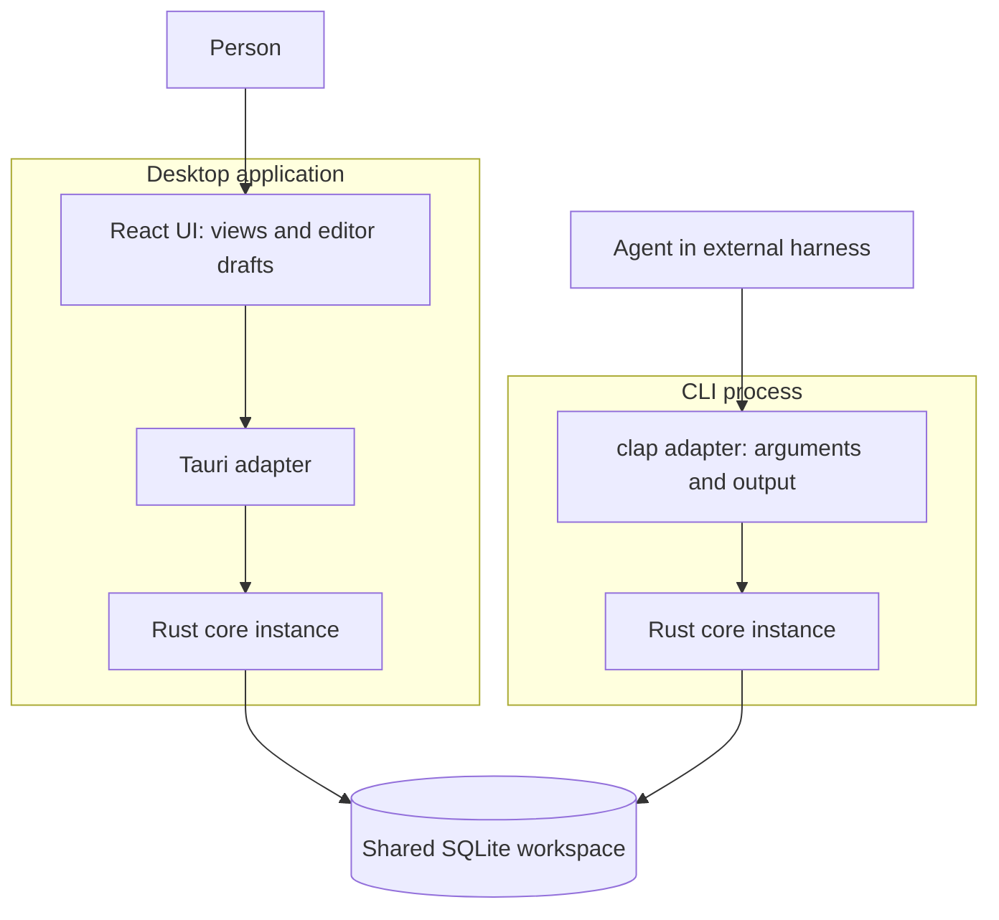
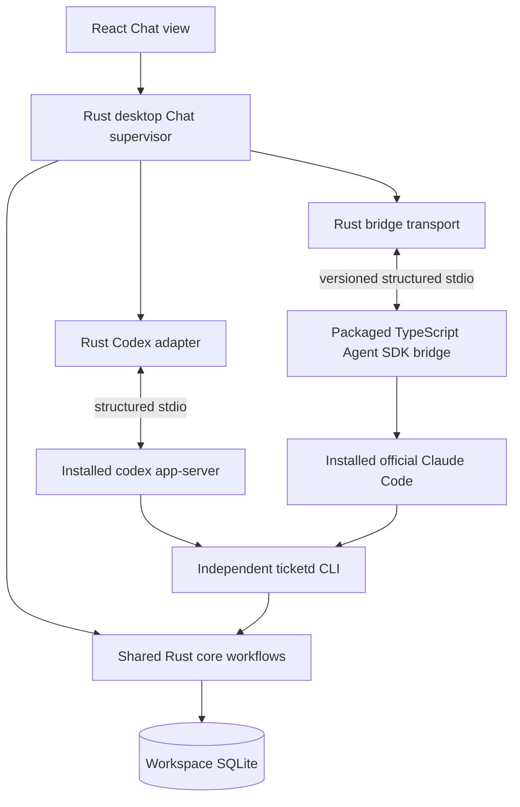

# High-level architecture

ticketd is a local desktop application and an independently usable CLI. Both call the same Rust core library, with a separate instance in each process, and share one local workspace database.

The desktop keeps a Workspace session open and refreshes its views when the shared change token advances. Each CLI invocation opens its own connection through the core. See [Workspace sessions](adr/0016-one-warm-workspace-session-per-process-wal-inside-it.md) and [desktop refresh](adr/0013-desktop-reads-from-one-change-token.md).

## Runtime

This diagram describes the direct-access runtime. Native Chat, which is
experimental, is shown separately below.



The core is a shared library, not a shared running process. A background daemon, HTTP server, or running desktop is not required for CLI operations.

## Source layout

The desktop and CLI meet at the Rust core. Start with the component that owns
the change, then follow its boundary into the next layer. For focused test
commands, see the [contributor guide](../CONTRIBUTING.md#where-to-start).

## Module responsibilities

| Component                                                                                  | What it owns                                                                                                                                                         |
| ------------------------------------------------------------------------------------------ | -------------------------------------------------------------------------------------------------------------------------------------------------------------------- |
| [Desktop UI](../apps/desktop/src/)                                                         | React views, editor drafts, and feedback when a save succeeds or fails.                                                                                              |
| [Tauri adapter](../apps/desktop/src-tauri/src/)                                            | Translates desktop requests and results across the native bridge.                                                                                                    |
| [CLI adapter](../crates/ticketd-cli/src/)                                                  | Parses arguments and input, resolves invocation context, calls the core, and formats results.                                                                        |
| [Rust core](../crates/ticketd-core/src/)                                                   | Domain rules, workflows, bounded queries, and atomic SQLite persistence.                                                                                             |
| [Chat host](../crates/ticketd-chat-host/) and [Claude bridge](../apps/chat-bridge-claude/) | The host supervises harness sessions. The bridge connects the host to the Claude Agent SDK. See [Native Chat runtime and storage](#native-chat-runtime-and-storage). |
| [Automation runner](../crates/ticketd-automation-runner/)                                  | Executes Automations triggered by Workspace events. See [Automation runs](#automation-runs).                                                                         |
| [Diagnostics](../crates/ticketd-diagnostics/)                                              | Configures logging for the CLI and desktop. See [Logging](#logging).                                                                                                 |

Runtime failures exit with status 1. Argument validation errors exit with status 2. The core classifies a failure as a `FailureKind` (`failure.rs`) so an interface can choose its words and next step, and only the desktop uses it.

The core has one public workflow interface. Its implementation is organized internally into domain rules, write operations, read queries, and SQLite persistence. Callers do not coordinate transactions or access storage directly. Keep domain calculations independent of SQL and Tauri without exposing a general-purpose storage framework.

### Logging

Rust code logs with `tracing`. The library crates (core, chat host, Automation runner) emit events and spans and never install a subscriber; only the two binaries do, through `ticketd-diagnostics`. The CLI's `main` calls `init_cli()` (readable lines on stderr, `warn` by default, `TICKETD_LOG` to change it). The desktop's `run()` calls `init_desktop(log_dir)` with Tauri's app log folder, keeps the returned handle in managed state and drops it on `RunEvent::Exit`; its subscriber writes JSON lines to a daily file. The event standard is in `docs/agents/quality.md`, and the decisions are in [ADR 0017](adr/0017-local-only-structured-logs.md).

## Native Chat runtime and storage

Native Chat extends the runtime above. It is experimental and off by default.
The Rust desktop host supervises a provider process for each active
Chat, using Codex app-server directly or a packaged TypeScript Claude Agent SDK
bridge pointed at the user's installed official Claude Code executable. The
harness owns authentication and native session state. The independently usable
CLI continues to call the shared core without requiring the desktop.



The shared core is a library instantiated by each caller, not a shared process.
Harness-to-CLI calls use the ordinary ticketd interface for context and writes.
The bridge/runtime is packaged by ticketd; harness installation, updates and
credentials remain user-managed. Native Windows, macOS and Ubuntu use the product
specification's existing release matrix.

### Runtime ownership and adapter interface

The Chat supervisor owns dispatch, the visible queue, one active turn per Chat,
and runtime lifetime. Adapters translate protocols and report capabilities and
observations. They coordinate with the supervisor around submission and approval
responses; they do not write workspace storage. The supervisor calls core
workflows, which own validation, transactions and durable Chat records.

Adapters also do not decide how a turn or its tools read. They report what the
harness said plus the evidence they saw: that an interrupt was written before a
failure, that an unattended session's allowed tools denied something, that a command
could not start. One supervisor-side module (`outcome`) turns outcome and evidence
into the turn's `TurnEnding` and its tools' states, so every harness is read by the
same rules. The fake, the Claude transport and the Codex adapter are held to one
conformance suite for the contract's guarantees: a stale generation is refused, a
process lost after a write leaves the submission unknown, evidence arriving after a
timeout settles the written submission, each request takes one answer, and a new
turn is acknowledged as the adapter declares.

Use an internal adapter interface with installation/capability inspection,
new-session or explicit native-resume opening, input submission (new turn or
supported steering), live interaction response, interruption, closure, and an
independent event stream. Capabilities describe effective behavior and its
evidence, including whether steering interrupts tools, rather than only booleans.
Do not expose provider wire formats as the React interface.

Commands carry application submission identity, current runtime generation and
expected native turn/request identity where applicable. Adapters report known
non-delivery, possible delivery, rejection and acknowledgment only as observed;
completion arrives separately. Recheck ownership before dispatch and after awaited
work before answering a live callback. A local request ID supplies correlation,
not a provider-side idempotency guarantee. Claude input-stream completion is not a
per-message acknowledgment. A timed-out command may still receive later evidence.

Continuously drain duplex protocol traffic while outgoing RPCs or human answers
are pending. Route replies, notifications and incoming requests independently;
drain bounded stderr diagnostics separately from stdout protocol frames. The
Claude bridge holds SDK objects and callbacks but has no second durable Chat store.

Navigation and window closure only detach views. Explicit Quit stops new dispatch,
interrupts/closes owned runtimes with bounded cleanup, flushes retained observations
and closes storage last. Verify Windows process-tree ownership separately from
POSIX process groups. A wrapper process exiting does not prove all tools stopped.
Archive does not stop execution; trash does. Process pooling and a standalone
always-running service are not selected for the initial design.

### Persistence and delivery observations

Chat storage uses structured records in the existing SQLite workspace for Chats
and their links, messages, submission attempts, turns, tool activity and retained
interaction state. A small ordered change log supports UI reconnection. These
records are authoritative for ticketd's history; reconstructing a Chat from all
raw provider events is not required. Exact table names and schema are internal
implementation details.

The storage half of this design exists: the core's Chat workflows
(`crates/ticketd-core/src/chats.rs`) own these records and the change log. Chat
tables do not move the workspace change token, so streaming a turn does not make
other views refetch; Chat views follow the Chat change log instead.

User input and submission attempts are separate. The core saves input before
dispatch and records possible submission before the adapter hands it to the
harness. Provider acknowledgment, correlated processing and terminal outcome
are separate observations, recorded only when supported by actual evidence.
Neither a successful transport write nor a lost response proves task completion
or safe retry. Uncertain attempts are retained without automatic resubmission.
Existing ticketd write-request deduplication does not imply harness idempotency.

A turn the harness correlated with a submission is evidence that the submission
arrived, with or without an explicit acknowledgment; losing contact afterwards
leaves the turn's outcome unknown, not the delivery. A written new turn that
nothing confirms within a bound is recorded as uncertain. The person's decision
about an uncertain submission is recorded beside the attempt and never rewrites
it: Discard keeps the message and its uncertainty, and Resend is a new attempt
for that message alone, dispatched with the queue paused. Where input stands
(queued, sending, delivered, awaiting a decision or set aside) is derived in one
place from all of its attempts and decisions: a discarded message is never queued
again whatever is observed later, and a resend the harness refuses returns the
message to awaiting a decision with the earlier uncertainty intact. A failed turn
keeps the kind of failure the adapter reported and, for a usage limit, the reset
time the provider gave. Such a failure describes the turn that ended; it does not
block the next message, which only a condition observed now does. How a turn ended
is one typed fact, `TurnEnding` in `ticketd-chat-host`: completed, failed (with the
kind, message and reset time), stopped by the person, stopped by ticketd for a named
reason (quit, Chat turned off, a restore, a run taken over, a time limit, the run's step
ending, the Chat trashed, an explicit resume, or storage failing), or contact lost. The
supervisor stores it in `chat_turns.ending` beside the turn's state and wording, and the
Chats list, the transcript and Automation runs read it from there; a turn recorded before
format 83 has no ending and is read from its state and wording. An optional
tool, MCP server or model that is unavailable is a typed problem of the running
session that blocks nothing. Warnings, retries and unmodelled provider traffic
are stored as bounded notices, and the settings a harness reports as in effect
are stored, bounded, with the Chat.

A workspace restore stops every Chat first and the host refuses all Chat requests
until it is over. A restore that replaced the data is reported as a success with
its safety copy; an unconfirmed stop or a failed check of the restored Chats is a
warning on that success.

The core commits durable record changes and their ordered change entries
atomically; the desktop publishes committed changes. A reconnecting view reads a
snapshot and follows changes after its sequence, refreshing the snapshot when a
cursor cannot be served. Reattaching the UI does not restart the harness. Native
session identity remains distinct from Chat identity and the current runtime
generation.

Stored approval/question state preserves history, not callable authority. Live
responses are checked against the current generation and native request; stale
callbacks and commands cannot target replacement processes. Text updates may be
coalesced and checkpointed with explicit bounds, while critical submission,
interaction and terminal observations are retained. A hard crash can lose an
uncheckpointed streamed suffix. Provider-specific details remain available through
bounded typed extensions rather than unrestricted raw transport storage.

Bound parser frames, pending requests, diagnostics, output previews and subscriber
backlogs separately. Slow views can be directed to a new snapshot instead of
accumulating an unbounded backlog. Flush preceding text before critical control
observations and reconcile authoritative final content without duplicating deltas.
Do not destructively truncate execution input to fit a display budget. On storage
failure, stop admitting/dispatching additional work, report uncertainty about work
already in flight, and perform controlled shutdown/reconciliation. No local
transaction can atomically commit an arbitrary harness side effect.

### Context and recovery boundaries

The host supplies lightweight linked-record references and locates the independent
CLI. Current context is read through core-backed operations. Preserve native
settings and instruction discovery in the selected
working directory. Domain writes retain existing source authority and concurrency
rules. Agent attribution never substitutes for Chat identity or permission.

`ticketd-chat-host` builds that context as text from the Chat's current links
(`context`) and finds the CLI the same way Settings does (`cli`). The text names
each record, the command that returns it, and the bundled `chat` guide; it holds no
record content and the host writes nothing into harness settings, skills or hooks.
When links change, the next new turn of a live session carries the context again,
and a resumed native session gets it when it differs from what it was last given.
Agents change records only by running the CLI. When the workspace change token moved
during a turn, the host lists the status moves and Activities written for that
Chat in that turn's time and keeps them with the turn for the transcript. The host
starts each harness process with the Chat's ID in `TICKETD_CHAT_ID` (only the ID);
the CLI the harness runs inherits it and records which Chat each status move and
Activity was written for (`chat_record_writes`). A write with no Chat ID (an older
CLI, or a harness that strips the variable) counts for the Chat only when it
carries the Chat's harness as agent name and no other Chat of that harness had a
turn running at that moment; otherwise it is shown for no Chat rather than the
wrong one. Save as Document is the ordinary Document-creation workflow applied to a
stored response.

A harness process started for an Automation run also gets the run's ID in
`TICKETD_AUTOMATION_RUN_ID`. A CLI that inherits a non-blank value logs every ticket
change it makes as a Workspace event with actor `automation`, and such events never
trigger Automations. The value itself is not stored.

### Permissions in a person's Chat

The person picks how a Chat's harness asks from the permission modes its adapter
reports, Full access among them ([ADR 0020](adr/0020-full-access-in-a-persons-chat.md)).
A pick in New Chat opens the session with it; a change in a Chat is held while a
turn runs and applies from the next message, like the model and effort. A reopened
Chat keeps its mode, recorded with its settings (`reopen_with`): Claude Code is
opened with the mode, and the effort, it last reported, and Codex with the choice
its last turn carried. While no session runs, the Chat shows the mode its next
session opens with (`HarnessAdapter::permission_before_session`, which reads the
same record), so a Chat in Full access says so before its next message, and a
change made then is kept for that session, new or resumed. A permission change is
saved with the Chat's record as soon as it is accepted, live or idle
(`HarnessAdapter::record_permission`), so a restart before the next message cannot
bring back a mode the person left. An idle pick that cannot be saved is refused, so
the idle Chat keeps showing its saved mode. When saving fails for a change the
harness already applied, or one a lost or closed runtime never answered, this
process still opens the next session with it, but a restart returns to the saved
mode; the failed save also stops the Chat with a storage problem. Nothing is
dispatched while a setting change is on its way to the harness, so
the next message runs on what the person last chose; a permission change the
harness refuses, or does not confirm, pauses the queue, so nothing runs on a mode
the person left until they resume it. Losing the harness while a change is on its
way pauses the queue too, and a permission change a lost or closed runtime never
answered is kept for the next session.

- **Claude Code.** Full access is the Agent SDK's `bypassPermissions`. The bridge
  starts every person's session with `allowDangerouslySkipPermissions`, because
  Claude Code switches a running session into that mode only when its process was
  started able to; the flag makes the mode available and never puts a session in
  it. Remembering an approval applies Claude Code's suggested updates except one
  that would set `bypassPermissions`, so only the person's pick turns it on. A
  request Claude Code still sends in Full access (its own safety checks, an ask
  rule in the person's settings) is shown like any other.
- **Codex.** The choices are "Codex settings", the approval policy and sandbox of
  the person's own configuration (ticketd sends none), and Full access: approval
  policy `never` and the `dangerFullAccess` sandbox, sent with every `turn/start`
  while it is chosen. A thread keeps the policy it was last given, across a
  resume too, so leaving Full access sends the approval policy and sandbox the
  thread reported when it opened without ticketd's; they are recorded with the
  Chat's settings (`own`) for a later session. The choice itself is recorded
  when a turn carries it, so a session opened again states it on its first turn.
  Full access is not offered when the person's Codex requirements refuse the
  no-sandbox profile.

An Automation's agent never gets Full access (see below), and a Chat taken over
from a run opens asking as before.

### Automation runs

`crates/ticketd-automation-runner` owns the loop and depends only on the core and
the Chat host, so it is tested without the desktop. The desktop calls one pass at
start, off the main thread (its Automation commands wait for it), then every five
seconds while Chat is on and an Automation is on or a run is Queued or Running;
otherwise when the Workspace changes, and at least every 30 seconds. A pass is one
use of the Workspace. A pass asks the core to queue a run
for each Workspace event after a switched-on Automation's cursor that matches its
trigger and conditions, and to start queued runs, oldest event first, until as
many are running as the device's "Runs at once" setting allows (2 unless changed,
at most 10; read on every pass, so a change counts from the next run). A run that
ends also starts the next queued one, but nothing starts while the Chat host is not
serving (Chat off, Quit, a restore): queued runs wait for it. The core
holds the rules: an event with actor `automation` matches
nothing, a ticket has one active run per Automation (a partial unique index), and a
run keeps the Automation definition it was created with. Each of the six event types
is a trigger. An event with actor `sync`, which a refresh of an external ticket
source logs, matches like one with actor `person`. An event with actor
`workspace_sync`, which Workspace sync logs for a change made on another desktop,
matches nothing: each desktop reacts only to changes made on it and to its ticket
sources (provisional, ADR 0012).
Conditions are tested against the ticket as it is when the event is matched, not as
it was when the event was logged: its project, its tags, and its source, which is
the provider that owns it now (`github`) or `local`, the same rule as the ticket
list's source filter. Matching and the run state
machine are functions with no SQL: the state machine takes the run's steps and how
the step it was on ended, and answers with the next step or how the run ends.
The executor drives a run with one core call, `advance_automation_run`, which
records how its step ended and answers with the next piece of work that needs a
process: an agent to run in its Chat, a notification to show, or the end of the
run. The core runs Change ticket and If steps itself, inside the transaction that
records the step before them, so a run that was stopped or taken over meanwhile
makes none of their changes; a run that has already ended answers `Ended`.
Every way a run can end (its steps ran out, Stop, turning the Automation off,
deleting it, taking it over, an executor that cannot go on) goes through one
function in the core, which decides from the run's status and the cause whether it
may end, what happens to the step it was on, and whether it needs the person.
Runs are local to the device, kept 90 days, and a run left Running by a process
that is gone ends as Needs attention when the next one starts; nothing retries.

A schedule and Run now start a run without going through the event log. Such a run
has no ticket and no event, and an Automation has at most one of them Queued or
Running. A schedule is every N hours, or a time of day on chosen weekdays, in the
computer's local time. The same pass asks the core which schedules have come due:
each Automation that is on keeps, on this device, the local time its schedule counts
from (`automation_device_state.schedule_from`), set when the schedule is first seen
on, when it fires, and cleared when the trigger changes. A schedule is due when it
had a time to run after that and up to now, so however many times were missed while
ticketd was not running, the first pass after the start fires it once. One that
comes due while its last run is still going is skipped. Whether a schedule is due is
a function of the schedule and two local times, with no SQL and no clock. An
Automation run by hand is never on, so it never keeps ticketd in the tray; Run now
queues its run, which the next pass starts. Change ticket and If steps need a
ticket: an Automation that starts on a schedule or by hand and holds one is
unfinished, so it cannot be switched on or run. An agent in a run without a ticket
is told so in its first message, and a Notify me step there opens the run.

The person can stop a Queued or Running run, which ends it as Needs attention: the
core marks the step it was on Failed and refuses the outcome its executor reports
later, so not even the step's failure path runs. The runner owns ending runs for
a cause the person states (Stop of the run, "Stop it and turn off", Delete): the
core ends the runs in one transaction and returns the Chats of the steps that had an
agent working, so a step that started meanwhile is stopped too, and the runner then
asks the Chat host to close those agents (`ChatHost::end_run_agents`), which
records the turn as stopped by ticketd (`StopReason::RunEnded`). The desktop
commands make one call into the runner each. The desktop creates the runner when it
starts, before any command is served and whether or not Chat is on: creating it ends
the runs a process that is gone left Running. A Stop of a run that has already ended
(it finished as the person pressed the button, or a restart ended it) returns the run
as it ended, not an error. With Chat off the runner only changes the record. An Automation deleted on another desktop and brought here by Workspace
sync is treated the same at the runner's next pass: its Queued runs never start
and its Running runs end as after a local Delete. Run again on a finished run queues a new run for the same Workspace
event, from the first step of the Automation as it is now; the finished run stays
as history. The run view draws a run from the definition the run keeps, so it shows
the steps as they were even after the Automation is edited.

A run that ends as Needs attention needs the person until they act on it: the core
counts it for the sidebar and adds an Attention inbox entry (kind `automation_run`)
on its ticket, whether or not the ticket is followed. A run without a ticket is
counted and listed under Needs you the same way, with no inbox entry: an entry
belongs to a ticket. Run again, Dismiss and taking
the run over clear that and mark the entry read; opening the run or reading the
entry does not. Dismiss leaves the run as it ended.

The person takes a run over in the Chat of one of its agent steps.
`ChatHost::send` and `ChatHost::stop` are the person's actions, so both ask the
core first: a message makes the Chat an ordinary one in the Chat list, and a run
that was Running or needed attention ends as Taken over, with the step it was on
ended there and nothing after it run. Stop takes over only a Running run, since
nothing is going in the Chat of one that ended. `ChatHost::stop` always means the
person's Stop and infers nothing from the database; when ticketd itself closes an
agent because its run ended, the runner uses `ChatHost::end_run_agents`, so such a
run stays Needs attention and the close also ends an agent still opening. A Completed run stays Completed when the person replies in its Chat.
Taking over a run that is going also ends its agents' unattended sessions at once:
a harness cannot change how it runs in place, so the host interrupts the turn and
closes the harness process of every Chat the run had working, and the wait in
`run_unattended` ends without reporting a step. The Chat the person acted in then
opens a new process that resumes the same conversation as an ordinary Chat, with
their own settings and approvals, no run marker on what it writes, and no time
limit; the Chat of a later step that was working stays closed and out of the list.
It opens as a new ordinary Chat would: Claude Code with New Chat's default model
and "Ask before edits", whatever its own `defaultMode` says. The message that took
the run over is that session's first turn, even when it was sent to wait behind the
agent's turn, and the turn the take-over ended does not pause the Chat's queue.
The run's own first message goes through a path that takes nothing over, and it
starts an agent only while the run is still going and the Chat is still the
agent's: a run taken over or stopped just after a step's Chat was created starts
no agent in it. Retention
deletes a run with the Chats it still owns, so a Chat the person took over is kept.

A Run agent step is an ordinary Chat, created by the core as the run reaches the
step (the step's folder is checked first, so a folder that is gone fails the step
and leaves no Chat), linked to the ticket and owned by the run
(`chats.automation_run_id`), which keeps it out of the Chat list. The core also
hands over what started the run, with the ticket's own words already fenced as data;
the runner words the first message around it and cannot place them raw. The host opens its harness with an `Unattended` request: the agent's
model, allowed tools and turn limit. An adapter given one never asks for approval
and never widens to full access. Claude Code runs in the Agent SDK's `dontAsk`
permission mode with the allowed tools as its allowlist and the tools of each
switch that is off disallowed; "Edit files" also allows `Read`, since Claude Code
edits only a file it has read. File tools are kept to the step's folder, Claude
Code's only working directory: the bridge turns on
`permissions.blockReadsOutsideWorkingDirectories` and
`blockWritesOutsideWorkingDirectories`, no file tool is allowed by its bare name,
and edits are allowed by `Edit(./**)` alone. Commands the agent may run are not
kept to the folder. It loads none of the person's user, project or
local Claude Code settings, so an allow rule there cannot widen the allowlist;
that also leaves out their hooks, `CLAUDE.md` and anything else those files set,
and it loads none of their MCP servers, claude.ai connectors or skills.
The ticketd CLI is allowed in both of Claude Code's shells, Bash and PowerShell,
by name only: every Chat's harness process has the CLI's folder first on its
`PATH`, and the Chat's context tells the agent to run `ticketd` by that name.
Codex runs with approval policy `on-request`, and ticketd declines every approval
request at once (with `never`, Codex reports a patch its policy rejects as no item at all, so
the step could not fail), with no network unless the web is allowed, and with
the person's MCP servers, plugins and apps turned off. The same overrides also switch off
their hooks, notify program, project `AGENTS.md`, memories, sub-agents, computer and browser
use, and Codex's bundled skills (the agent editor does not list these). The switches map as follows. "Edit
files" off is a `readOnly` sandbox; on, a `workspaceWrite` sandbox whose only writable place
is the step's folder. "Run commands" off sets `features.shell_tool=false` (and turns the image
viewer off), which also ends the agent's reading, because Codex has no read tool and reads
through its shell; with it on the agent runs any command inside the sandbox, as Codex has no
list of allowed commands. With both off, the thread starts with `environments: []`, so
`apply_patch` goes too. "Read files" is not a Codex setting, and no read limit is applied: it
can read any file the person can when Run commands is on. The agent reaches its tickets through
ticketd's own tool: the thread declares one dynamic tool, `ticketd`, over the experimental app-server API,
and ticketd answers its `item/tool/call` requests by running the bundled CLI in its own process
with the arguments as an array, the step's folder as working directory and the run's identity, so
the Codex sandbox does not apply to it and a read-only agent can still record its result. `restore-workspace`
and `skills install` are refused. Codex still reads the
person's own global `AGENTS.md` and lists their skills in `~/.agents/skills`, and their "always
allow" rules apply when Run commands is on: its app-server has no
setting that leaves them out, and the agent editor says so. Codex 0.163.0 or newer is required:
0.162.x cannot start its Windows sandbox while another Codex process holds a runtime file. A command Codex could not
start fails the step: the agent could not do its work. So does a tool Codex declined and a
file change it declined or failed to write, with a reason naming the file. A Chat taken over from a
run resumes its Codex thread with the person's own approval policy and sandbox
from their Codex configuration (`on-request` and `read-only` when it sets none). Codex
has no turn limit to set, so the agent editor hides the Turns field for Codex. `ChatHost::run_unattended` sends the first
message, stops a turn still going at the agent's time limit, reports how the turn
ended (finished, turn limit, time limit, tool denied, crashed, or another failure)
and closes the harness process. It waits on a signal kept for that Chat, so another
Chat's steps do not wake it. An unattended harness that asks for approval
anyway is stopped and counted as denied.

A Change ticket step is the core's own work, done inside `advance_automation_run`: it
logs its write with actor `automation`, so the change starts no Automation, and signs a
status change or a posted update with the Automation's name. Text in a posted
update or a notification holds field references (`{{ticket.reference}}`,
`{{ticket.title}}`, `{{ticket.status}}`, `{{event.tag}}`) that the core fills in
when the step runs, from the ticket as it is then. A write the core refuses fails
the step. A Notify me step asks the core for the notification and hands it to the
runner's host. The desktop shows it from the Rust side, not from the page, because
a run goes on while the window is hidden to the tray; a click brings the window
back and the page opens the ticket or the Automation's runs.

An If step is also the core's own work: it tests the step's checks
(tags, status, project) against the run's ticket as it is at that moment, so it
sees what the steps before it and their agents recorded. The run goes down the
Yes path when every check passes and down the No path otherwise. Paths never
rejoin: the end of a path is the end of the run, and the editor places no step
after an If.

A Run agent, Change ticket or Notify me step may carry a failure path, a list of
steps like any other (`on_failure`); null means it has none. When such a step
fails, the run marks it Failed with its reason and goes down that path to its end,
and the run ends Completed: the failure was handled, so nothing asks for the
person. A path with no steps handles the failure by ending the run. A step that
fails with no failure path ends the run as Needs attention with the step's reason.
Only a refusal by the Workspace fails a step: when storage itself fails, or the
runner cannot open the Workspace, nothing is recorded and the executor gets the
error. The run then ends as Needs attention saying so, never through a failure path.
Only a step's own failure takes the path: a run the person stops, switches off
with "Stop it and turn off" or takes over has left Running, so the outcome its
executor reports later is refused and the path does not run.

Keep view reattachment and replacement-process native resume distinct; a broken
stdio transport means the process is gone, so there is no separate live-process
recovery. Only a live request registry can answer approvals. Native resume failure
keeps the Chat readable and offers an explicit resume in a fresh harness session
started with selected history, recorded under a new native-session identity; it
never triggers automatic replay of uncertain submissions.
Backups retain application records and queued input, not harness credentials or a
promise of native resume state. Restore does not restart work automatically:
the desktop stops every running Chat before the workspace is replaced, records
what the backup held in progress as lost contact, and pauses restored queues
until the person acts.

Adapter writes and process shutdown are bounded. A harness that stops reading its
input is killed, and an adapter's own shutdown bound is shorter than the
supervisor's, so the kill has happened by the time the supervisor stops waiting.

The desktop owns one `ChatHost` for the life of the process
(`apps/desktop/src-tauri/src/chats.rs`, exposed by `chat_commands.rs`). The Chat
screens reach it through `chat_*` commands with validated arguments. Opening a
Chat returns a snapshot and a per-view channel of changes numbered one apart,
already translated into the view model (`chat_view.rs`); a view that falls behind
or cannot be served receives one `resync` entry and reads a new snapshot. Each
update's changes arrive as one array, and an item already sent unchanged is not
sent again. Steps carry the last lines of their output; an opened row reads the
whole of it with `chat_step_output`. The view
model only shapes what the host and core decided: attention and notification
rules, step classification and what blocks Send live in `ticketd-chat-host`
(`attention`, `step_kind`, `conditions`), and record queries such as New Chat's
suggestions and a folder's Project live in the core. List
rows and counts follow the `chat-overview` event, which comes from the host and
not from the workspace poll. Each wake rebuilds only the rows of Chats written
since the last one or whose live state moved. The Experimental switch is a per-computer
preference kept by the interface; the backend starts with Chat off and is told
the choice at startup.

Closing the window while Chat is on and either a Chat is working or an
Automation is switched on for this device hides the window and shows a tray
icon; the process, the host, the Automation runner and the page stay, so showing
the window again attaches to the same work. An Automation that is on counts even
when nothing is running, because it may start a run at any time and runs only in
this process. Starting ticketd a second time shows the
running window instead of starting a second host
(`tauri-plugin-single-instance`). Quit from the tray or the system asks in the
window first, then stops app-owned execution with bounded cleanup before the
process exits; a run whose agent was stopped that way ends as Needs attention
when ticketd next starts. With Chat off, or with no Chat working and no
Automation on, closing the window exits as before.

Switching an Automation off stops matching and leaves its active runs to finish.
"Stop it and turn off" also ends its Queued and Running runs as Needs attention in
the same transaction, and the runner then closes the agents they were
running; what those turns report afterwards is refused.

"Start ticketd when you sign in" registers the app with the system through
`tauri-plugin-autostart` (the Run registry key on Windows, a launch agent on
macOS, an autostart entry on Linux). The page reaches it through two ticketd
commands; the plugin's own commands are granted to no window. There is no
service: with ticketd quit, nothing runs.

The product behavior is in [Native Chats](product.md#native-chats).
Provider support clarification and live compatibility checks remain requirements
before release; this architecture does not claim they have passed. Exact SQL
schema, Rust signatures, bridge framing, buffer limits and version ranges are
implementation details to validate against this contract.

## Local attachment storage

The public `Workspace` interface owns snapshot upload, metadata inspection,
direct ticket associations, native-open resolution, and byte export. The CLI and
Tauri adapters share those workflows. Attachments have their own typed records
and association table, separate from Documents, source connectors, and
Implementation evidence. Storage kinds are `local_snapshot` and `external_reference`;
there is no remote deletion operation.

`Workspace::search_attachments` returns bounded results and their direct,
embedded, Document, draft, Undo and Trash usage from one read snapshot. Literal
filename/metadata search and in-use/unused filtering run in core before paging;
current-ticket context ranks related files ahead of recent workspace uploads.
Ranking never turns linked Document files into direct ticket associations.
Desktop library and insertion search use this same query as the independent CLI.
Display-name changes use `rename_attachment` and the retryable write interface;
they never rewrite Markdown labels, original filenames, upload outcomes or bytes.

Snapshots live in `<database-path>.attachments/<attachment-id>/bytes/` beside
the workspace database. Core upload validates a regular file and the workspace upload
bound, writes into a temporary directory, syncs bytes and a recovery manifest,
then publishes the directory before committing metadata and a replayable result
in SQLite. A file lock serializes uploads and recovery across processes. A
completed manifest survives database failure; listing, inspection, or retry
reconciles it without copying source bytes again. Incomplete staging directories
are never exposed as valid attachments. Ticket association is a separate
retryable transaction, so failed or abandoned insertion retains the upload.

Schema 49 stores the per-file upload limit in `attachment_upload_settings`, with
a 100 MiB default. Core progress callbacks report actual copied bytes in bounded
64 KiB chunks and can cancel before directory publication. Screenshot byte
capture shares the same staging, byte bounds and recovery/commit path; its
request equality includes the filename and SHA-256 digest. Completed operations
replay before checking the current limit or reopening a deleted source.
Tauri translates a binary screenshot IPC payload and progress channel; it owns
only cancellation signals, not storage policy. Native drops are scoped to the
active editor/picker bounds using physical-to-logical coordinates.

The desktop upload queue records source paths or clipboard File blobs and original
operation IDs in IndexedDB, scoped by the core workspace identity, before copying.
Completed uploads and canonical references remain core-owned. Recovering a queue
does not insert into another editor automatically: Retry is explicit at the new
caret. Successful insertion dismisses its capture record; Dismiss discards only
capture recovery and never deletes stored bytes. This local capture journal is
outside workspace backups and is separate from content-draft retention. A broken
or unavailable journal blocks new capture rather than silently losing retry IDs.

Upload and ordinary write request IDs share the existing workspace-wide replay
namespace. Exact source path and supplied display name define upload request
equality; retries return original metadata without requiring the source file.
Native open resolves only a stored, complete snapshot and permits passive file
formats; arbitrary types can be exported explicitly without executing them.
Exports publish synced temporary output without replacing an existing file.

`Workspace::export_markdown_with_files` owns portable content export for saved
Documents, tickets (including direct attachments), and selected/current Markdown.
Selections can supply source context; core carries only used reference definitions
into the output, without copying unrelated prose or files.
It acquires the attachment file lock before a SQLite read snapshot, uses local
metadata/byte validation and external provider viewer links, and rewrites only
exported destinations. A fresh temporary bundle is retained only after its
Markdown, copied bytes and complete/partial manifest are synced successfully.
Identity-prefixed filenames prevent collisions across filesystem case rules.
Canonical source and independently linked Documents remain unchanged. The CLI
and desktop translate sources, folder selection and results; they do not resolve
private storage paths or duplicate export policy. Provider references export
links without invoking a download or credential capability.

Backup, restore safety copies, and migration safety copies include every
retained local file. Attachment-bearing backups use a versioned single SQLite
container with streamed file blobs, per-file SHA-256 and a checked inventory;
its version is independent of the workspace schema. The upload lock covers
database snapshotting and file packaging. Files with no reference, files in
Trash, recovery manifests, and retained quarantine are included; incomplete
upload staging and coordination locks are excluded. Remote records remain
references and metadata; credentials and implicit remote downloads are excluded.

The format of a Workspace is defined by the migration ladder in
`crates/ticketd-core/src/format.rs` and nothing else (ADR 0014): a Workspace at
format version V is what steps 1 through V leave behind. Restore and inspection
check a backup's tables, columns, triggers and unique indexes against a scratch
Workspace built at the backup's version.

Restore validates the database and all retained bytes before changing the
workspace. It stages a live database without archive-only tables and a separate
attachment root, saves a complete safety copy, then replaces the files and
atomically replaces the database. A synced journal resolves interrupted file
swaps before another workspace connection opens. Supported attachment-free and
older database-only backups remain readable. See
[ADR 0008](adr/0008-attachment-backup-container.md) for the format and recovery
trade-off. Desktop review and `ticketd inspect-backup <path>` expose completeness,
local file totals, and the limits of remote references through the same core.
`inspect-backup` prints its JSON report for every readable file and exits with an
error, worded as a restore would word it, when `check.status` is anything but
`valid`. Each file must fit one SQLite blob, so the upload limit is capped at
999,000,000 bytes and an older, larger setting is held to it.

## Local media previews

`Workspace::attachment_preview` retains attachment metadata when bytes are missing,
incomplete, unreadable, or unsuitable for preview. `Workspace::attachment_media`
authorizes a workspace UUID and attachment ID, opens only a complete managed local
snapshot, and classifies bounded header evidence against a passive-media allowlist.
It returns a read handle, never a filesystem path to React. PNG, JPEG, GIF, WebP,
BMP, WAV, MP3, recognized Ogg, MP4 and WebM containers can be attempted; container
recognition is not a codec guarantee. HTML, SVG, PDF, office files, playlists and
unrecognized content retain metadata and explicit export/open fallback actions.
External references use the same preview entry point with cached provider details,
current-source wording and explicit Open in Drive. They never enter the local media
route or offer an original-byte export; unknown provider size remains unknown.
Images require checked dimensions of at most 16,384 per axis and 40 million pixels;
files above 100 MiB remain usable through explicit export/open rather than preview,
even if the configurable upload limit is higher.

The main Tauri WebView serves `attachment-media` requests by identity. GET and HEAD
support single byte ranges, capped at 1 MiB per range response; a full GET remains
a complete representation. Tauri/Wry buffer these responses rather than stream
them; at most two Rust responses are prepared concurrently. Responses use explicit
allowlisted MIME types, no-store, nosniff and a restrictive response CSP. The app
CSP permits this origin only for images/media, with frames and objects disabled.
Navigation to the media origin is refused: Tauri otherwise treats registered
custom schemes as local IPC origins. Media responses also reject document,
frame, object and script fetch destinations when that request evidence is present.
The dialog loads one selected file, never autoplays, and releases media sources on
close. A rendering error triggers fresh inspection without asserting a codec or
storage failure that inspection cannot establish.

Managed-byte resolution rejects links and Windows reparse points at the attachment
root and every managed path component, verifies canonical containment and the
opened regular file's recorded length, and uses the same handle for media reads
and byte exports. Native open retains its explicit extension allowlist. This
protects against stored path traversal and existing filesystem redirections; it
does not sandbox a hostile same-user process racing filesystem replacement between
checks and open, nor isolate hard-linked files. Workspace storage must remain
under the local user's control.

Previewing never rewrites authored Markdown. Replacement selects/uploads a new
identity and changes only the selected Markdown occurrence or direct association.
Reader replacement preserves surrounding source, labels and image syntax; a changed
draft requires reselection. Direct replacement is one replayable core transaction,
so failure leaves the old association intact and other uses retain their snapshots.
Before draft mutation, replacement awaits the shared durable Undo protection for
the chosen identity. Reader replacements retain their own conservative history
claim until that reader unmounts; ordinary reading creates no claim. Cancellation
and failed protection leave the selected reference unchanged. Preview usage is a
display projection of `attachment_usage`, with the full count and at most 20 labeled
entries, including drafts, Undo and Trash; the display subset never decides cleanup.

## Document editing

Draft recovery payloads and derived attachment claims commit together through
`Workspace::retain_draft`. The core parses canonical Markdown using the saved
reference parser. Drafts are private workspace recovery data, not published
Documents or Activities. Desktop startup loads recovery while the views mount;
editor hosts wait for it behind a recovery gate, and each host retains its
existing autosave or explicit-submit behavior. The Markdown editor owns its save
cadence: rich text is written out as Markdown once typing pauses and at once on
blur, Escape, a shortcut, unmount and window close; source text passes through
as typed. Recovery writes for one owner coalesce while queued. Capture
requests keep their original retry identity across restart. Backups include
recovery prose and protections; ordinary domain JSON export excludes this private
authoring state.

Owners use compare-and-swap revisions, including release tombstones; exact
retries of the last update are idempotent. Desktop writes serialize and failures
remain visible and block subsequent submission until protection is durable.
Current draft replacement and independent editor Undo use separate claims; Undo
accumulates references until history is reset/unmounted, and is written only when
its attachment links grow. Normal unmount releases only transient history, never
a recoverable draft; a released history record is removed, since its owner
belongs to one editor mount. An interrupted history release
leaves conservative protection for explicit review, without a time expiry.

`Workspace::attachment_usage` returns a consistent snapshot of direct, embedded,
draft and Undo protections, including recoverable Trash and unpromoted Activity
details. Its eligibility is advisory until explicit cleanup rechecks under its
writer/file coordination. Quarantine moves only unused local snapshots into a
fixed retained location. Canonical reference writes and available draft/Undo
references restore those bytes under their existing writer boundary, never taking
the upload lock inside a transaction. Cleanup and explicit restore take that lock
before the writer lock. Both locations remain resolvable after failed commits.
Backup briefly freezes writers for its database/path inventory and streams files
with one open input at a time after releasing the writer barrier. See
[ADR 0010](adr/0010-local-attachment-quarantine.md) for move, retry and backup races.

Explicit permanent purge uses `Workspace::purge_attachment`, outside the generic
write-outcome transaction. Schema 54 records retained/pending/purged status.
Under file-lock-before-writer ordering it commits eligible quarantine's purge
intent, deletes only its checked file with no writer transaction open, then records
completion. Pending intent blocks restoration and byte reads until explicit retry;
recovery prose and identity remain. Complete backup refuses pending purges and
preserves completed purges as unavailable identities. Replayed attachment outcomes
keep original metadata with current purge status. No provider deletion exists.

Remote record removal uses `Workspace::remove_remote_attachment` and the shared
retryable write interface. It checks the same retention claims under a SQLite
writer lock, then removes only the unused attachment and Drive reference rows.
It takes no provider capability and changes no local bytes, credentials or sharing.
Removal outcomes retain the safe provider link for retry/recovery, while uploaded
copy operations and immutable provenance remain discoverable. Old attachment
outcomes resolve current registration before returning success, preserving the
local purge overlay and refusing removed remote identities. Metadata refresh
updates only an existing record after its network read, so a concurrent removal
cannot be silently undone. Upload journals record `record_removed` atomically
with removal, including selected files whose upload registration is still
uncertain. Stale cancellation writes and late completion preserve the marker;
reconciliation can retain verified provenance without recreating the record.
Only explicit Picker selection clears it. Older journal JSON defaults to a
registered record. No workspace schema change is required.

Only upgrades with existing attachment records require review of legacy browser
drafts. Startup imports every recoverable slot in the current profile, including
unopened tickets and legacy Activity details/request keys. Other profiles remain
unknowable to the core: cleanup stays blocked until the user confirms those
profiles were reviewed. Fresh and attachment-free upgraded workspaces have no
such guard. See [durable draft retention](adr/0009-draft-retention.md).

Rich document editing uses Plate, with Markdown remaining canonical across storage and CLI operations. Editor document trees remain transient UI state; CodeMirror provides source editing, and Mermaid renders diagrams locally. See [Plate editing with canonical Markdown](adr/0005-plate-editor-with-canonical-markdown.md) for fidelity and integration boundaries.

## Interface direction

| Caller intent           | Core behavior                                                                                               |
| ----------------------- | ----------------------------------------------------------------------------------------------------------- |
| Create a ticket         | Validate initial content and links, assign identity/reference, persist, and return the ticket               |
| Change a ticket         | Apply supplied fields, explicit relationship changes, and optional authored Activities as one atomic change |
| Apply a batch           | Compose the same operations atomically, with local names for new tickets                                    |
| Find tickets            | Apply search, filters, ordering, and output limits                                                          |
| Open ticket context     | Assemble the ticket and requested related context from one consistent snapshot                              |
| View a dependency graph | Return bounded graph data for presentation                                                                  |

Projects, Plans, Activities, tags, and trash/restore also need focused operations; their exact signatures remain to be designed. The table describes the main ticket workflows, not a complete method inventory. Few methods alone do not make an interface simple: each operation must hide the coordination its callers would otherwise repeat.

## Writes and concurrent editing

Desktop `create_ticket` submits initial content, status, project, Plan, tags, following and blocker references through the existing replayable `CreateTicketWithContent` operation. Its create and change use one Core batch/follow transaction. A failing blocker rolls back the complete creation and receipt. `blockers` is an optional mutation input, with default-empty and empty serialization omitted so legacy payload hashes and stored replay outcomes remain compatible; it adds no stored data.

For each write, the core coordinates request-ID replay checks, validation against current data, persistence, history, and the saved request outcome. Changes and their successful request outcome commit together. Batches either commit completely or persist nothing.

Inside the core, every ticket write runs in one write scope (`write_scope.rs`), so the order is kept in one place: a savepoint with the write lock, the Ticket reference resolved and checked for editability, the operation's own rule, history, Workspace events folded so a ticket created by the write logs one `ticket.created` with its final values, then the read back. A ticket in Trash is refused by default; a write that the Workspace allows on a ticket in Trash (restoring it, detaching a link to it from a visible ticket, following it, a reminder) says so explicitly. Scopes nest, so a write made of other writes, such as a batch, runs them inside its own.

Inside that scope every way of changing a ticket is one ticket change (`ticket_change.rs`): `change_ticket`, the combined `TicketChange`, batches, tag, parent, dependency and Plan changes, ticket creation and the `WriteRequest` that names each. They share the rules (editability, the external owner of a ticket's content, an archived Plan, entering and leaving Duplicate, history and the inbox) and one read back; a combined change or batch makes all its steps in one scope. One rule still depends on the way in, named by the change's mode: a change on its own that leaves Duplicate clears the duplicate link, while a change in a batch, and so the combined single-ticket change, is refused.

Reads never write. A read of several statements runs in the read scope (`read_scope.rs`), beside the write scope: one deferred transaction, so it sees one snapshot, takes SQLite's shared lock once instead of once per statement, and never waits behind a writer that has not begun to commit. Inside a transaction already under way it runs as part of it, and `Workspace::read` lets an adapter combine several reads in one snapshot. Due reminders reach the Inbox through their own write, `deliver_due_reminders`, which the desktop's reminder timer (set to the next due reminder) and the CLI's `inbox` command call; it takes the write lock only when a reminder is due.

Record versions are outside the MVP. An editor may send the title, body or Document `updated_at` it last loaded, and the core rejects its save if that value has since changed ([ADR 0015](adr/0015-optional-expected-values-guard-editor-saves.md)); a caller that omits them, such as the CLI, keeps last-successful-write wins. Updates affect only supplied fields, with last-successful-write wins on the same field. Dependencies and tags use explicit additions/removals rather than replacing whole lists. The desktop retains unsaved drafts when saved content changes, indicates that change, and lets the person reload or save over it.

Request IDs prevent repeated execution after a lost response; they do not prevent overwrites by different requests. Successful request outcomes are retained indefinitely in the MVP and included in backups. Replays return original results, not current ticket state.

## Workspace and persistence

One default workspace lives in the operating system's application-data directory, outside project checkouts. The database holds tickets, project registrations, Plans, Activities, tags, relationships, ticket history, and successful request outcomes. Project checkout paths locate repositories; they do not select a different database. Multiple selectable workspaces are outside the MVP.

The core owns migrations, export, backup/restore, and data access. Domain validation and persistence must remain atomic across processes, including cycle checks and hierarchy rules. Validate lock handling, concurrent writes, migration coordination, and active-database backup behavior before finalizing the process model.

The desktop, with the Chat host and Automation runner inside it, keeps the Workspace open through the core's one `WorkspaceSession` per file and process, instead of opening it per command; the CLI opens it once per invocation. Inside the session the file is in WAL mode with every commit synced, so readers and writers do not wait for each other. A restore or migration in another process asks warm sessions to let go through a release marker beside the Workspace, and a file swap first checkpoints the file back to a single file and removes any leftover WAL. Backups are always single files. See [one warm Workspace session per process](adr/0016-one-warm-workspace-session-per-process-wal-inside-it.md).

## External changes

The desktop must detect writes committed by CLI processes and refresh affected views through the core's read interface. It must also refresh dependent information, such as readiness and Plan counts. It polls the core's change token every two seconds. Any change makes every visible read stale, a hidden view catches up once when shown, and the desktop's own write causes one refresh rather than two and shows what it set at once. A read that failed is read again only on Retry, on a change while it is visible, or when it is shown after a change it missed. Views move onto one reads module that owns this, the open Ticket first; see [desktop reads from one change token](adr/0013-desktop-reads-from-one-change-token.md). Unsaved editor drafts remain owned by the UI.

## Verification and future evolution

Future ticket source integrations use a ticketd-owned extension engine and a
shared, versioned connector interface, beginning with a built-in GitHub Issues
connector. Connectors handle provider-specific connection configuration,
discovery, ticket/comment retrieval, external identity, status interpretation,
and optional publication. ticketd owns scheduling, identity preservation, local
data, and persistence; connectors do not modify the database directly.

Provider-specific configuration and filter forms are described by schemas for
fields, selectors, dynamic options, and validation, rendered by ticketd and
usable through the CLI. Custom extension development, installation/distribution,
and arbitrary extension-rendered UI are deferred. Keep the interface suitable for
future providers without building a general plugin system. Exact interface
signatures and execution mechanics are described next.

### Source connector layers

The code lives in `ticketd_core::source`, from the inside out:

- **Contract** (`contract.rs`): the `Connector` trait and its provider-neutral
  types (`ExternalIssue`, `ExternalIdentity`, `ExternalState`, `ClosureReason`,
  `SourceError`). `CONTRACT_VERSION` identifies the contract; the engine refuses
  a connector that declares another version. Changing an existing signature or
  the meaning of a type bumps the version. Contract 1 includes the additive,
  optional `ExternalIssue.repository` field and an offline method to map a
  destination to the same repository identity. Publication is an optional
  capability with a default "unsupported" implementation.
- **Schema** (`schema.rs`): fields, selectors, dynamic options, and validation,
  shared by every client. Desktop forms and CLI `--set key=value` flags both build
  raw values that `ConfigSchema::validate` checks and normalizes.
- **Engine** (`engine.rs`): the only caller of connectors. It validates
  configuration, walks pages with a progress guard, de-duplicates by external
  identity, bounds previews, and holds no database handle.
- **Connectors** (`github/`): provider translation over an `HttpTransport` seam
  with deterministic fixtures in tests. GitHub uses the person's own credential
  (environment token or `gh auth token`), which is never stored, exported,
  backed up, logged, or sent to any host other than the API.
- **Workflows** (`source/tracking.rs`, `publication.rs`, `takeover.rs`,
  `conversation.rs`, `freshness.rs`, `connect_source.rs`, and `mod.rs` for saved configuration):
  methods on `Workspace` that call the engine first and then write in one short
  transaction, so no network I/O happens while the database is locked.
  `save_source` validates and previews before it saves.

Saved source configuration is workspace data (`source_configurations`), is
included in export and backups, and is separate from any imported ticket.

An imported ticket stores three things apart, each keyed by the ticket:
`external_identities` (provenance: which external issue it is or was, including its
last reported repository), `external_ownership` (authority: `external` means
synchronized and read-only, `local` means ticketd owns it), and `source_sync`
(the last observed external state, who opened the issue and when, and freshness).
Imported title and description live in the ordinary ticket columns.
`Workspace::refresh_sources` gathers through the engine with no transaction
open and then applies the result in one short write that re-reads each ticket's
ownership; the core rejects title, description and
closure-owned status edits to externally owned tickets. The same write re-reads
the saved configuration. If it changed during the network work, successful reads
of existing tickets can still apply, while discovery imports, membership, failures
and source-run health from the replaced rules are discarded. Saving changed rules
invalidates match membership until the next complete discovery walk.

When a connector reports a repository, the import write matches its normalized
`host/owner/name` against the Project remote. It saves the matching project link
and a project membership history entry in the same transaction as the new ticket.
Refresh preserves existing project membership. It retains a previously observed
repository while the issue's locator and URL stay the same. A changed location
without a repository report clears the old observation. GitHub derives the web
host from the API host. It maps `api.github.com` to `github.com` and
`api.<tenant>.ghe.com` to `<tenant>.ghe.com`. GitHub Enterprise Server uses its
configured host. Enterprise issue identities include the web host, so issues
with the same numeric ID on different hosts stay separate after a source change.
[GitHub Enterprise Cloud data residency](https://docs.github.com/en/enterprise-cloud@latest/admin/data-residency/about-github-enterprise-cloud-with-data-residency#api-access)

Public GitHub keeps its numeric IDs. Format version 87 populates the repository
when a legacy issue URL agrees with its locator. Format version 88 qualifies
legacy IDs using stored host evidence. A legacy ID without host evidence remains
unverified. Discovery holds a potential new import with the same ID and issue
location as an unverified ticket. A person can confirm the original issue URL
with `ticketd source reconcile-github`. Core checks the host, ID, and location
through GitHub before atomically repairing provenance on the existing ticket.
Drive sync applies the same qualification to older incoming issue records and
derives their repository when a ticket gains or changes its external location.
Initial discovery history uses host-qualified repository keys on Enterprise and
the existing bare repository keys on public GitHub.

`Workspace::preview_connect_source` reads one local snapshot of the Project
remote, the saved source, and the exact set of eligible ticket identities. It
matches stored repositories on the source's host independently of discovery
filters and fingerprints the effect. The fingerprint includes saved discovery
rules and the account when confirmation would add a repository.
`Workspace::connect_source` checks this
fingerprint before contacting the provider, then rechecks under the write lock.
When adding a repository, it shares the validation and persistence path of
`save_source`. If the bounded preview stops early, a separate preview checks the
added repository with the same filters. Provider validation and discovery preview
finish before the lock. The transaction saves the new rules, invalidates discovery membership, and applies
the reviewed project links using the ordinary history path. If the rules already
list the repository, the transaction only applies the links and can run offline.
A separate bounded match count for the new repository keeps the saved assignee
and label filters and has no effect on the fingerprint or the confirmation.

The source conversation (an external ticket's comments and timeline events) is
a read-only mirror in `source_conversation`, keyed by ticket and the source's
own entry id. It has no write workflow: refresh replaces it in the same short
write as the ticket, only when the issue changed since it was last read, and a
failed read keeps what was retrieved. Authors are the source's identities, never
an editing agent, and the rows survive takeover as provenance. Agents read it
with `ticketd context T-KQ1 --conversation`.

Freshness and availability are persisted, not inferred: `source_sync` records the
start of each ticket's failure streak and `source_status` records each source's
last run, current error and any rate-limit hold. A ticket reads _Source
unavailable_ exactly when its latest recorded attempt failed with an unreachable,
unauthenticated, forbidden, missing, unusable or unconfigured answer; a rate
limit is delayed, not unavailable. Neither changes content, status or ownership.
A successful or partial whole-source run persists its distinct checked-issue
count with its refresh time; a failed or single-ticket run does not replace it.
The current tracked-ticket count is read separately. A source closure time comes
only from the latest close event in a conversation retrieved for the currently
observed source update; missing or stale evidence remains unknown.
A refresh ignores an observation older than the one it holds, so a slower
overlapping run cannot move confirmed state backwards. The desktop starts
refreshing on launch and periodically through one in-process
`RefreshCoordinator` (one run at a time, exponential backoff on failure, rate
limits honored across restarts); there is no daemon, and `ticketd source refresh`
and `ticketd source status` work without the desktop.

Publication cannot be atomic across GitHub and SQLite, so `Workspace::publish_ticket`
is built on a durable attempt (`publication_attempts`). One short write checks
eligibility, resolves the destination against the current ticket and saved source,
and saves the attempt as `in_flight` with the exact title, description and
destination. A unique partial index allows one open attempt per ticket. The
connector supplies the host for matching the Project remote to a listed
repository. When using this default, the write also requires a matching preview
fingerprint. The connector's create call runs with no transaction open. A second
short write links the confirmed issue (`external_identities` with origin
`published`, ownership `external`) and marks the attempt `succeeded`. A refusal
the provider proves (`SourceError::ruled_out_creation`) marks it `failed` and
leaves the ticket local. Anything else (timeout, server error, unreadable
answer, an issue that could not be recorded, a crash) leaves it `in_flight` past
its lease or `unresolved`: the ticket stays local and a second create is
refused until the attempt is resolved. Replaying a request for an already
published ticket returns it without calling the connector.

Taking ownership (`Workspace::take_ownership`, `ticketd source take-ownership`,
replayable as `WriteRequest::TakeOwnership`) is one atomic write allowed only
while a ticket reads _Source unavailable_. It flips `external_ownership` to
`local`, clears the failure columns of `source_sync` and records an `ownership`
history entry; the identity, content, status, relationships and authored Activities are
untouched. Because every refresh path re-reads authority inside its own write,
rediscovery, restored access and a refresh already in flight neither resume
synchronization nor import a second ticket, and nothing turns a local row back
into `external` for an existing identity: reconnecting needs a future explicit
action. A taken-over Duplicate keeps its status and the source's last canonical
as provenance until it leaves Duplicate.

Test core behavior through its public interface using temporary SQLite databases, including multiple-process concurrency tests. UI and CLI tests focus on their respective interactions and translation of requests/results.

A future server may call the same core workflow interface. Personal sync between one person's desktops is described under [Workspace sync](#workspace-sync). A cloud service, accounts, and authorization require additional design; preserving this interface does not make synchronization automatic. GitHub Issues tracks development of ticketd and is separate from the application's local ticket storage.

## Related documents

- [Product description](product.md)
- [Domain glossary](../GLOSSARY.md)
- [Atomic writes and retries](adr/0002-atomic-writes-and-retries.md)
- [Deferred record versioning](adr/0003-defer-record-versioning.md)
- [Optional expected values guard editor saves](adr/0015-optional-expected-values-guard-editor-saves.md)
- [Shared core and local workspace](adr/0004-shared-core-local-workspace.md)
- [One warm Workspace session per process, WAL inside it](adr/0016-one-warm-workspace-session-per-process-wal-inside-it.md)
- [Workspace sync through Google Drive](adr/0011-markdown-file-sync-through-google-drive.md)
- [Sync file format](sync-file-format.md)

A caller that needs retries uses the core `write` workflow with a typed write request and optional request ID. The CLI exposes the same workflow as `ticketd write --request-id ID FILE` (use `-` for standard input). For example, `{"operation":"create_ticket","title":"Investigate","project_id":null}` creates a ticket, and `{"operation":"batch","operations":[...]}` applies a batch. Results contain a `kind` and `value` (the delete result has no value). Existing individual commands remain available without retry IDs.

Desktop ticket creation retains its submission ID in the recoverable draft before
sending the write. `create_ticket_with_content` atomically commits the ticket's
content, organization and following choice with its replay receipt. A lost response
or failed draft release reuses that ID after restart rather than creating another
ticket. Retrying locks the submitted fields; editing them as a new ticket requires
an explicit decision and durable draft save before a fresh ID can be used. The
captured following and Create more choices survive restart. After workspace restoration,
recovery reloads the restored revisions and cutover state, and retained editor
subtrees remount against that recovery generation.

Request IDs share one workspace-wide namespace. Equality compares the serialized typed request, including its operation, exact strings, attribution, supplied patch fields, and ordered arrays. JSON object key order and whitespace do not matter; omitted optional fields and their default values compare equally, except that omitted patch fields and explicitly cleared fields remain distinct. A different request with the same ID fails even if its effect would happen to be equivalent. Failed requests are not retained and may be retried. Successful outcomes are retained indefinitely and replayed as originally returned.

The JSON export includes `ticket_follows` and `inbox_entries`. Their `person`
field is the stable `local-person` scope for the initial local person; it is a
personal preference scope, not an account or editing-agent identity. Backups
include these records and retained write outcomes.

The CLI reads the newest personal entries with `ticketd inbox` (use `--limit`
and `--offset` for bounded pages). Personal writes use the retryable `write`
workflow: `set_following` takes a ticket `reference` and `following` boolean;
`set_inbox_read` takes explicit entry `ids` and a `read` boolean. Supplying the
IDs actually displayed avoids marking later arrivals read.

To review duplicate dependencies through the CLI, run `ticketd preview-duplicate
T-KQ1 T-KQ2`. Submit the returned `canonical` as `expected_canonical` and each edge
with an explicit `replace`, `remove`, or `retain` choice using `ticketd write`
with operation `mark_duplicate_reviewed`, source, canonical, decisions, and an
optional agent. The preview records its `mode` (`duplicate`, or `separate` with
`--separate`) and the normalized `source`. The preview
also lists each dependent (`waiting`) with its current status, trash state,
readiness and unresolved blockers, and, per edge, the reason Replace is invalid
(`already_exists`, `self_block`, `cycle`, or `trashed`). A ticket reviewed against
itself, or a trashed source or canonical in a duplicate review, is rejected up
front. Each edge carries that `mode` and two opaque fingerprints. `basis` covers
what Remove and Keep depend on (the edges, and each dependent's and its blockers'
status and trash state); `replacement_basis` covers what only Replace depends on
(the replacement endpoints and the replacement dependent's blockers) and is
compared only for Replace decisions. Submit edges unchanged. An edge missing
`mode`, `basis` or `replacement_basis` is rejected, so requests built from an
older preview must be previewed again. If the affected edges, any of that state,
or the resolved canonical change, the review is stale and must be previewed
again; edits to unrelated tickets do not make it stale. Feasibility of a Replace
(a new cycle, a trashed endpoint) is not in the fingerprints; it is re-checked on
evaluate and apply, and a Replace that is no longer possible is also reported as a
changed review. A preview
submitted to the other kind of review fails with a distinct "different kind of
review" error instead.

The core also judges all of a review's choices together. The desktop calls
`evaluate_dependency_review` (core `evaluate_dependency_review`) with the preview's
source and canonical, the mode, and the decisions, and receives one outcome per
waiting ticket (each dependent and, for Replace, the replacement dependent, so the
canonical appears when the duplicate is a dependent): its status, `before` and
`after` readiness (`ready`, `blocked`, or `no_ready_state`), and the blockers
still unresolved afterwards. Readiness uses `Status::satisfies_dependency`; a
started, finished, or trashed ticket has no Ready state, matching the Ready list.
The duplicate has the Duplicate status afterwards in a duplicate review.
For a separate graph edit after undo, preview the current endpoint against the
replacement endpoint with `--separate` and submit the same fields with operation
`edit_dependencies_reviewed`. Neither operation silently moves newly arrived
edges; a retained duplicate prerequisite remains unresolved.
Personal reminders are exported in `ticket_reminders`, scoped to `local-person`.
`ticketd reminder show|set|snooze|dismiss` manages one reminder per ticket.
Set and snooze take an RFC 3339 instant with an explicit offset; show displays
local time and UTC. Times are stored as whole-second UTC instants (fractions are
dropped, a leap second reads as the second before it, years 0000 to 9999).
`snooze` needs an existing reminder and a later time; `dismiss` says when there
was nothing to dismiss. The retryable `set_reminder` write takes `reference` and
`due_at` (or null to dismiss) and reschedules freely; it answers
`{"kind":"reminder","value":<due time or null>}`. `set_following` answers
`{"kind":"following","value":<bool>}` and `set_inbox_read` answers
`{"kind":"inbox_read","value":<read>}`; an inbox ID that was never issued is refused.
Reading the inbox atomically delivers due
occurrences; reopening the inbox catches up after downtime without a daemon.

Inbox entries for new Activities retain the Activity ID and its original brief in
`from_value` and `to_value`; this snapshot remains meaningful after the Activity is
edited or deleted. `editing_agent` is descriptive attribution. Relationship
history kinds `parent`, `dependency`, and those prefixed `relationship:` also
produce inbox entries for followed tickets, in the same transaction as the
change. New relationship types use that prefix to participate.

## Context-management extension

The confirmed target model adds Documents, Activities, and Plans; see [product behavior](product.md#context-management) and
[ADR 0007](adr/0007-context-storage-and-graph-queries.md). Earlier implementation
names and command examples in this architecture describe the current runtime,
not compatibility requirements for the extension. No migration of development
data or legacy command aliases is required.

The core owns atomic Activity/supporting-Document creation, origin cleanup,
Document search and mention indexing, Plan associations, and bounded context and
graph queries. The desktop owns capture/editing state and graph presentation;
the CLI exposes the same operations without coordinating their transactions.
Explicit relationship tables remain authoritative. Shared entity identities
support cross-type references while concrete records retain domain invariants.

Desktop Plan islands compose bounded existing reads: `list_plans` accepts optional
limit/offset, and `show_plan` accepts optional member/Document limit/offset and
`include_members`. Legacy calls retain complete output. Graph summaries, sidebar
progress and palette progress omit members. Full PlanCounts use a grouped count
independently of those pages; Document reads return headings and identities,
never Markdown.

The existing `find_tickets_with_updates` command accepts optional `metadata` and
`flow` projections. Both return validated subsets of existing Ticket fields,
never partial objects presented as full Tickets. Metadata selects no body,
Activity, hierarchy or relationship payload. Flow additionally selects at most
50 prerequisites per Ticket, its existing update timestamp and source-availability
fields. A 51st prerequisite marks the page omitted. Indexed adjacency is bounded
before sorting the small result; availability uses an existence query instead of
materializing every prerequisite status. Legacy full-Ticket output is unchanged.

A graph window selects at most eight Plans, 240 island identities, 50 workspace
candidates, 250 presented nodes and 600 edges before requesting work. Each Plan
uses one bounded summary, at most two 100-Ticket metadata reads and one graph
hydration. One shared filtered search reads at most five pages. One metadata read
resolves at most 50 off-window Ticket memberships; a bounded Plan hydration
supplies their island labels. A final hydration joins connections across all
selected identities. Optional `node_limit` and `edge_limit` inputs on the existing
graph query permit a 250/600 hydration window; legacy defaults remain 100/300.
Core adjacency limits still bound each indexed relationship group, and every
omission stays explicit. Client joins visit at most 3,000 connections per island
and 3,000 in the final join (eight islands maximum). Client cursors retain the
Plan/member/workspace window and its independent text/tag match continuation.
Each filter window reads at most five workspace match pages shared by its Plans;
Load more exhausts that match continuation before advancing the member window.
A refresh hydrates all identities in the current window, up to 250, using its
original cursor. It retains the current continuation, filters and selection.
Load more replaces the window, and connection expansion reuses it. Missing hydration differs from deliberate omission. Unknown membership
never implies an unplanned item. Flow and Next up require complete metadata and
stop at 500 members or an omitted prerequisite page instead of classifying a
partial set. These are projections and pagination controls over existing data;
no stored field or schema changes.

## Inline attachment references

Schema 48 assigns a persistent workspace identity and derives
`embedded_attachments` from canonical Markdown link/image destinations, including
GFM tables and reference-style links. Ticket and Document body indexing and
Activity brief indexing update these references within the content transaction;
Activity details use their supporting Document identity. Activity deletion removes
its brief references while leaving the supporting Document and its files intact.
Trash keeps references. Direct `ticket_attachments` remain independent, and files
in linked Documents are not flattened into ticket attachments.

`Workspace::attachment_uri` checks a completed local snapshot or stored external reference before producing
`ticketd://attachment/<workspace-id>/<attachment-id>`.
`resolve_attachment_uri` rejects foreign workspace identities and retains metadata
for missing local bytes. Newly introduced local links require stored bytes;
existing broken references remain editable and removable. Foreign links remain
canonical content with unresolved reference records. `embedded_attachments` and
`embedded_attachment_uris` expose derived uses without depending on editor trees.

Publication eligibility inspects the exact outgoing Markdown inside the write
transaction before saving an attempt or calling the connector. Its
`internal_attachments` reason and preview list expose workspace-only URIs and known
display names to desktop and CLI. Retries use the same guard; resolving an
uncertain attempt only reads the provider and never resends its saved body.
Direct attachments are counted as local context, never uploaded implicitly.

Source import, refresh and publication resolution index authoritative incoming
text without requiring its attachment links to resolve. Known identities retain
their file association; unknown or foreign links retain the URI with no local
identity. Local authoring continues to validate newly introduced local file links.
Both paths update derived references in the content transaction and leave direct
ticket attachment associations and explicit local Document references untouched.

The desktop shares one AttachmentPicker between the direct-ticket adapter and
MarkdownEditor. Its `onPick(file, requestId)` callback receives only a successfully
stored or inspected identity. MarkdownEditor resolves the URI through the core
and inserts at its saved rich/source selection; the host owns persistence. Closing
or unmounting abandons insertion without deleting uploaded bytes. The CLI's
`attachment uri` exposes the same identity contract without the desktop.

## Existing Google Drive references

The core's narrow `drive::AttachmentProvider` capability resolves file metadata.
It is separate from ticket-source connectors. Uploads use the separate
`drive::DriveUploadProvider` capability; neither interface exposes deletion,
overwrites, conversion or sharing changes.
The Google implementation can exchange/refresh authorization, read account
identity and read explicitly authorized file metadata. A separate read-only
`DriveCopyProvider` inspects and downloads uploaded blob copies for explicit
export. It never downloads or converts Google-native content and cannot change
sharing or delete a remote file.

`Workspace::reference_drive_file` resolves outside a SQLite transaction, validates
metadata and viewer URLs, then atomically stores/reuses a workspace attachment
identity keyed by connection and Drive file ID. A `drive_references` row holds the
opaque connection handle and last-known MIME, size when supplied, resource key,
name and viewer URL. External references can be reused and inserted offline;
resolution errors retain identity and last-known metadata. Local snapshot-byte
validation remains mandatory. Schema 51 rebuilds the attachment kind constraint
under the existing exclusive migration lock, checks foreign keys before commit,
and retains pre-migration safety backup behavior and reference rows.

OAuth uses the system browser, native OAuth-integrated Picker, PKCE S256 and a
bounded one-shot IPv4 loopback callback with host/path/state validation. Only
`drive.file` is requested; broader grants are refused. Account identity is read
with the same scope, so reconnecting the same client/account reuses its handle,
and another account cannot replace credentials behind existing references.
Selection order is retained. Tauri owns browser opening and cancellation, returns
only attachment metadata/errors to React, and never loads Google scripts in the
WebView. The shared picker handles both direct associations and inline insertion.

The shared core embeds the publisher's installed-app registration from build-time
`TICKETD_GOOGLE_OAUTH_CLIENT_JSON`, so desktop and CLI need no user configuration
to begin sign-in. The optional runtime `TICKETD_GOOGLE_OAUTH_CLIENT_FILE` remains
an explicit developer override; an invalid override never falls back silently.
Distribution validates each platform's registration before building its artifacts.

Refresh credentials and installed-client material live in the OS user's secure
store, under `ticketd.google-drive.v1`, keyed by the opaque connection handle.
Windows uses Credential Manager, macOS Keychain, and Linux encrypted Secret
Service. There is no plaintext fallback. Cross-process file locks outside the
workspace serialize refresh-token rotation; access tokens stay in memory.

Every Drive request, from Attachments and from Workspace sync alike, goes through
one crate-private Drive client over the transport interface. It caches the access
token and renews it once when Drive refuses it, using the credential stored at that
moment, so a later sign-in needs no cache reset. It also owns the classification of
Google's errors, `generateIds`, resumable sessions, ranged reads that require an
exact `Content-Range`, pagination, and retry with backoff for the requests that opt
in. Only Workspace sync opts in; an uploaded copy is never retried automatically.
The Attachment providers and the sync adapter translate its answers into their own
results: per-file guidance on one side, recovery states on the other.
Transport diagnostics omit URLs, headers and bodies, and Google redirects are
not followed. Workspace backups/JSON export contain reference metadata, never
credentials or remote bytes. The standalone CLI uses the same core/vault namespace;
no desktop process is needed. Portable Drive-link export and remote record cleanup
are separate workflows.

`check_drive_reference` returns an explicit access observation with typed provider
failure and last-known metadata; access is not persisted as a workspace-wide fact
because credentials belong to each OS user. Failed reads never erase metadata.
Successful refresh changes current provider metadata and known size, preserving
local display names, original filenames, authored Markdown and immutable uploaded-copy
provenance. Network calls precede short database transactions.

`begin_drive_reference_recovery` constrains native Picker recovery to one original
file and account/client handle. Callback processing verifies both before loading
or saving credentials; `recover_drive_reference` rechecks the selection at the
Workspace boundary before metadata refresh. Wrong selection is not replacement.
React displays recovery state and Tauri translates browser/cancellation requests;
the standalone CLI prints the same bounded session URL for explicit browser opening.
Neither adapter decides authorization policy or changes sharing. Error classification
uses provider evidence: app-not-authorized, reconnect, explicit file-permission
denial and positively observed trash are distinct; unknown 403/404 stays ambiguous.

## Google Drive uploaded copies

Schema 55 stores the workspace upload preference and per-request destination
bindings. `attachment_upload_destination` reads last validated metadata offline;
`set_drive_upload_destination` checks the existing provider's writable-folder
capability before one atomic preference update. Validation and network failures
preserve the prior value. Local selection requires no provider configuration.

`begin_attachment_upload` freezes either the current preference or an explicit
override in a short writer transaction before an upload effect. Both storage paths
enforce the binding. Retries return the original destination, even after another
process changes the default. Pre-55 local receipts/recovery manifests and Drive
operation journals supply their historical destination instead of today's preference.
The desktop's older capture records continue to pass their explicit original
local/Drive choice. Preferences and bindings survive backup/restore and contain
opaque account/folder metadata only, with no credentials or remote bytes.

Schema 52 adds `drive_upload_operations`. Workspace workflows own per-file input
bounds, a frozen temporary input and its SHA-256, destination validation, durable
operation identity, remote ID reservation, reconciliation and attachment registration.
An operation binds the original connection, folder and filename. Both adapters
use `DriveUploadDestination`; future default-destination changes cannot redirect
an existing retry. The shared picker persists that destination with its existing
capture recovery record. Explicit local fallback creates a separate local operation
and retains the Drive operation for reconciliation.

Each operation holds a cross-process file lock before short database writes;
process exit releases ownership without a time-based lease. No network call holds
a SQLite transaction. The operation is persisted before ID allocation, the
pre-generated blob ID is persisted before create, and uncertainty is persisted
before sending bytes. Retry/restart resolves that same ID first. A missing or
inaccessible read does not prove non-creation: subsequent creates still use the
same ID, allowing Drive's duplicate-ID rejection to prevent a second object.
`check_drive_upload` only reconciles; it never starts an upload. Ordinary writes
and Drive uploads share a request-ID namespace enforced by database triggers.

The provider creates a blob with that ID and provenance in `appProperties`, then
sends bounded 256 KiB resumable chunks. Session URLs stay in memory and are never
logged, backed up or exported. After interruption or session expiry, a new session
may target only the original ID after reconciliation. Completion requires matching
ID, operation provenance, folder, size and SHA-256; unsupported/missing verification
leaves an uncertain operation with an Open in Drive route. A same-ID conflict is
not itself success. Failure to register metadata remains recoverable without a
second create or requiring the source when remote completion can be verified.

Completed copies use the remote `external_reference` storage locator with separate
immutable upload provenance, exposed by `drive_uploaded_copy`. They remain reusable
if insertion or reference saving fails. They are uploaded copies, not local
snapshots. Explicit byte export verifies current content against provenance.
Backup/restore and JSON export retain
operation metadata and remote references only, with no tokens, session URLs,
source paths or cached remote bytes. Remote content is retained after cancellation,
local fallback and record cleanup.

`inspect_drive_uploaded_copy` compares immutable upload SHA-256 and size with
current metadata without downloading or updating provenance. Its `unchanged`
status describes a matching checksum/size observation, not verified downloaded
bytes. Missing checksum/version/size or capability evidence is `unknown`;
unsupported downloads, changed content and typed access failures remain distinct.
Drive's [file version](https://developers.google.com/workspace/drive/api/reference/rest/v3/files)
includes server-side metadata changes, so a later version with matching content
does not prevent export. The recorded upload version remains immutable.

Both `export_attachment` and the existing portable Markdown exporter use the
same verified-download workflow. The Google adapter reads authenticated blob
ranges of at most 256 KiB, checks range/length responses and preserves resource
keys. Core stages output, bounds and hashes actual bytes, and requires matching
before/after metadata observations, including version, before publishing a file.
Version changes during download return `unknown`; failed or unstable
downloads remove staged bytes and return explicit status; there is no revision
pinning or automatic cache. Portable format 1 adds nullable `copy_status` to
uploaded-copy entries, retaining old manifest compatibility. Omissions make the
result partial without changing canonical Markdown or current-source links.
Local inputs are copied from the existing protected snapshot before network
reads; no provider call holds a SQLite transaction or attachment file barrier.

## Workspace sync

Workspace sync keeps one person's desktops in step through that person's Google
Drive. See [ADR 0011](adr/0011-markdown-file-sync-through-google-drive.md) for
the decision and the [sync file format](sync-file-format.md) for the files.

```text
Desktop / CLI
      |
Shared Rust core
      |
Local SQLite + Attachment files
      |
Markdown converter + sync engine
      |
Remote file storage interface
      |
Google Drive adapter
```

Each device keeps its own SQLite Workspace and Attachment files, which remain the
working copy. The live database is never placed in Drive. The sync rules live in
the core: what is captured, how files convert, and how versions merge. The desktop
schedules runs and shows their state, and holds two things the core does not:
reading Drive's revisions for History (it supplies the Drive connection when
asked), and the rule for resolving a conflict by hand, where only Markdown body
text may be edited and an Automation is taken whole from one desktop
(`sync_commands.rs`).

| Part                     | Responsibility                                                                                                                                                                                                                                                                               |
| ------------------------ | -------------------------------------------------------------------------------------------------------------------------------------------------------------------------------------------------------------------------------------------------------------------------------------------- |
| Device identity          | `device.rs` holds the device code and issues Ticket references. A ticket arriving by sync keeps the reference in its file.                                                                                                                                                                   |
| Change capture           | `sync/capture.rs` marks the owning record of every synced change in the writing transaction, so writes from the CLI and the desktop are captured alike with no caller involvement.                                                                                                           |
| Markdown converter       | `sync_files.rs` turns a record into its file and back, validates incoming files, and applies a record to the Workspace. It knows nothing about storage.                                                                                                                                      |
| Merge rules              | `sync/merge.rs` is pure: the three-way field merge against the last-synced copy, set merging, and the choice of which dependency to drop from a loop. The rest are in `sync/engine.rs`: merging a record's sections by GUID, and the later refresh of a tracker's fields winning as a whole. |
| Remote storage interface | `sync/remote.rs` defines the file operations the engine needs (folders, list, download, conditional write, revisions). Its in-memory fake, `sync/fake_remote.rs`, is built only for tests.                                                                                                   |
| Google Drive adapter     | `drive/remote.rs` implements that interface under `drive.file`, with authorization renewal, pagination, bounded retries and typed recovery states.                                                                                                                                           |
| Version history          | `versions.rs` saves the replaced version of a ticket or Document through database triggers, for local edits and incoming sync alike, and removes versions older than 30 days when asked.                                                                                                     |
| Workspace event log      | `events.rs` logs each committed ticket change through database triggers, with its previous and current values and actor kind; device-local, read by cursor, kept 90 days (ADR 0012).                                                                                                         |

A captured mark names a record, not a change. The file is produced from current
state at upload time and compared with the last-synced copy, so a mark for a
record that did not really change uploads nothing. Applying an incoming file runs
with capture switched off inside one savepoint; the switch exists only in that
uncommitted transaction, so another process is never affected and a crash cannot
leave it set. Version history is still recorded for applied files.

A record is identified by its GUID everywhere: in its file, in storage keys and in
relationships between files. The file name shown in Drive is a readable label
only. Listing a folder is never taken as the complete truth: a file absent from a
listing is not a deletion (its record is written again by that run, which finds
the file in place if the listing only left it out), and a missing folder, an
empty listing or a failed authorization is reported as a recovery state. Any
other failure of a run is saved as a recovery state too, with its message.

Drive has no conditional update. The adapter checks a file's version immediately
before uploading, and repeating a write whose bytes are already stored creates no
new version, so a retry after a lost response is safe. A write from another device
inside that short window is replaced as the current file and stays in Drive's
revisions.

Sync runs only in the desktop process, while the app is open. The CLI stays
independent: it writes locally, its changes are captured with the write, and they
upload when the desktop next runs. No background service is involved.

`Workspace::sync_now` is the one way to run sync, and the engine and its tests
use no other. The first run of a Workspace file in a process begins the app
session itself (the run token, the downloads cut off when the app last stopped,
files held back as from a newer ticketd), so the host has nothing to call at
launch. A run does not overlap another run of the same Workspace file in the
process: it returns at once with the status marked `run_in_progress` and makes no
call to the storage. The host keeps two rules of its own: hold runs while
`sync_download_workspace` replaces the Workspace file, and read `retry_after`
from the status a run returns, since it is not stored.

[ADR 0003](adr/0003-defer-record-versioning.md) and [ADR 0015](adr/0015-optional-expected-values-guard-editor-saves.md) govern local edits.
The last-synced copy is internal to sync and is not a record version in the
workflow interface.
