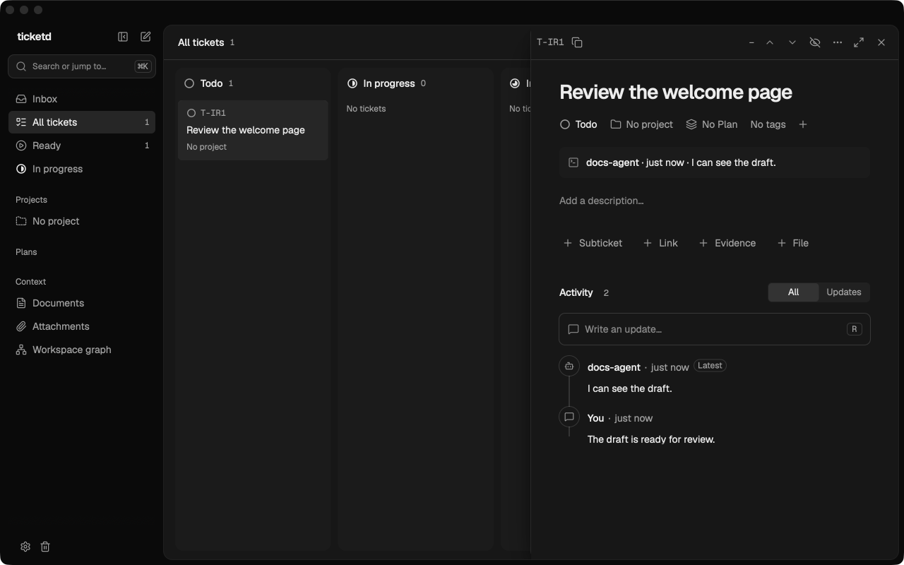

# Create your first ticket

Use one ticket to see how progress moves between the desktop and an agent.
[Install ticketd](install.md#availability) and open the app. You can complete
the desktop steps without connecting an agent, GitHub, or Google Drive.

## Create a ticket and post an update

1. In **All tickets**, choose **New ticket**. Enter **Review the welcome page**
   in **Title** and choose **Create ticket**. A title is all you need.
2. The new ticket opens in the detail pane. If you closed it, select **Review
   the welcome page** in **All tickets**. Find the reference beside the copy
   button at the top. It stays the same if you rename the ticket.
3. With the ticket open, press **R** to write its first update. You can also
   open **Search or jump to…**, type **Write an update**, and choose that
   command. Enter **The draft is ready for review.** and choose **Post update**.
4. Your sentence now appears under **Activity**. Choose **Updates** to see
   authored updates on their own. Use **Write an update…** here to post another.

## Ask an agent to post an update

1. Open **Settings › Set up ticketd** and choose **Install for** your agents.
   It makes the [CLI available](install.md#command-line-tool) and
   [installs the discovery skill](install.md#agent-cli-skill) for Claude Code,
   Codex and the other agents it finds, asking for your password once. Start a
   fresh agent session so it can discover the skill and the executable.
2. On the ticket, choose **Copy reference**. Send the prompt below to your
   agent, replacing `TICKET_REFERENCE` with the reference you copied.

   > Read ticket TICKET_REFERENCE with the ticketd CLI. Tell me its title and
   > latest update, then post “I can see the draft.” as an update on that ticket.

3. Return to the open ticket. **Activity** now shows **I can see the draft.**
   alongside your first update. The desktop picks up the CLI write automatically.

In this example, **T-IR1** at the top of the right pane is the reference to copy.
Under **Activity**, **You** and **docs-agent** identify who posted each update.

If the agent cannot find your ticket, have it run `ticketd workspace` in its
own terminal. Compare the path with the workspace under **Settings › Backups & export** and
check that both run as the same OS user. [CLI setup](install.md#command-line-tool)

To try the same exchange yourself in a terminal, follow the
[CLI walkthrough](cli.md#create-a-ticket-and-verify-an-update).
