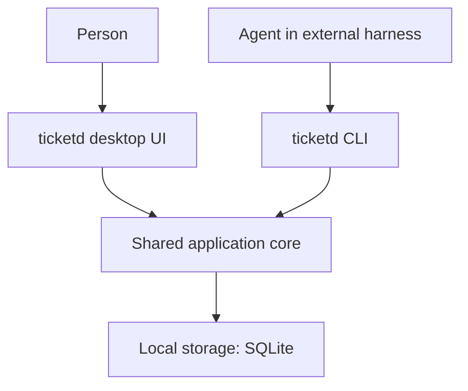

# ticketd — MVP Specification

**Version:** 0.3 — Domain model reviewed; delivery details remain draft\
**Date:** October 31, 2026\
**Product name:** ticketd\
**CLI command:** `ticketd`\
**Initial surface:** Local desktop application and agent-facing CLI.

> ticketd is a local ticket workspace: a simple desktop UI for people and a fast CLI for agents, sharing the same work and context.

## 1. Problem and purpose

The current workflow uses skills and coding agents to create local Markdown tickets. As work grows, reading, editing, navigating hierarchy, and understanding dependencies become difficult. People lack a clear overview, while agents must repeatedly locate and assemble context.

ticketd is the system of record for locally owned tickets. Its future platform integrations also make it a central working surface for externally owned tickets, whose authoritative records remain in their external trackers (section 15.7). People use a desktop UI; agents use a CLI. Brainstorming, conversations, planning, skill execution, and coding remain in external harnesses such as Claude Code, Codex, and Orca.

External trackers can organize and dispatch high-level work, while ticketd gives the finer-grained tickets discovered through decomposition a home where people and agents can manage and visualize them.

### Goals

- Make creating, reading, editing, and organizing tickets easy.
- Present work as a flat, searchable stream without losing hierarchy.
- Make dependencies and available work understandable.
- Provide structured context to agents with few CLI calls.
- Work locally and offline, with a path toward accounts, cloud storage, and synchronization.

### Non-goals

- Running or orchestrating agents inside the application.
- Replacing coding harnesses, IDEs, or execution environments.
- Building an enterprise project-management platform in the first release.

## 2. Product philosophy

### 2.1. Task-driven work, with the user in control

Follow the task-driven direction of the Matt Pocock workflow the user currently applies. Tickets express intent, scope, and expected outcomes. The user retains direction; people and agents can manage ticket statuses themselves, including completion. In review expresses finished implementation awaiting review, without requiring every ticket to pass through review.

This specification records the agreed direction, not compatibility with a particular skill version. Actual skills must be inspected when adapting their ticket-writing steps to the CLI.

### 2.2. Simple and familiar

Creating, reading, editing, and taking notes should feel straightforward. Reveal structure as needed. Do not require a complete form or a custom workflow before someone can record work.

### 2.3. Lightweight and performant

Ticket management must not become a bottleneck in the AI workflow. Optimize UI responsiveness, CLI startup and execution, tool-call count, and context volume.

### 2.4. Fit existing workflows

ticketd provides shared storage, visualization, and context. Users keep their preferred harnesses and skills. The CLI is the primary agent interface; MCP is not required.

### 2.5. Expand from real use cases

First make ticket management, visualization, and context retrieval work well. Add capabilities when actual usage demonstrates a clear need.

## 3. Actors and responsibility boundaries

| Actor or component          | Responsibility                                                                        |
| --------------------------- | ------------------------------------------------------------------------------------- |
| Person using the desktop UI | Understand the work, review and edit tickets, inspect relationships and progress      |
| Agent using the CLI         | Create and update tickets, notes, tags, hierarchy, and dependencies; retrieve context |
| External harness            | AI conversations, brainstorming, planning, skills, implementation, and verification   |
| Application core            | Business rules, context queries, and consistent data operations                       |

The MVP does not include account sign-in, agent-provider integration, or subscription handling.

## 4. Confirmed product model

### 4.1. Workspace, projects, and Efforts

- One default local workspace contains projects, Efforts, and tickets.
- Store the default workspace in the operating system's application-data directory, outside repository checkouts. Multiple selectable workspaces are outside the MVP.
- A project represents one repository, not a grouping of work. Its explicit identity survives repository moves and renames; multiple local checkouts may refer to the same project.
- A ticket optionally links to one project. Tickets without a project are valid; no Inbox project is required.
- Registered checkout paths locate projects without implying Git integration.
- Project context is local to each UI or CLI interaction. Explicit selection takes precedence; the CLI may infer a project from a registered checkout. With neither, new tickets remain unlinked.
- An **Effort** is a named grouping of tickets pursuing a shared objective, potentially spanning projects. Each ticket optionally belongs to one Effort.
- Efforts are Active or Archived. Archiving hides an Effort from active Effort views; its tickets remain searchable and editable, with statuses and relationships unchanged. Reactivation is supported.
- Effort progress is counts by status of all non-trashed member tickets, including parents and subtickets equally, rather than a completion percentage. Archiving is explicit, never automatic.
- Project archiving is outside the MVP. Future archiving should preserve tickets and relationships and permit reactivation.
- Preserve the workspace boundary to support ownership and accounts later.

### 4.2. One ticket type

- Use a single work-item type: **ticket**.
- Use **tags** for categories such as bug, research, or feature. No mandatory issue-type system.
- Only the title is mandatory user-entered content. Project and Effort links are optional.
- A ticket describes an intended outcome, including when it has subtickets.
- Short ticket references are unique across the workspace and remain unchanged when project or Effort links change.
- Support Markdown content and checklists. Checklist items have no independent statuses or dependencies; unchecked items do not prevent Done.
- Acceptance criteria can be written in the body; no separate mandatory field is required.
- Support editable, deletable, timestamped notes for progress and findings. Record the editing agent when supplied; do not store human names in the MVP. Attribution is descriptive, not verified identity or authorization.
- Keep automatic ticket history separate from notes: record status, relationship, project/Effort membership, and trash/restore changes. Full body revision history is outside the MVP.
- Tags use a shared workspace vocabulary; a ticket may have multiple tags independently of other relationships.
- Priority, deadlines, attachments, and custom fields are not required for the MVP.

### 4.3. Hierarchical relationships, flat presentation

- Support one level of parent/subtickets. A subticket cannot have its own subtickets in the MVP.
- Hierarchy and dependencies are separate relationships.
- Parent tickets and subtickets appear as ordinary rows in the same flat list.
- Users do not need to expand a parent to discover its subtickets.
- A subticket displays its parent link; ticket details show the parent and subtickets.
- Support filtering around a parent and its subtickets.
- Parent and subtickets may link to different projects and belong to different Efforts. Membership changes never cascade.
- A parent may be Done with open children, without warning or override. Completing children does not automatically complete their parent; no status changes cascade.

### 4.4. Dependencies

- A directed relationship: `A blocks B` is equivalent to `B is blocked by A`.
- Add and remove relationships through the UI and CLI.
- Reject self-dependencies and cycles; do not create duplicate edges.
- Relationship validation and persistence must remain consistent under concurrent writes.
- Parent/subticket relationships do not create dependency edges automatically.
- Dependencies may connect tickets across projects within the workspace.
- Readiness guides selection; unresolved dependencies do not prohibit starting or completing work.
- Keep dependency relationships after completion so readiness can be recalculated if a prerequisite reopens. There is no separate relationship resolution state.

### 4.5. Status and derived availability

| Stored status | Meaning                                            |
| ------------- | -------------------------------------------------- |
| Todo          | Work has not started                               |
| In progress   | Work is underway                                   |
| In review     | Implementation is finished; review is pending      |
| Done          | Work is complete and no further review is required |
| Canceled      | Work will not continue                             |
| Duplicate     | The same outcome is represented by another ticket  |

People and agents may transition locally owned tickets between ordinary statuses directly; duplicate designation follows section 15.5. Publication preserves the ticket's status; reconciliation with external status is described in section 15.7. Review may be skipped when unnecessary; transitions are recorded in history and do not change related tickets.

`Ready` and `Blocked` are derived information, not manually maintained statuses:

- **Ready:** a Todo ticket without unresolved blocking dependencies.
- **Blocked:** a Todo ticket with unresolved blocking dependencies.
- In progress, In review, Done, Canceled, and Duplicate tickets have neither indicator. Their dependency lists still show unresolved prerequisites.
- Only a Done prerequisite satisfies an existing dependency. In review, Canceled, and Duplicate prerequisites remain unresolved.
- Remove an obsolete dependency or replace it with the appropriate relationship; cancellation does not resolve it.
- Reopening a prerequisite recalculates availability for Todo dependents. Started dependents retain their status and only show the open prerequisite in their dependency lists.
- Trashed tickets are excluded from ordinary lists and work selection. Trashing a Done prerequisite leaves it satisfied; trashing an unfinished prerequisite leaves it unresolved.

### 4.6. Trash and restoration

- Trash and restore are supported; permanent ticket deletion is not supported.
- Preserve ticket identity and relationships while in trash. Trashing a parent leaves its children visible and unchanged, with a link identifying the trashed parent.
- Require restoration before editing a trashed ticket's content, status, or relationships, except that visible tickets may remove relationships to trashed tickets.
- Show an unresolved trashed prerequisite explicitly on its dependent tickets.
- Continue enforcing hierarchy and dependency validity across trashed tickets so restoration cannot introduce invalid relationships.

## 5. Primary workflows

### 5.1. Agent creates a plan; the person reviews it

1. The person brainstorms and plans in an external harness.
2. The agent creates tickets, tags, hierarchy, and dependencies through the CLI.
3. The person opens the project and reviews its flat list and dependency graph.
4. The person edits content or relationships in the UI.
5. The agent reads current information before continuing.

### 5.2. Agent finds work and retrieves context

1. The agent queries Ready tickets for a project.
2. It retrieves a ticket and the requested context in one call where appropriate.
3. It implements and verifies work in the external harness.
4. It updates status, findings, and outcomes through the CLI.
5. The UI reflects those changes without requiring an application restart.

### 5.3. Person manages work directly

1. Create a ticket with a title, optionally selecting a project and Effort.
2. Add content, checklist items, tags, and relationships when needed.
3. Record notes and update status as work progresses.
4. Open the graph to understand dependency chains.

## 6. MVP functional scope

| Area              | Required capability                                                                                           |
| ----------------- | ------------------------------------------------------------------------------------------------------------- |
| Projects          | Create, read, and edit repository projects; select interaction-local context; register checkout paths         |
| Efforts           | Create, read, edit, archive/reactivate; manage membership; view counts by status                              |
| Tickets           | Create, read, edit, trash, and restore; stable identifiers and workspace-wide short references                |
| Content           | Markdown editor and preview, checklists, autosave with clear save state                                       |
| Notes and history | Add, read, edit, and delete timestamped notes; record author/source when known; read automatic ticket history |
| Tags              | Add, remove, and filter tags; classification is optional                                                      |
| Hierarchy         | Assign/remove parent, display subtickets, enforce one-level limit                                             |
| Dependencies      | Add/remove edges, reject cycles, derive Ready/Blocked                                                         |
| Search            | Search titles, bodies, and notes; combine with filters                                                        |
| Filters           | Project (including unlinked), Effort, status, tags, Ready/Blocked, and parent                                 |
| CLI               | Main UI operations, structured output, batch operations, and context queries                                  |
| Local data        | Offline persistence, migrations, export, and verifiable backup/restore                                        |

Trash preserves relationships under section 4.6; permanent ticket deletion is not supported.

## 7. UI/UX direction

### Visual principles

- Clean, neutral, and low-noise; use Linear and Orca as references.
- Lists and ticket content are the primary surfaces.
- Flat surfaces, subtle borders, restrained colors, and minimal nested cards.
- Comfortable information density, readable content, visible focus, and sufficient contrast.
- Efficient keyboard navigation with complete mouse support.
- Progressive disclosure of metadata and advanced actions.
- No streaks, productivity scores, or guilt-based backlog mechanics.

### Required views

| View             | Purpose                                                                                                      |
| ---------------- | ------------------------------------------------------------------------------------------------------------ |
| List             | Flat stream, search, filtering, and quick operations; surface important relationships                        |
| Ticket detail    | Read/edit content, checklist, notes, project/Effort links, parent/subtickets, and dependencies; read history |
| Effort view      | Flat member-ticket list, counts by status, membership management, and archive/reactivation                   |
| Dependency graph | Understand dependency direction, blocked work, and relationships around a selected ticket                    |

Initial layout direction: navigation for projects and Efforts, including unlinked tickets, main list/graph surface, and ticket detail in a panel or dedicated page appropriate to window size. Validate through prototyping rather than treating this as a fixed pixel layout.

The graph needs clear edge direction or a legend and ticket selection. Creating edges by dragging is optional if adding dependencies from ticket details is already easy.

A board view and an agent/chat panel are outside the MVP.

### Document reading and editing

- Descriptions and notes support rich editing in place, with Markdown shortcuts, slash commands, selection formatting, and block movement with keyboard alternatives.
- Rich authoring covers paragraphs, headings, nested lists, checklists, quotes, dividers, links, inline formatting, fenced code, and simple GFM tables. Markdown remains the content format exchanged with the CLI and exports; advanced source editing remains available.
- Viewing or focusing content does not rewrite it. Visual edits preserve supported content without silent loss; unsupported syntax stays intact through source editing when it cannot safely be represented visually.
- Fenced Mermaid blocks display diagrams offline and expose their source for editing. Invalid or incomplete diagrams retain their source and show a local error without preventing the document from being saved.
- Descriptions retain autosave with visible save/error state; notes retain explicit submission. Drafts survive mode changes, navigation, save failures, and external refresh, with existing reload or overwrite choices when saved content changes.

## 8. CLI and context contract

### Required capabilities

- Create, list, show, and update tickets; change status and append notes.
- Manage projects and their checkout paths, Efforts and archive/reactivation, ticket project/Effort links, tags, parent/subtickets, and dependencies.
- Trash and restore tickets; edit/delete notes and read ticket history.
- Query Ready/Blocked work and search with project, Effort, and other filter constraints.
- Retrieve explicit context scopes with bounded, deterministic output.
- Support atomic batch creation and updates: all operations succeed or none persist. Identify invalid operations in errors. Allow batch-local names to reference newly created tickets before their permanent references are returned.
- Provide help, structured JSON output, exit codes, and actionable errors.
- Avoid interactive prompts in agent mode; keep diagnostics separate from JSON stdout.
- Accept multiline content through files or stdin to avoid fragile shell quoting.
- Record versioning and stale-edit rejection are outside the MVP. Support safe retry semantics for operations that could otherwise create duplicates.
- A caller may attach a request ID to a write or batch. Retrying the same request returns its original result without repeating changes; reusing its ID with different content fails. Persist the outcome atomically with the changes. Retain successful request IDs and original results indefinitely in the MVP, including in backups; a replay returns the original result rather than current ticket state.
- Writes do not require caller-supplied record versions, including ticket, note, and relationship edits. Update only explicitly supplied fields; omitted fields remain unchanged and clearing is explicit. The last successful write to a field wins.
- Writes may identify the editing agent when supplied, without human names or an account model. Missing agent attribution must not be treated as proof that a human performed the write.

### Context contents

A context query may include:

- Current ticket title, content, checklist, status, and tags.
- Relevant linked project and Effort information.
- Parent and subtickets when requested.
- Dependencies and blocking reasons.
- Notes within a selected limit.

Do not return the entire workspace by default. Indicate truncation and how to fetch more. The MVP does not use AI to summarize or select context.

### Illustrative commands — syntax is not final

```bash
ticketd create "Fix upload timeout" --project demo
ticketd list --project demo --ready --json
ticketd show T-42 --context dependencies,parent,notes --json
ticketd update T-42 --status in-progress
ticketd note T-42 --file progress.md
ticketd dependency add T-43 --blocked-by T-42
```

Agents use the CLI/application core. They do not write SQL directly or treat Markdown exports as the system of record.

## 9. Confirmed technology stack

| Component                      | Technology                |
| ------------------------------ | ------------------------- |
| Desktop: macOS, Linux, Windows | Tauri                     |
| Frontend                       | React + TypeScript + Vite |
| UI components                  | shadcn/ui + Radix UI      |
| Styling and icons              | Tailwind CSS + Lucide     |
| Application core               | Rust                      |
| Agent-facing CLI               | Rust + clap               |
| Local database                 | SQLite                    |
| Dependency visualization       | React Flow + Dagre        |
| Markdown editor                | CodeMirror + preview      |

The product name `ticketd` does not require a background daemon. The proposed MVP CLI remains a direct client of the shared application core.

Dependency versions are not pinned in this product specification. Select compatible versions during implementation planning.

## 10. Architecture direction and extensibility

See [High-level architecture](architecture.md) for runtime structure, module responsibilities, and data flows.

- UI and CLI share application core, business rules, and data.
- Each process uses its own instance of the same Rust core library. Keep one public workflow interface and organize domain rules, writes, queries, and SQLite persistence internally. Test core behavior through that interface using temporary SQLite databases.
- The core must offer a simple interface that hides validation, transaction handling, persistence, and history recording from callers. Its exact interface remains a design decision; a small method count alone does not establish simplicity.
- Keep ticket creation distinct from a cohesive ticket-change operation. A change may combine field edits, an appended note, and relationship changes atomically, without requiring a record version and returning the updated ticket. Batches compose these same operations rather than defining another editing language.
- Provide workflow-shaped reads for finding tickets, opening a ticket with selected context, and viewing a dependency graph. The core owns context assembly and output limits; callers do not assemble tables or use a general-purpose query language.
- Dependencies and tags use explicit additions/removals rather than whole-list replacement. Parent changes use explicit assignment/removal. The core validates relationship changes and graph invariants atomically without version checks. Each context response is assembled from one consistent read snapshot; this does not reserve work or prevent subsequent changes.
- Keep business logic independent of Tauri and SQLite so it can run in a server later.
- The CLI calls the core directly; a running desktop UI, HTTP server, or MCP server is not required by the proposed architecture.
- Selected MVP direction: UI and CLI processes access the same SQLite database through the shared core, without a required background daemon. Validate concurrency, migrations, and UI refresh in a technical spike before finalizing.
- Detect external changes and refresh affected UI data.
- Use short transactions, appropriate indexes, lock handling, and atomic updates.
- Use globally unique identities and schema migrations to preserve future options.
- Preserve workspace boundaries and necessary change metadata without building a universal database abstraction.
- Future sync may retain SQLite locally and add a cloud database. Sync requires change propagation, conflict handling, deletion semantics, and authorization; it is not simply a database swap.
- Placing a live database in a file-sync folder is not the product synchronization strategy.



## 11. Non-functional requirements

### Performance

Measure UI and CLI independently, including full CLI startup rather than database query time alone. Do not present unmeasured numbers as guarantees.

| Area        | Measurement                                                                 |
| ----------- | --------------------------------------------------------------------------- |
| CLI         | End-to-end process startup to output, cold and warm                         |
| Context     | Call count and output size for a real workflow                              |
| UI          | Project opening, search, ticket opening/editing, external-update visibility |
| Graph       | Loading, layout, and pan/zoom across representative graph sizes             |
| Concurrency | UI reads during agent writes, multiple writers, lock waits, and conflicts   |

Set latency budgets and representative dataset sizes after a benchmark spike. Batch operations, bounded output, and loading only needed data are design requirements from the start.

### Reliability and data ownership

- Record-version conflict detection is deferred. External updates refresh saved information while preserving unsaved UI drafts, following familiar file-editor behavior. If saved content changes beneath a draft, indicate the change and let the user reload or save the draft over the current field value; do not automatically merge it.
- Persist acknowledged writes across application restarts.
- Provide an appropriate backup/recovery path for migrations.
- Export projects, Efforts, tickets, notes, ticket history, tags, and relationships in a documented format.
- Backup/restore must preserve identities and relationships, including correct handling of an active database.
- UI and CLI enforce the same hierarchy and dependency rules.

### Platform support

The first release targets these native desktop and CLI combinations. Release
validation remains outstanding; a CI build alone is not a support guarantee.

| Operating system | Architecture          | First-release target | Validation status                                                                                           |
| ---------------- | --------------------- | -------------------- | ----------------------------------------------------------------------------------------------------------- |
| macOS 26         | ARM64 (Apple Silicon) | Desktop and CLI      | Scaffold builds in CI; first agent host is macOS 26.5 ARM64. Full workflow and delivery remain unvalidated. |
| Ubuntu 24.04 LTS | x86-64                | Desktop and CLI      | Scaffold builds in CI. Full workflow and delivery remain unvalidated.                                       |
| Windows 11       | x86-64                | Desktop and CLI      | Unvalidated on Windows 11; CI uses a Windows Server runner, not a desktop installation.                     |

Other versions, architectures, and Linux distributions are not part of this first
matrix. Before release, validate installation and launch, editor behavior, shortcuts,
clipboard, rendering, CLI packaging, and the shared workspace workflow on each
target. Verify cross-process writes, migration and refresh behavior as specified
in the architecture; do not infer those properties from a build.

The delivery ships desktop and CLI together; the CLI must run independently with the desktop
closed and without a daemon. Package format, signing, and distribution details remain
to be decided and validated.

The observed first agent environment is native macOS, so WSL is not required for
that workflow. WSL is deferred from the first matrix; neither a WSL-native workspace
nor a WSL agent accessing a Windows-hosted database is validated. Do not assume
cross-environment database access or locking works without explicit testing.

## 12. Proposed acceptance criteria

These are draft verification criteria for review, not individually approved requirements.

1. A person can create a project and ticket without entering unnecessary metadata.
2. An agent can create tickets, hierarchy, and dependencies through the CLI; the UI displays them correctly.
3. The default list remains flat; subtickets are not hidden behind parent expansion.
4. Both UI and CLI reject self-dependencies and dependency cycles.
5. Ready/Blocked applies only to Todo tickets and follows completion, cancellation, reopening, and trash rules in section 4.
6. One context query retrieves the requested ticket context without repeated follow-up calls for included scopes.
7. Content, checklists, and notes persist and are searchable.
8. The CLI works while the UI is closed, and reopening the UI shows current data, subject to confirming distribution behavior.
9. The UI reflects CLI changes; concurrent saves follow the agreed overwrite policy without requiring record versions.
10. Export and backup/restore preserve data and relationships.
11. One real repository project completes the full workflow: external planning, CLI ticket creation, UI review/editing, external execution, and CLI progress updates.
12. Tickets can exist without project or Effort links; references survive membership changes.
13. An Effort groups tickets across projects and supports status counts and reversible archiving without changing tickets.
14. Parent completion is independent of child completion; hierarchy and dependencies may cross projects.
15. Trash/restore preserves relationships and enforces validity; no permanent deletion is offered.

## 13. Explicitly out of scope

- Embedded agent chat or terminal, provider adapters, and subscription handling.
- Running, orchestrating, or automatically assigning work to agents.
- Built-in AI decomposition, summarization, prioritization, or scheduling.
- Highlight/comment feedback delivered directly to an agent session.
- Branch, worktree, commit, PR, or CI-check synchronization.
- GitHub/Jira integrations, Slack/Google Chat capture, and browser extension.
- Board, roadmap, calendar, time tracking, reporting, and gamification.
- Full web/mobile clients, cloud hosting, account/auth, collaboration, and multi-device sync.
- Plugin system, custom workflow engine, vector database, and MCP server.
- Project archiving, permanent ticket/project deletion, full ticket body revision history, and record-version conflict detection.

These exclusions apply to the initial MVP. Section 15 records agreed product
extensions and future integration intent; it does not commit delivery dates.

## 14. Open decisions

| Question              | Proposal for review                                            |
| --------------------- | -------------------------------------------------------------- |
| MVP success criterion | Complete one real project through the workflow in section 12   |
| Performance budgets   | Establish after measuring a representative dataset and machine |

## 15. Agreed product extensions

The priority remains completing and validating the existing person-and-agent
workflow. The following extensions describe agreed product direction; detailed
behavior still requires design before implementation.

### 15.1. Attention inbox

- People explicitly follow tickets to receive changes in an attention inbox.
- Include new notes, status changes, and relationship changes on followed tickets.
- Support read/unread state and navigation to the relevant change.
- Following and inbox read state are personal preferences. Shared ticket changes
  must not overwrite another person's preferences when multiple users are
  supported. The initial local workspace serves one person without requiring
  accounts.

### 15.2. Ticket references and contextual relationships

- Ticket references in descriptions and notes are clickable.
- Show incoming backlinks with the passage containing each reference.
- Support explicit Related to and Discovered while working on relationships.
- These contextual relationships do not affect readiness or imply hierarchy.

### 15.3. Bulk editing

- People can select tickets and change status, project, or Effort, and add/remove
  tags across the selection.
- Show the selection count clearly.
- Apply each bulk edit atomically: every selected ticket changes successfully or
  none does.

### 15.4. Reminders

- Support one reminder per person per ticket, with reschedule, snooze, and dismiss.
- Reminders are personal preferences; shared ticket changes do not replace
  another person's reminder.
- Reminders bring tickets back to attention without changing status or readiness.
- Due reminders appear while the desktop is running. Reminders missed while it
  was closed appear when it next opens; background delivery is not required.

### 15.5. Duplicate handling

- Preserve a duplicate ticket's identity, content, and history, and link it to its
  canonical ticket. Marking a locally owned ticket Duplicate requires selecting
  its canonical ticket; status and relationship change together.
- Marking a duplicate sets the dedicated Duplicate status and presents its
  canonical relationship explicitly, for example, Duplicate of T-10. This
  replaces the earlier representation as Canceled plus a duplicate relationship.
- Review affected blocking dependencies when marking a duplicate. Show proposed
  replacements and apply the agreed changes atomically with cycle validation.
- Cancellation alone never satisfies a prerequisite. For example, if T-30 is
  blocked by T-20 and T-20 duplicates T-10, replacing T-20 with T-10 as the blocker
  makes T-30's readiness depend on T-10's completion.
- Preserve canonical identity alongside Duplicate status so integrations can
  retain the relationship across platforms with different closure conventions.
- Removing the duplicate designation restores the status held before duplicate
  marking, following [Linear's documented undo behavior](https://linear.app/changelog/2026-06-18-agent-assisted-project-updates).
  Explicitly choosing another status leaves Duplicate and removes the canonical
  relationship together, keeping the chosen status.
  Reversing dependency replacements requires a separate review of the current
  graph; undo does not silently revert later work.
- Each duplicate points directly to one canonical ticket, following
  [YouTrack's consolidation behavior](https://www.jetbrains.com/help/youtrack/server/workflow-duplicates.html).
  If A duplicates B and B is then marked as duplicating C, both A and B point to C.
  Reject self-links and duplicate cycles. Record consolidation and undo in ticket
  history.
- An imported duplicate may refer to a canonical issue outside the workspace.
  Preserve and show its external reference without automatically importing it;
  resolve the reference to a local ticket if that issue is later imported. Show
  an unknown target when the source does not supply an accessible canonical
  identity. These imported cases do not require inventing a local canonical ticket.

### 15.6. Implementation evidence

- People and agents can attach named evidence through the desktop and CLI:
  pull request URLs, commits, branches, worktree paths, and verification results.
- The first version uses explicit attachments. Live platform synchronization is
  a separate future capability.

### 15.7. Future platform synchronization

Future synchronization with external work trackers is an intended direction.
GitHub Issues is the first provider. Jira and other providers are deferred.
The first integration synchronizes title, description, status, and external
comments. External comments are displayed separately from local notes.

Ticket sources are connectors run by a ticketd-owned extension engine. The
built-in GitHub connector uses the shared, versioned extension interface, designed
to accommodate future providers. User-developed extensions, custom extension
installation, and distribution are outside the current integration scope.

The interface covers connection configuration, discovery, ticket and comment
retrieval, stable external identities, and interpretation of external status.
Publication is an optional connector capability. ticketd owns scheduling, identity
preservation, local data, and persistence; connectors translate provider data and
operations without directly modifying ticketd's database. Provider-specific
configuration and filters use schemas describing fields, selectors, dynamic
options, and validation. ticketd renders those forms and supports configuration
through the CLI. Arbitrary extension-rendered UI is deferred.

The agreed authority model is:

- Tickets synchronized from an external tracker are externally owned.
- Ongoing synchronization is one-way: external tracker to ticketd. Synchronized
  fields are read-only in ticketd; people and agents change them in the external
  tracker and those changes flow back into ticketd. Local progress while an
  external issue remains open is the status exception described below.
- Locally owned tickets can be published to an external tracker once. Publication
  transfers authority for those tickets to that tracker while preserving their
  ticketd identity, references, notes, dependencies, and subtickets. Subsequent
  synchronization is inbound only; publication does not establish ongoing
  outbound updates.
- Initial publication is limited to Todo, In progress, and In review tickets.
  Publishing Done, Canceled, or Duplicate tickets is deferred.
- Publication transfers ownership only after ticketd confirms the external ticket
  exists and records its identity. Failed publication leaves the ticket locally
  owned. An uncertain result must be resolved before retrying creation, to avoid
  duplicate external tickets.
- Publication previews a normal GitHub issue using the ticket's title and
  description. Local notes, Effort membership, dependencies, and subtickets stay
  in ticketd; publication adds no ticketd-specific metadata to the external issue.
- Publication preserves the existing ticketd status. Creating an open GitHub
  issue must not reset a published ticket to Todo. Repeated open-state refreshes
  preserve local progress; Open-to-Todo initialization applies only to newly
  imported tickets.
- Ownership belongs to each ticket independently. Subtickets created in ticketd
  remain locally owned unless explicitly published, including when their parent
  is externally owned. Publishing a parent does not publish its subtickets.
- Externally owned tickets retain ticketd-specific organization, including Effort
  membership and relationships to local subtickets. This organization stays local;
  the external tracker must not need awareness of ticketd.
- The first platform integration includes automatic discovery of external tickets,
  rather than only explicit ticket selection. Users configure discovery rules,
  preview matches during setup, and matching tickets are brought in automatically.
  Repeated discovery preserves the existing ticket's identity and organization.
- GitHub discovery starts with selected repositories and optional assignee and
  label filters, implemented through the ticket source extension interface.
- Automatic discovery and refresh run on desktop startup and periodically while
  the desktop is open. Manual refresh is available through both the UI and CLI.
  Retain the last synchronized content offline and show when it was refreshed.
  An always-running background synchronization service is deferred.
- Tickets that stop matching a discovery rule remain in ticketd and continue
  synchronizing while access remains available. Stopping synchronization is a
  separate action, not a consequence of leaving discovery scope.
- Externally owned tickets have no outbound edit queue or two-way edit-conflict
  reconciliation. This replaces the earlier bidirectional editing direction.
- External status changes happen in the tracker. Ticketd reflects those changes;
  the first GitHub integration uses issue state and closure reason rather than
  labels or GitHub Projects columns: newly imported Open issues start as Todo,
  completed closure maps to Done, not-planned closure to Canceled, and duplicate
  closure to Duplicate.
  Preserve duplicate information. Missing or unrecognized closure reasons are
  flagged rather than assumed to mean Done.
- While a GitHub issue remains open, people and agents can manage Todo,
  In progress, and In review locally in ticketd. These changes are not sent to
  GitHub. External closure determines Done, Canceled, or Duplicate.
- When GitHub reopens a previously closed issue, ticketd moves it to Todo and
  removes any active duplicate designation. Later open-state refreshes preserve
  local progress rather than resetting it again.
- Show each ticket's source clearly. When an external ticket becomes unavailable,
  retain its last synchronized content and local work, show a Source unavailable
  warning, and offer an explicit transfer of ownership to ticketd. Unavailability
  does not automatically delete, complete, or transfer the ticket.
- Taking ownership preserves ticket identity, last synchronized content, local
  work, and the external ticket identity as provenance. The ticket becomes locally
  editable and its source indicator becomes Local; it no longer carries the
  external-provider ownership indicator. The retained external reference does
  not imply active synchronization.
- Taking ownership stops synchronization with that external record. Rediscovery
  must not create a second ticket or silently restore external ownership when
  access returns. Reconnecting requires an explicit choice.
- Notes and ticketd-specific organization remain locally editable, including for
  externally owned tickets. Incoming synchronization does not overwrite them.
  Posting external comments is outside this one-way integration.
- Agent sessions, branches, and worktrees remain the responsibility of external
  coding harnesses. Integrations do not change ticketd's execution boundary.
- Exact extension interface signatures and execution mechanics remain technical
  design work. These decisions do not move platform integrations into the initial
  MVP.

Design these extensions with compatible meanings and preserve enough information
to distinguish duplicate closure from completion or ordinary cancellation.
Platforms differ, so exact status mappings, unsupported relationships, and
synchronization behavior require explicit integration design.

In particular, the current official documentation describes different duplicate
conventions:

- [GitHub](https://docs.github.com/en/issues/tracking-your-work-with-issues/administering-issues/marking-issues-or-pull-requests-as-a-duplicate)
  records a duplicate reference and a reversible timeline event.
- [GitLab](https://docs.gitlab.com/user/project/quick_actions/) closes the item and
  marks it as related to, and a duplicate of, the selected item.
- [Linear's issue properties](https://linear.app/docs/issue-property) describe a
  reserved Duplicate status, while its [triage documentation](https://linear.app/docs/triage)
  describes a Canceled status type. Resolve this documentation inconsistency
  against the actual API when designing that integration.
- [YouTrack's default duplicate workflow](https://www.jetbrains.com/help/youtrack/server/workflow-duplicates.html)
  uses a Duplicate state and consolidates duplicate links onto a single original.

These sources do not establish a common automatic dependency-transfer rule.
Ticketd's reviewed dependency replacement is its own explicit behavior.
